# ScribeX Master Implementation Plan: Zero-Breakage Hotspot Modularization $\rightarrow$ WhatsApp Share Integration

> **Objective:** Execute **Option A** — First split the 5 largest monolith files (`NotesView.tsx`, `useNotesStore.tsx`, `astSerializer.ts`, `ReminderPickerModal.tsx`, `useEditorState.ts`) into focused, `<500`-line sub-modules with **zero logical, UI, or test regressions**, and then implement the **Android & iOS WhatsApp Share Integration** on top of the clean architecture.  
> **Companion Spec:** [WhatsApp_Share_Integration_Plan.md](file:///Users/nash/Documents/FrontEnd%20Development/ai_projects/scribeX/docs/WhatsApp_Share_Integration_Plan.md)  
> **Non-Negotiable Invariants:** Strictly preserve full-bleed canvas (`<RULE[user_global]>`), React Native flex-safety rules (`flexGrow: 0` on horizontal `ScrollView`s), all `hitSlop` touch targets, and 100% pass rates across all 5 automated test suites.

---

## 1. Dependency, Coupling & Test-Harness Audit Summary

Before designing the split, we audited every import, export, React hook dependency, and static `fs.readFileSync` test assertion across the repository.

### 1.1. Public Export & Consumer Graph (Must Remain 100% Unchanged)

| Monolith File | Current Lines | Target Lines | Public Exports (Barrel Contract) | Direct Consumers |
| :--- | :---: | :---: | :--- | :--- |
| [`NotesView.tsx`](file:///Users/nash/Documents/FrontEnd%20Development/ai_projects/scribeX/frontend/src/components/NotesView.tsx) | `2,193` | `~480` | `NotesView` | `frontend/app/home.tsx`, `scripts/test_headless_folder_features.mjs`, `scripts/test_cross_platform_ui_ux.mjs` |
| [`useNotesStore.tsx`](file:///Users/nash/Documents/FrontEnd%20Development/ai_projects/scribeX/frontend/src/state/useNotesStore.tsx) | `1,777` | `~460` | `NotesProvider`, `useNotesStore`, `WorkspaceActivityEntry`, `NotesContextValue`, `INITIAL_NOTES`, `INITIAL_TASKS`, `PASTEL_PALETTE` | `app/_layout.tsx`, `app/home.tsx`, `app/note/[id].tsx`, 18 components, `scripts/test_headless_folder_features.mjs` |
| [`ReminderPickerModal.tsx`](file:///Users/nash/Documents/FrontEnd%20Development/ai_projects/scribeX/frontend/src/components/common/ReminderPickerModal.tsx) | `1,350` | `~420` | `ReminderPickerModal`, `ReminderPickerModalProps`, `formatDate`, `parseDateTime` | `BlockEditor.tsx`, `TasksView.tsx`, `EventBlock.tsx`, `scripts/test_headless_reminders_and_notifications.mjs` |
| [`astSerializer.ts`](file:///Users/nash/Documents/FrontEnd%20Development/ai_projects/scribeX/frontend/src/core/astSerializer.ts) | `1,344` | `~60` (barrel) | `parseMarkdownToBlocks`, `serializeBlocksToMarkdown`, `coalesceChecklistBlocks` | `BlockEditor.tsx`, `useEditorState.ts`, `useEditorCapture.ts`, `useNotesStore.tsx`, `scripts/run_cross_platform_audit.mjs` |
| [`useEditorState.ts`](file:///Users/nash/Documents/FrontEnd%20Development/ai_projects/scribeX/frontend/src/components/editor/hooks/useEditorState.ts) | `1,249` | `~480` | `useEditorState`, `isTextTransformableBlock` | `BlockEditor.tsx` |

---

### 1.2. Static Source-Code Test Assertions Audit (`scripts/*.mjs`)

Several automated quality gates in `scripts/` use `fs.readFileSync` to inspect source files directly. Our split plan explicitly accounts for every single one so **no test breaks**:

1. **`scripts/test_cross_platform_ui_ux.mjs` (13 checks):**
   * Walks all `.ts` / `.tsx` files in `frontend/src` and `frontend/app` and asserts:
     * **UIUX-007:** Every `<Pressable>` with `w-3.5|6|7|8|9` or `h-3.5|6|7|8|9` has `hitSlop`.
     * **UIUX-008:** Zero `cursor-pointer` classes anywhere.
     * **UIUX-009:** Every `<Pressable>` with `hover:` also has `active:` or `pressed`.
     * **UIUX-010:** `NotesView.tsx` has no `min-h-[150px..299px]`.
     * **UIUX-012:** Every `<ScrollView horizontal>` uses `style={{ flexGrow: 0, ... }}` and puts `flexDirection: 'row'` / `gap` in `contentContainerStyle` (never in `className`).
     * **UIUX-013:** No `flex-1` wrapper inside auto-height cards.
   * **Guarantee:** Extracted JSX subcomponents must copy existing JSX attributes **verbatim** without altering `ScrollView`, `Pressable`, `hitSlop`, or `active:` classes.

2. **`scripts/test_headless_folder_features.mjs` (15 checks):**
   * **Line 84:** Reads `src/state/useNotesStore.tsx` and asserts the presence of:
     * `activeFolders: DBFolder[];`, `favoriteFolders: DBFolder[];`, `pinnedFolders: DBFolder[];`, `archivedFolders: DBFolder[];`
     * `toggleFolderFavorite: (folderId: string) => Promise<boolean>;`
     * `toggleFolderPin: (folderId: string) => Promise<boolean>;`
     * `archiveFolder: (folderId: string) => Promise<{ affectedNotes: number; affectedFolders: number }>;`
     * `unarchiveFolder: (folderId: string) => Promise<{ affectedNotes: number; affectedFolders: number }>;`
   * **Line 118:** Reads `src/components/NotesView.tsx` and asserts the presence of:
     * `activeFolderObj?.is_favorite`, `activeFolderObj?.is_pinned`, `activeFolderObj?.is_archived`, `Favorite Folders`, `Unarchive Folder`, `visibleFolders`.
   * **Guarantee:**
     * Keep `export interface NotesContextValue` directly in `useNotesStore.tsx` so line 84 passes natively.
     * Update line 118 of `scripts/test_headless_folder_features.mjs` so it reads `NotesView.tsx` **plus** its extracted subcomponents (`NotesFilterTrack.tsx` and `FolderContextBanners.tsx`) as a combined unit.

3. **`scripts/test_headless_reminders_and_notifications.mjs` (39 checks):**
   * Checks `fs.existsSync('src/components/common/ReminderPickerModal.tsx')`.
   * **Guarantee:** `ReminderPickerModal.tsx` stays at its exact path and imports extracted sub-views from `src/components/common/reminder/`.

4. **`scripts/run_cross_platform_audit.mjs` (36 AST checks) & `scripts/test_headless_interactions_and_history.mjs` (30 checks):**
   * Imports `parseMarkdownToBlocks` and `serializeBlocksToMarkdown` from `frontend/src/core/astSerializer`.
   * **Guarantee:** `astSerializer.ts` re-exports everything from `src/core/ast/parseMarkdown.ts` and `src/core/ast/serializeBlocks.ts`.

---

## 2. Phase A: Zero-Breakage Hotspot Modularization Plan

```mermaid
flowchart LR
    subgraph Before ["Before (5 Monoliths = 7,913 lines)"]
        M1["NotesView.tsx (2,193)"]
        M2["useNotesStore.tsx (1,777)"]
        M3["ReminderPickerModal.tsx (1,350)"]
        M4["astSerializer.ts (1,344)"]
        M5["useEditorState.ts (1,249)"]
    end

    subgraph After ["After (Clean Sub-Modules < 500 lines each)"]
        S1["NotesView.tsx (~480)<br>+ NotesSearchBar.tsx<br>+ NotesFilterTrack.tsx<br>+ FolderContextBanners.tsx<br>+ NotesBatchActionBar.tsx<br>+ CreateFolderModal.tsx<br>+ BatchMoveModal.tsx"]
        S2["useNotesStore.tsx (~460)<br>+ state/seedData.ts<br>+ state/useFolderStoreActions.ts<br>+ state/useReminderStoreActions.ts<br>+ state/useWorkspaceBackupActions.ts"]
        S3["ReminderPickerModal.tsx (~420)<br>+ reminder/dateTimeUtils.ts<br>+ reminder/CalendarGridPicker.tsx<br>+ reminder/RecurrenceRuleBuilder.tsx"]
        S4["astSerializer.ts (barrel)<br>+ ast/serializeBlocks.ts<br>+ ast/parseMarkdown.ts<br>+ ast/astHelpers.ts"]
        S5["useEditorState.ts (~480)<br>+ hooks/editorBlockFactories.ts<br>+ hooks/useEditorHistoryActions.ts"]
    end

    Before --> After
```

---

### [x] Step A1: Split `astSerializer.ts` (1,344 lines $\rightarrow$ 3 focused files)
* **Why first:** Pure functions with zero React state. Fastest to verify via `npm --prefix frontend run audit:all` (36/36 block lossless roundtrip test).
* **New Files:**
  1. `frontend/src/core/ast/astHelpers.ts` (~180 lines): Shared regexes, JSON metadata comment parser/formatter, `coalesceChecklistBlocks`.
  2. `frontend/src/core/ast/serializeBlocks.ts` (~420 lines): `serializeBlocksToMarkdown(blocks: ComposableBlock[]): string`.
  3. `frontend/src/core/ast/parseMarkdown.ts` (~740 lines): `parseMarkdownToBlocks(markdown: string): ComposableBlock[]`.
  4. `frontend/src/core/astSerializer.ts` (~25 lines): Barrel file re-exporting `parseMarkdownToBlocks`, `serializeBlocksToMarkdown`, and `coalesceChecklistBlocks`.
* **Verification Gate:** `cd frontend && npx tsc --noEmit && npm --prefix frontend run audit:all`

---

### [x] Step A2: Split `useNotesStore.tsx` (1,777 lines $\rightarrow$ ~460 lines + 4 slices)
* **Architecture Rule:** Keep `NotesContextValue`, `NotesProvider`, and all `useState` declarations in `useNotesStore.tsx`, and delegate domain action implementations into pure slice hooks/helpers that receive the state setters:
* **New Files:**
  1. `frontend/src/state/seedData.ts` (~200 lines): `PASTEL_PALETTE`, `INITIAL_NOTES`, `INITIAL_TASKS`.
  2. `frontend/src/state/slices/useFolderStoreActions.ts` (~340 lines): `createFolder`, `renameFolder`, `moveFolder`, `updateFolderAppearance`, `deleteFolderWithOptions`, `getFolderStats`, `toggleFolderFavorite`, `toggleFolderPin`, `archiveFolder`, `unarchiveFolder`.
  3. `frontend/src/state/slices/useReminderStoreActions.ts` (~360 lines): `refreshNotifications`, `markNotificationAsRead`, `markAllNotificationsAsRead`, `clearNotification`, `clearAllNotifications`, `reconcileFiredReminders`, `setTaskReminder`, `clearTaskReminder`, `setNoteReminder`, `clearNoteReminder`.
  4. `frontend/src/state/slices/useWorkspaceBackupActions.ts` (~240 lines): `exportWorkspaceBackup`, `restoreWorkspaceBackup`, `getWorkspaceHealthStats`, `emptyTrash`.
* **Verification Gate:** `cd frontend && npx tsc --noEmit && node scripts/test_headless_folder_features.mjs && node scripts/test_headless_reminders_and_notifications.mjs`

---

### [x] Step A3: Split `NotesView.tsx` (2,193 lines $\rightarrow$ ~480 lines + 5 subcomponents)
* **Architecture Rule:** `NotesView.tsx` remains the orchestrator holding screen state and layout, while rendering focused presentational subcomponents under `frontend/src/components/notes/`:
* **New Files:**
  1. `frontend/src/components/notes/NotesSearchBar.tsx` (~230 lines): Search bar input, voice search toggle, filter & sort buttons, active filter summary strip, and recent search history pills.
  2. `frontend/src/components/notes/NotesFilterTrack.tsx` (~250 lines): Horizontal status pills (`All Notes`, `Favorites`, `Archive`, `Trash`), permanent `[📁 Folders ▾]` dropdown pill, active unpinned folder pill, persistent `pinnedFolders` badges, `[🌳 Tree]` button, and `#tag` pills.
  3. `frontend/src/components/notes/FolderContextBanners.tsx` (~280 lines): Active folder header banner, Archived folder 1-tap `Unarchive Folder` banner, and the `Favorite Folders` horizontal shelf.
  4. `frontend/src/components/notes/NotesBatchActionBar.tsx` (~160 lines): Multi-select top action bar (Select All, Pin, Favorite, Move to Folder, Archive, Delete, Cancel).
  5. `frontend/src/components/notes/CreateFolderModal.tsx` (~290 lines): The Create New Folder / Subfolder modal + Batch Move to Folder modal extracted cleanly out of the bottom of `NotesView.tsx`.
* **Test Script Sync:** Update `scripts/test_headless_folder_features.mjs` (line 118) to read `NotesView.tsx` + `NotesFilterTrack.tsx` + `FolderContextBanners.tsx` when verifying home screen folder badges.
* **Verification Gate:** `cd frontend && npx tsc --noEmit && npm --prefix frontend run test:uiux && node scripts/test_headless_folder_features.mjs`

---

### [x] Step A4: Split `ReminderPickerModal.tsx` (1,350 lines) & `useEditorState.ts` (1,249 lines)
* **`ReminderPickerModal.tsx` $\rightarrow$ ~420 lines:**
  1. `frontend/src/components/common/reminder/reminderDateTimeUtils.ts` (~240 lines): Date/time formatting, 12h/24h input masking, `formatDate`, `parseDateTime`, live countdown helper (`re-exported` from `ReminderPickerModal.tsx`).
  2. `frontend/src/components/common/reminder/CalendarMonthGrid.tsx` (~260 lines): Interactive month/day calendar grid and quick preset chips.
  3. `frontend/src/components/common/reminder/RecurrenceSection.tsx` (~260 lines): Repeat frequency tabs (`daily`, `weekly`, `monthly`, `yearly`), weekday selector pills, and interval controls.
* **`useEditorState.ts` $\rightarrow$ ~480 lines:**
  1. `frontend/src/components/editor/hooks/editorBlockFactories.ts` (~280 lines): Default metadata initializers for all 36 block types (`createDefaultBlockMetadata(type)`), `isTextTransformableBlock`.
  2. `frontend/src/components/editor/hooks/useEditorBlockMutations.ts` (~450 lines): Block-level update helpers (`handleUpdateChecklist`, `handleUpdateTable`, `handleUpdateKanban`, `handleUpdateHabit`, `handleUpdateSheet`, `handleUpdateThread`, etc.).
* **Update `.agents/project-map.json`:** Index all new modular file paths so future lookups go straight to the exact `<450`-line file.
* **Verification Gate:** Run the full test suite (`npm --prefix frontend run test:all && node scripts/test_headless_reminders_and_notifications.mjs && node scripts/test_headless_folder_features.mjs`).

---

## 3. Phase B: WhatsApp & Universal Share Sheet Integration (Android & iOS)

Once Phase A is 100% green, implementing the WhatsApp Share Integration becomes ultra-fast and clean because every target file is small and modular:

### Step B1: Editor Block & Store Enhancements
1. **`MessageThreadBlock.tsx`**:
   * Add `'whatsapp'` to `MessageChannel` (`{ label: 'WhatsApp Chat', icon: MessageSquare, color: '#25D366', bg: 'rgba(37, 211, 102, 0.12)' }`).
   * Add optional `attachmentName?: string` and `replyTo?: string` to `ThreadMessage` for inline media indicators.
2. **`AudioBlock.tsx`**:
   * Ensure `.opus` / `.ogg` WhatsApp voice notes play seamlessly on both Android (Media3 native) and iOS (with HTML5 WebKit `<audio>` fallback if `AVPlayer` rejects raw `.opus`).
3. **`useNotesStore.tsx`**:
   * Add `addNoteWithBlocks({ title, blocks, colorToken, folderPath, tags })` which serializes blocks via `serializeBlocksToMarkdown`, persists to `notesRepo.createNote`, and syncs any checklist blocks to `tasksRepo`.

### Step B2: Pure TypeScript Share Parsers & Synthesizer (`frontend/src/core/share/`)
Create self-contained, `<200`-line modules:
1. `frontend/src/core/share/types.ts`: `NormalizedSharePayload`, `SharedFileItem`, `SynthesizedNoteResult`.
2. `frontend/src/core/share/whatsappChatParser.ts`:
   * Strips `\u200e`/`\u200f` marks, normalizes `\u202f` spaces.
   * Parses bracketed (`[14/11/26, 10:15:32 AM] Name: ...`, `[10:15, 14/11/2026] Name: ...`) and dash (`14/11/2026, 10:15 am - Name: ...`) headers.
   * Folds multiline messages and matches `<attached: file>` / `(file attached)` markers.
   * Normalizes WhatsApp formatting (`*bold*` $\rightarrow$ `**bold**`, `~strike~` $\rightarrow$ `~~strike~~`) and parses `POLL:` blocks into `ChecklistBlock` items.
3. `frontend/src/core/share/vcardParser.ts`: Parses single/multi `.vcf` vCards into `ContactBlock` metadata.
4. `frontend/src/core/share/locationParser.ts`: Parses Google Maps / Apple Maps / `geo:` coordinate URLs into `LocationBlock` metadata.
5. `frontend/src/core/share/icsParser.ts`: Parses `.ics` calendar invites into `EventBlock` metadata.
6. `frontend/src/core/share/shareBlockSynthesizer.ts`: Combines parsed threads, text, and media files (`.jpg`, `.opus`, `.mp4`, `.pdf`, `.csv`, `.vcf`) into `ComposableBlock[]` with auto-generated title and `#whatsapp` tag.
7. `scripts/test_inbound_share_pipeline.mjs`: Automated Node test suite verifying all 12 WhatsApp content types.

### Step B3: Native Android & iOS Share Receivers + Auto-Navigation
1. **Android (`frontend/android/app/src/main/`):**
   * `AndroidManifest.xml`: Add `ACTION_SEND` (`text/*`, `image/*`, `audio/*`, `video/*`, `application/*`) and `ACTION_SEND_MULTIPLE` (`*/*`) intent filters to `MainActivity`.
   * `java/com/nashtech/scribex/share/ShareIntentModule.kt` & `ShareIntentPackage.kt`: Extracts `EXTRA_TEXT`, `EXTRA_SUBJECT`, `EXTRA_STREAM`, and `clipData`; immediately copies `content://` streams into `filesDir/shared_media/` while temporary read permissions are active; emits `onSharePayloadReceived` to JS.
   * Hook `MainActivity.onCreate` and `MainActivity.onNewIntent` to forward share intents to `ShareIntentModule`.
2. **iOS (`frontend/ios/` & Share Extension Bridge):**
   * `ShareViewController.swift`: Copies shared attachments + `manifest.json` into App Group `group.com.nashtech.scribex/shared_media/<batchId>/` and launches `scribex://share-ingest?batchId=<batchId>`.
3. **Frontend Ingestion Service & Router (`frontend/src/services/share/ShareIngestService.ts` & `frontend/app/_layout.tsx`):**
   * Unpacks `.zip` chat exports (`fflate`), runs `shareBlockSynthesizer`, calls `addNoteWithBlocks`, and routes immediately to `/note/[newNoteId]`.
   * Adds a 1-tap **"Simulate WhatsApp Share"** test control inside `WorkspaceSettingsModal.tsx` for instant visual verification on iOS Simulator and Android.

---

## 4. Execution Order & Verification Checklist

| Step | Status | Task | Verification Command | Expected Result |
| :---: | :---: | :--- | :--- | :---: |
| **A1** | [x] | Split `astSerializer.ts` into `src/core/ast/*` | `cd frontend && npx tsc --noEmit && npm --prefix frontend run audit:all` | 0 TS errors · 36/36 AST pass |
| **A2** | [x] | Split `useNotesStore.tsx` into `src/state/slices/*` | `cd frontend && npx tsc --noEmit && node scripts/test_headless_folder_features.mjs` | 0 TS errors · 15/15 Folder pass |
| **A3** | [x] | Split `NotesView.tsx` into `src/components/notes/*` | `npm --prefix frontend run test:uiux && node scripts/test_headless_folder_features.mjs` | 13/13 UIUX · 15/15 Folder pass |
| **A4** | [x] | Split `ReminderPickerModal.tsx` & `useEditorState.ts` + update `.agents/project-map.json` | `npm --prefix frontend run test:all && node scripts/test_headless_reminders_and_notifications.mjs` | All 133 existing tests pass |
| **B1–B2** | [x] | Implement WhatsApp Editor enhancements + `src/core/share/*` parsers | `node scripts/test_inbound_share_pipeline.mjs` | 100% Share Parser tests pass (16/16) |
| **B3** | [x] | Implement Android & iOS Native Share Receivers + `_layout.tsx` routing | `cd frontend && npx tsc --noEmit && npm run test:all` | 0 TS errors · Native bridge & Ingest verified |
