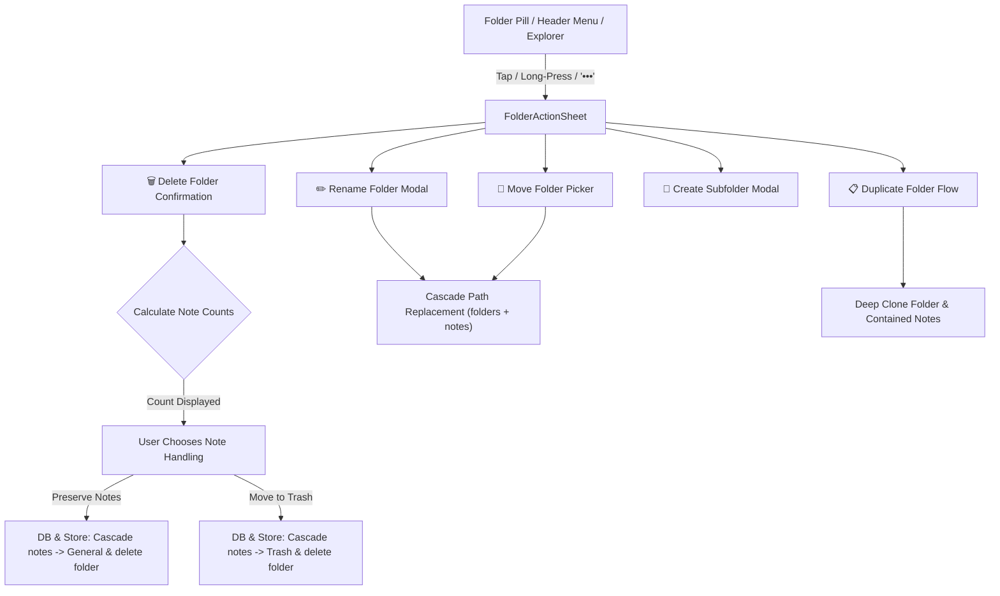

# ScribeX Folder Actions & Hierarchy Management Feature Plan

> **Status:** All Phases (1-7) Completed  
> **Last Updated:** 2026-11-04  
> **Target Scope:** Folder actions (Rename, Delete with Note Count Confirmation, Move/Reparent, Copy/Duplicate, Create Subfolder, Color/Icon Customization) across iOS, Android, and Web.

---

## 1. Executive Summary & Objective

In ScribeX, notes are categorized by `folderPath` (e.g. `General`, `Work`, `Work/Projects`, `Work/Projects/ScribeX`) and backed by local SQLite and Zustand. While basic folder creation and batch-moving notes exist, users currently lack comprehensive folder management capabilities directly from the UI.

This feature adds complete folder lifecycle controls:
1. **Rename Folder**: Validates name and cascades path updates to all subfolders and member notes.
2. **Delete Folder**: Computes exact note counts (direct and nested) and displays a confirmation dialog offering:
   - **Preserve Notes**: Re-route all contained notes to root `"General"`.
   - **Trash Notes**: Move all contained notes to the Trash.
3. **Move Folder (Reparent)**: Change folder parent path in the hierarchy with cyclic dependency protection.
4. **Duplicate / Copy Folder**: Deep copy of folder structure and all contained notes with new unique IDs and fresh timestamps.
5. **Create Subfolder**: Directly from folder context menus.
6. **Visual Folder Customization**: Color token badge selection for folder pills.

---

## 2. Architecture & Data Flow

---

## 3. Detailed Phase Breakdown & Progress Tracker

- [x] **Phase 1: Database Repository & Cascade Logic**
  - [x] Add `renameFolderCascade(id, oldPath, newName)` to `foldersRepo.ts` with child folder and note path updates.
  - [x] Add `moveFolderCascade(id, oldPath, newParentPath)` to `foldersRepo.ts` with cycle detection.
  - [x] Add `deleteFolderCascade(id, targetPath, noteAction)` to `foldersRepo.ts` supporting `'moveToGeneral'` and `'trash'`.
  - [x] Add `duplicateFolderCascade(id, sourcePath, newName)` to `foldersRepo.ts` and deep-clone notes in `notesRepo.ts`.
  - [x] Add helper queries to count direct and nested notes in `foldersRepo.ts` / `notesRepo.ts`.

- [x] **Phase 2: Zustand Store Integration**
  - [x] Add `renameFolder(id, newName)` with optimistic store update & sync changelog in `useNotesStore.tsx`.
  - [x] Add `moveFolder(id, newParentPath)` in `useNotesStore.tsx`.
  - [x] Add `deleteFolderWithOptions(id, folderPath, noteAction)` in `useNotesStore.tsx`.
  - [x] Add `duplicateFolder(id, folderPath, newName?)` in `useNotesStore.tsx`.
  - [x] Ensure `partitionCounts`, `searchIndexMap`, and folder filter states update cleanly without UI flicker.

- [x] **Phase 3: Folder Action UI Components**
  - [x] Create `FolderActionSheet.tsx` (Mobile bottom sheet & Web popover modal for Rename, Move, Duplicate, Subfolder, Delete).
  - [x] Create `DeleteFolderModal.tsx` showing exact contained note counts, subfolder counts, and explicit choice (Move to General vs Trash).
  - [x] Create `MoveFolderModal.tsx` with hierarchical tree selector preventing invalid/cyclic moves.
  - [x] Create `RenameFolderModal.tsx` with instant live path preview and name validation.

- [x] **Phase 4: Home & NotesView Integration**
  - [x] Add long-press handler (`onLongPress`) and right-click context menu to horizontal folder pills in `NotesView.tsx`.
  - [x] Add quick `•••` action menu icon when a folder pill is active in `NotesView.tsx`.
  - [x] Wire all modal actions to the Zustand store methods.
  - [x] Support folder color badge accenting on pills.

- [x] **Phase 5: Quality Gate & Validation**
  - [x] TypeScript typecheck: `cd frontend && npx tsc --noEmit`.
  - [x] UI/UX layout and flex safety audit: `node scripts/test_cross_platform_ui_ux.mjs`.
  - [x] Core interaction & note store test suites: `npm --prefix frontend run test:interactions`.
  - [x] Verify zero regressions in editor AST and note query engine (`audit:all`).

- [x] **Phase 6: Folder Explorer Tree & Advanced Folder Controls**
  - [x] Add `updateFolderIcon(id, icon)` to `foldersRepo.ts` and `useNotesStore.tsx` with custom folder icon tokens.
  - [x] Add "Select All Notes in Folder" to `FolderActionSheet.tsx` to directly enter batch selection mode.
  - [x] Add "Export Folder Notes" to `FolderActionSheet.tsx` using the native Share API.
  - [x] Add Folder Icon Picker to `FolderActionSheet.tsx` (Briefcase, Book, Code, DollarSign, Compass, Heart, Star, Folder).
  - [x] Build `FolderExplorerModal.tsx`: Collapsible hierarchical folder tree showing nested paths, live note counts, and inline action triggers.
  - [x] Add Folder Explorer trigger button to `NotesView.tsx` pill strip and render custom folder icons on pills.

- [x] **Phase 7: Folder Sync & Remote Replication**
  - [x] Delta payload sync for folder hierarchy re-parenting and renaming in `sync_changelog`.
  - [x] Tombstone soft-delete sync across devices for deleted folder subtrees.
  - [x] Conflict resolution for concurrent folder path updates.

---

## 4. Invariants & Guardrails

1. **Root Folder Protection**: The default `"General"` root folder can never be deleted or renamed.
2. **Cycle Prevention**: A folder cannot be moved into itself or into any of its subdirectories.
3. **Full-Bleed Native Canvas**: No generic boxed card wrappers. Modals use clean backdrop blur with explicit `minHeight` and flex-safe text containers.
4. **Atomic Multi-Entity Updates**: Updating folder paths must update both the `folders` table and `notes` table in local SQLite and mirror immediately in Zustand.
5. **No APK Builds**: Per user instruction, offline APK exports are paused during feature implementation.
