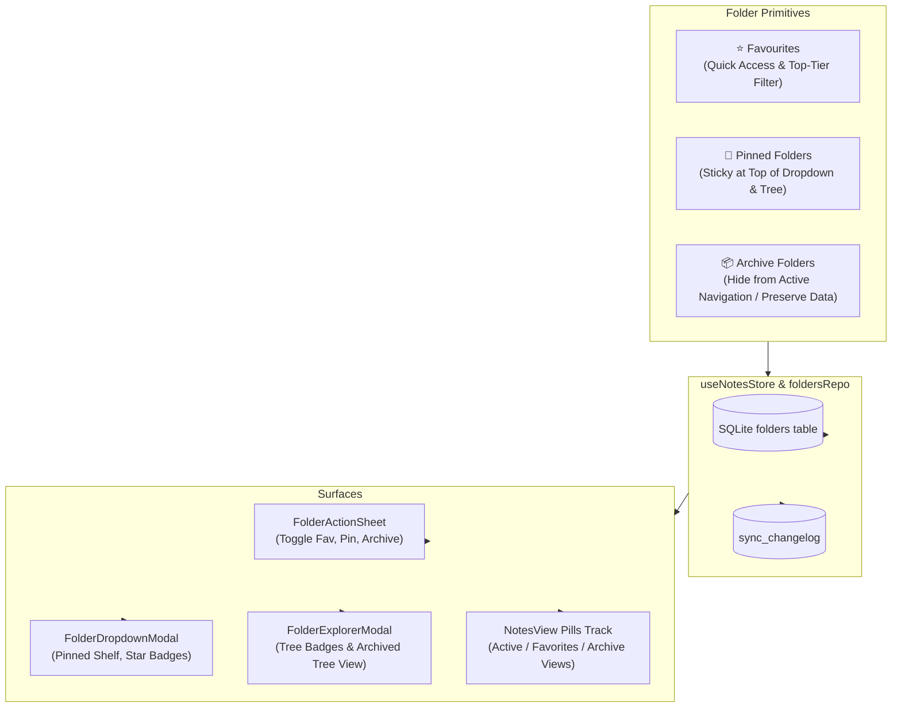

# Folder Favourites, Pinned & Archive Feature — Implementation Plan

> **Tracking:** Point 32 in `docs/future_ideas.md`  
> **Target:** ScribeX Universal Storage Engine (SQLite WebAssembly + Expo SQLite Native)  
> **Design Alignment:** [ScribeX-Pastel-Tile-UI-Design-System.md](file:///Users/nash/Documents/FrontEnd%20Development/ai_projects/scribeX/docs/ScribeX-Pastel-Tile-UI-Design-System.md)

---

## 1. Architectural Overview & Feature Specs

Currently, Notes support `is_favorite`, `is_pinned`, and `status IN ('active', 'archived', 'trashed')`. Point 32 extends these core organizational primitives to **Folders**:



### Feature Capabilities
1. **⭐ Folder Favourites (`is_favorite: boolean`)**:
   - Quick-access priority for high-frequency folders (e.g. `Work/Projects`, `Daily Journals`).
   - Highlighted in `FolderDropdownModal` and `FolderExplorerModal` with a gold star badge (`#FFD43B`).
   - When the user selects the **Favorites** badge on the home feed, a dedicated **Favorite Folders** shelf appears, allowing quick hopping to favorite folders.
   - Quick toggle directly from `FolderActionSheet` and long-press menus.

2. **📌 Pinned Folders (`is_pinned: boolean`)**:
   - Pinned folders stay anchored at the top of the **Folder Dropdown** and **Folder Explorer**, above standard alphabetically sorted folders.
   - Visual pin badge (`#FFC96F`) displayed in the folder selector pill and list items.
   - Quick toggle from `FolderActionSheet`.

3. **📦 Archived Folders (`is_archived: boolean`)**:
   - Moves inactive, historical, or completed project folders out of the active folder selector, dropdowns, and daily note feeds without deleting any data.
   - **Contained Archiving Behavior**:
     - When a folder is archived, the folder **and all contained notes (including nested subfolders and their notes)** are archived together in a single atomic transaction.
     - When an archived folder is unarchived/restored, the folder and its contained notes are restored back to `active` status.
     - When viewing the **Archive** status scope (`statusScope === 'archived'`), the folder selector shows archived folders, allowing the user to browse archived folder hierarchies and **Unarchive** them in 1 tap.

---

## 2. Phase-by-Phase Execution Plan

### Phase 1: SQLite Schema & Storage Layer Migration
*Goal: Add columns with backward-compatible zero-loss migration across Web and Native.*

1. **Schema Updates (`frontend/src/db/schema.ts`)**:
   - Update `folders` table definition:
     ```sql
     CREATE TABLE IF NOT EXISTS folders (
       id TEXT PRIMARY KEY,
       user_id TEXT NOT NULL,
       name TEXT NOT NULL,
       parent_id TEXT,
       path TEXT NOT NULL,
       color_token TEXT DEFAULT 'apricot',
       icon TEXT,
       is_favorite BOOLEAN NOT NULL DEFAULT 0,
       is_pinned BOOLEAN NOT NULL DEFAULT 0,
       is_archived BOOLEAN NOT NULL DEFAULT 0,
       sync_rev INTEGER NOT NULL DEFAULT 0,
       created_at DATETIME NOT NULL DEFAULT CURRENT_TIMESTAMP,
       updated_at DATETIME NOT NULL DEFAULT CURRENT_TIMESTAMP,
       FOREIGN KEY (parent_id) REFERENCES folders(id) ON DELETE SET NULL
     );
     CREATE INDEX IF NOT EXISTS idx_folders_flags ON folders(is_favorite, is_pinned, is_archived);
     ```

2. **Cross-Platform Auto-Migration (`client.web.ts` & `client.native.ts`)**:
   - Add safe `ALTER TABLE` migrations inside `initDatabase()`:
     ```typescript
     try { await db.run('ALTER TABLE folders ADD COLUMN is_favorite BOOLEAN NOT NULL DEFAULT 0;'); } catch {}
     try { await db.run('ALTER TABLE folders ADD COLUMN is_pinned BOOLEAN NOT NULL DEFAULT 0;'); } catch {}
     try { await db.run('ALTER TABLE folders ADD COLUMN is_archived BOOLEAN NOT NULL DEFAULT 0;'); } catch {}
     ```

3. **Types & DTOs (`frontend/src/db/types.ts`)**:
   - Extend `DBFolder`:
     ```typescript
     export interface DBFolder {
       id: string;
       user_id: string;
       name: string;
       parent_id: string | null;
       path: string;
       color_token: string;
       icon: string | null;
       is_favorite: number; // 0 or 1
       is_pinned: number;   // 0 or 1
       is_archived: number; // 0 or 1
       sync_rev: number;
       created_at: string;
       updated_at: string;
     }
     ```
   - Update `CreateFolderDTO` and `FolderTreeNode` to include optional `isFavorite`, `isPinned`, `isArchived`.

4. **Folders Repository (`frontend/src/db/foldersRepo.ts`)**:
   - Implement repository methods:
     - `toggleFolderFavorite(folderId: string): Promise<boolean>`
     - `toggleFolderPin(folderId: string): Promise<boolean>`
     - `archiveFolder(folderId: string, cascadeNotes: boolean): Promise<void>`
     - `unarchiveFolder(folderId: string, cascadeNotes: boolean): Promise<void>`
     - Update `listFolders(includeArchived?: boolean)`: by default filter out archived folders (`WHERE is_archived = 0`), or include them when requested.
     - Record event delta in `sync_changelog` with entity_type `'folder'` and action `'update'`.

---

### Phase 2: State Management & Store Layer
*Goal: Provide reactive hooks, partitioned lists, and state handlers in `useNotesStore`.*

1. **Store State Extensions (`frontend/src/state/useNotesStore.tsx`)**:
   - Expose:
     - `toggleFolderFavorite: (folderId: string) => Promise<void>`
     - `toggleFolderPin: (folderId: string) => Promise<void>`
     - `archiveFolder: (folderId: string, cascadeNotes?: boolean) => Promise<void>`
     - `unarchiveFolder: (folderId: string, cascadeNotes?: boolean) => Promise<void>`
     - `favoriteFolders: DBFolder[]` (computed getter/selector)
     - `pinnedFolders: DBFolder[]` (computed getter/selector)
     - `archivedFolders: DBFolder[]` (computed getter/selector)
     - `activeFolders: DBFolder[]` (folders where `is_archived === 0`)

2. **Query & Ordering Rules**:
   - When listing folders in the dropdown:
     1. Pinned folders first (`is_pinned = 1` ordered by `name ASC`)
     2. Standard active folders (`is_pinned = 0` ordered by `name ASC`)
   - When user is in `statusScope === 'archived'`:
     - Folder dropdown displays archived folders with an "Unarchive" action and badge.

---

### Phase 3: UI & Interaction Design

1. **`FolderActionSheet.tsx`**:
   - Add a quick action row at the top of the sheet:
     - **⭐ Favorite / Unfavorite button** with dynamic icon and label.
     - **📌 Pin / Unpin button** with dynamic icon and label.
     - **📦 Archive / Unarchive button** with dynamic icon and label.
   - For archiving: show confirmation sheet asking whether to also archive contained notes.

2. **`FolderDropdownModal.tsx`**:
   - Display a **"📌 Pinned Folders"** shelf at the top of the scrollable list when any pinned folder exists.
   - Show a gold star ⭐ for favorite folders and a pin 📌 for pinned folders.
   - When `statusScope === 'archived'`, show the **Archived Folders** list with a 1-tap **Unarchive** button.

3. **`FolderExplorerModal.tsx`**:
   - Tree nodes display Star and Pin indicators.
   - Add a toggle button or bottom section: **"View Archived Folders"** to view and restore archived directory branches.

4. **Home Screen Integration (`NotesView.tsx`)**:
   - When a folder is pinned or favorited, the active folder dropdown selector pill shows the pin/star indicator.
   - In the **Favorites** view (`statusScope === 'favorites'`), render a compact horizontal pill carousel of favorite folders right above the notes feed for rapid jumping.
   - In the **Archive** view (`statusScope === 'archived'`), show an archived folder alert/banner when an archived folder is selected, with a prominent **Unarchive Folder** button.

---

### Phase 4: Quality Gates & Verification

1. **TypeScript Type Safety**:
   - Run `cd frontend && npx tsc --noEmit`.
2. **UI/UX Cross-Platform Check**:
   - Run `npm --prefix frontend run test:uiux`.
3. **Automated Headless Test Suite (`scripts/test_headless_folder_features.mjs`)**:
   - Test DB schema migration on both fresh and pre-existing databases.
   - Test toggling favorite and pin flags with SQLite persistence.
   - Test folder archive cascade with note state transitions and restoration.
   - Test sync changelog delta logging.

---

## 3. Recommended Phased Implementation Order

| Stage | Focus Area | Files Involved | Scope |
| :--- | :--- | :--- | :--- |
| **Stage 1** | Schema & Database Repository | `schema.ts`, `client.web.ts`, `client.native.ts`, `types.ts`, `foldersRepo.ts` | Backend / DB |
| **Stage 2** | Store State & Business Logic | `useNotesStore.tsx`, `noteQueryEngine.ts` | State / Store |
| **Stage 3** | Action Sheet & Modals UI | `FolderActionSheet.tsx`, `FolderDropdownModal.tsx`, `FolderExplorerModal.tsx` | Components |
| **Stage 4** | Home Screen & View Integration | `NotesView.tsx`, `DeleteFolderModal.tsx` | View / UX |
| **Stage 5** | Test Suite & Verification | `scripts/test_headless_folder_features.mjs` | Quality Gates |

