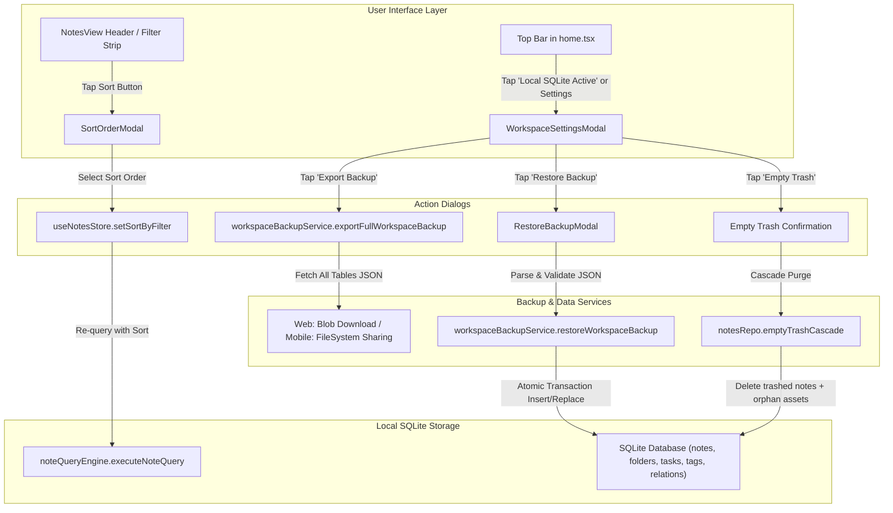

# ScribeX Manual Notes Final Gaps Implementation Plan

> **Status:** All Phases (1-4) Completed — 100% Verified  
> **Source:** Items 29, 30, and 31 in [future_ideas.md](file:///Users/nash/Documents/FrontEnd%20Development/ai_projects/scribeX/docs/future_ideas.md)  
> **Target Scope:** Note Sorting UI, Full Workspace Backup & Restore, and Storage Settings Modal with "Empty Trash" Purge before Phase 2 Cloud Sync.

---

## 1. Executive Summary & Objective

Before initiating **Phase 2 (Supabase Realtime Sync, Next.js Serverless AI & Google Drive Media Vault)**, three critical gaps in the standalone manual note-taking engine must be addressed:

1. **Note Sorting & Ordering UI (Item 29):** The query engine and store already support multiple sort orders (`updated_desc`, `created_desc`, `title_asc`, etc.), but `NotesView.tsx` lacks a UI control to toggle or customize sorting.
2. **Full Workspace Backup & Restore (Item 30):** Provide a local data safety guarantee by enabling users to export a complete JSON snapshot of all SQLite tables (`notes`, `folders`, `tasks`, `tags`, `entity_relations`, `assets`) and restore/import it with schema validation and merge/replace options.
3. **Workspace Storage & Settings Modal + "Empty Trash" Purge (Item 31):** Provide a top app bar settings modal (accessible via the "Local SQLite Active" badge) displaying database health and storage metrics, one-tap backup/restore triggers, and a one-click "Empty Trash" purge that cascades to remove orphaned audio/drawing files.

---

## 2. Architecture & Data Flow

---

## 3. Phase-by-Phase Implementation Plan

### Phase 1: Note Sorting & Ordering UI (Item 29)
- [x] **Step 1.1: Query Engine & Store Sort Alignment**
  - Verify and expand `frontend/src/core/noteQueryEngine.ts` to ensure all 6 sort permutations operate cleanly on both pinned shelves and main feeds:
    - `updated_desc` (Recently Modified - Default)
    - `updated_asc` (Least Recently Modified)
    - `created_desc` (Date Created - Newest First)
    - `created_asc` (Date Created - Oldest First)
    - `title_asc` (Title A → Z)
    - `title_desc` (Title Z → A)
  - Ensure `useNotesStore.tsx` persists the user's active sort choice in local storage so it remains active across app restarts.
- [x] **Step 1.2: Sort Order Modal (`SortOrderModal.tsx`)**
  - Create `frontend/src/components/notes/SortOrderModal.tsx`.
  - Serene pastel-accented bottom sheet / dialog with radio selection, clear descriptive labels, and active checkmarks.
- [x] **Step 1.3: NotesView Sort Trigger Integration**
  - Add a dedicated Sort button (icon: `ArrowDownUp` or `SlidersHorizontal`) in `frontend/src/components/NotesView.tsx` alongside the search / folder filter strip.
  - Display an active sort indicator badge if a non-default sort is active (e.g., "Title A-Z").

---

### Phase 2: Full Workspace Backup & Restore (Item 30)
- [x] **Step 2.1: Workspace Backup Service (`workspaceBackupService.ts`)**
  - Create `frontend/src/services/workspaceBackupService.ts`.
  - Implement `exportFullWorkspaceBackup()`:
    - Query complete datasets from SQLite: `folders`, `tags`, `notes`, `note_tags`, `tasks`, `entity_relations`, and `assets`.
    - Package into a versioned JSON payload (`schemaVersion: 1`, `app: 'ScribeX'`, `exportedAt: ISOString`).
    - Cross-platform delivery:
      - **Web:** Generate a timestamped download (`ScribeX-Backup-YYYY-MM-DD-HHmm.json`) using `Blob` and anchor download.
      - **Mobile (iOS/Android):** Write to `FileSystem.cacheDirectory` via `expo-file-system` and prompt the system share sheet via `expo-sharing`.
- [x] **Step 2.2: Backup Restore & Validation Logic**
  - Implement `restoreWorkspaceBackup(jsonString, strategy: 'merge' | 'replace')`:
    - Strict schema validation: check `app === 'ScribeX'`, `schemaVersion`, and presence of required arrays.
    - Transactional write into SQLite: insert/update folders, tags, notes, tasks, and relations.
    - Refresh Zustand store and rebuild FTS5 search indexes.
- [x] **Step 2.3: Restore Confirmation Modal (`RestoreBackupModal.tsx`)**
  - Create `frontend/src/components/settings/RestoreBackupModal.tsx`.
  - Let user pick `.json` file (via `<input type="file">` on Web, `expo-document-picker` on Mobile).
  - Preview file contents before restoring: show total notes, folders, and tasks detected in the backup.
  - Option to select **Merge** (add missing notes without overwriting existing) or **Clean Replace** (wipe and replace with backup).

---

### Phase 3: Workspace Storage & Settings Modal + "Empty Trash" Purge (Item 31)
- [x] **Step 3.1: Cascade Trash Purge in Repository & Store**
  - Add `emptyTrashCascade()` in `frontend/src/db/notesRepo.ts`:
    - Delete all notes where `status = 'trashed'`.
    - Cascade delete associated checklist tasks and note tags.
    - Purge orphaned binary asset records from `assets` and local disk cache.
    - Record deletion tombstones in `sync_changelog`.
  - Expose `emptyTrash()` in `frontend/src/state/useNotesStore.tsx`.
- [x] **Step 3.2: Workspace Settings Modal (`WorkspaceSettingsModal.tsx`)**
  - Create `frontend/src/components/settings/WorkspaceSettingsModal.tsx`.
  - Layout & Sections:
    1. **Storage Health & Stats:** Total notes (Active, Archived, Trashed), total folders, open tasks, and database engine type (Native SQLite WAL / Web Wasm).
    2. **Data Portability:** 1-tap "Export Full Backup (.json)" and "Restore Backup".
    3. **Maintenance & Trash:** "Empty Trash" button with note count badge and warning dialog.
- [x] **Step 3.3: Top App Bar Integration in `home.tsx`**
  - Update `frontend/app/home.tsx` to make the `"• Local SQLite Active"` badge interactive, opening the `WorkspaceSettingsModal`.
  - Add a settings icon button (`SlidersHorizontal` or `Database`) in the top right header cluster.

---

### Phase 4: Quality Gates & Verification
- [x] **Step 4.1: Static Type Check**
  - Run `cd frontend && npx tsc --noEmit` and resolve any type mismatches.
- [x] **Step 4.2: Automated UI/UX & Interaction Test Suites**
  - Run `node scripts/test_cross_platform_ui_ux.mjs`.
  - Run `npm --prefix frontend run test:interactions`.
- [x] **Step 4.3: Manual Cross-Platform Verification**
  - Verify sorting notes on Web and Mobile preview.
  - Verify exporting and restoring a full workspace backup JSON file.
  - Verify "Empty Trash" permanently clears trashed notes and updates counts.
  - Update `docs/future_ideas.md` and `docs/Master_Tasks_Tracker.md` upon completion.

