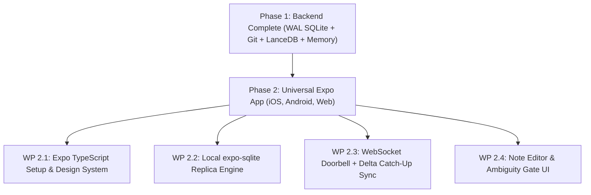

# ScribeX Master Tasks Tracker & Engineering Roadmap

> **Document Type:** Master Task Log & Long-Term Roadmap Tracker  
> **Status:** Active Central Command Document  
> **Repository:** `Nisarg39/scribeX`  
> **Last Updated:** October 25, 2026  
> **Architectural References:**
> - [Technical_System_Architecture.md](file:///Users/nash/Documents/FrontEnd%20Development/ai_projects/scribeX/docs/Technical_System_Architecture.md)
> - [SaaS_Architecture_and_Integration_Plan.md](file:///Users/nash/Documents/FrontEnd%20Development/ai_projects/scribeX/docs/SaaS_Architecture_and_Integration_Plan.md)
> - [Product_Requirements.md](file:///Users/nash/Documents/FrontEnd%20Development/ai_projects/scribeX/docs/Product_Requirements.md)
> - [Learning_Storing_Retrieval_Strategy.md](file:///Users/nash/Documents/FrontEnd%20Development/ai_projects/scribeX/docs/Learning_Storing_Retrieval_Strategy.md)
> - [Phase_1_Implementation_Plan.md](file:///Users/nash/Documents/FrontEnd%20Development/ai_projects/scribeX/docs/Phase_1_Implementation_Plan.md)

---

## 1. Executive Master Dashboard

This document is the **single source of truth** for tracking completed engineering work and upcoming milestones across the entire ScribeX platform. As individual phases and features are tackled, update this document to preserve complete visibility over what is implemented and what remains.

### Overall Progress
```
[██████████░░░░░░░░░░░░░░░░░░░░░░░░░░░░░░░░░░░░░░░░] 1 / 6 Phases Completed (16.7%)
```

### Phase Status Matrix

| Phase | Core Milestone | Primary Tech Stack | Status | Primary Doc Reference |
| :---: | :--- | :--- | :---: | :--- |
| **Phase 1** | **VPS Core Backend, Operational SQLite & 4-Layer Memory** | FastAPI, SQLite WAL, GitPython, LanceDB, LiteLLM | `[x] COMPLETED` | [Phase_1_Implementation_Plan.md](file:///Users/nash/Documents/FrontEnd%20Development/ai_projects/scribeX/docs/Phase_1_Implementation_Plan.md) |
| **Phase 2** | **Universal Expo App + Resilient Delta Sync** | React Native / Expo, `expo-sqlite`, WebSockets | `[ ] UPCOMING (NEXT)` | [Technical_System_Architecture.md #3 & #4](file:///Users/nash/Documents/FrontEnd%20Development/ai_projects/scribeX/docs/Technical_System_Architecture.md#3-storage-architecture-sqlite-wal--git-vault-projection) |
| **Phase 3** | **Manual Edit Diff Learner + Temporal "Versions of Me"** | GitPython Diff Engine, Layer 3 Timeline, Layer 4 Ledger | `[ ] PLANNED` | [Technical_System_Architecture.md #5](file:///Users/nash/Documents/FrontEnd%20Development/ai_projects/scribeX/docs/Technical_System_Architecture.md#5-agent-architecture-the-three-autonomous-loops) |
| **Phase 4** | **Remote PC Bridge Daemon + Pluggable CLI Verification Loop** | Python/Node Daemon, WebSockets, `cli_agents.yaml` | `[ ] PLANNED` | [Technical_System_Architecture.md #6 & #7](file:///Users/nash/Documents/FrontEnd%20Development/ai_projects/scribeX/docs/Technical_System_Architecture.md#6-remote-pc-agent-orchestration-daemon) |
| **Phase 5** | **SaaS Multi-Tenancy, Auth & Device Pairing Protocol** | Clerk / Supabase Auth, HMAC/Ed25519 Tokens, Cloudflare | `[ ] PLANNED` | [SaaS_Architecture_and_Integration_Plan.md #2, #3, #4](file:///Users/nash/Documents/FrontEnd%20Development/ai_projects/scribeX/docs/SaaS_Architecture_and_Integration_Plan.md#2-day-1-saas-ready-foundations-phase-1-pre-requisites) |
| **Phase 6** | **Commercial Launch, Billing, Token Quotas & Public Scaling** | Stripe Subscriptions, LiteLLM Quotas, S3/R2 Backups | `[ ] PLANNED` | [SaaS_Architecture_and_Integration_Plan.md #5, #6, #7](file:///Users/nash/Documents/FrontEnd%20Development/ai_projects/scribeX/docs/SaaS_Architecture_and_Integration_Plan.md#5-billing--tier-enforcement-stripe-integration) |

---

## 2. Phase-by-Phase Task Breakdown & Implementation Details

---

### Phase 1: VPS Core Backend, Operational SQLite & 4-Layer Memory Engine
* **Status:** `[x] COMPLETED & VERIFIED` (33 / 33 automated tests passing)  
* **Reference Implementation Document:** [Phase_1_Implementation_Plan.md](file:///Users/nash/Documents/FrontEnd%20Development/ai_projects/scribeX/docs/Phase_1_Implementation_Plan.md)  
* **Target Codebase:** [`backend/`](file:///Users/nash/Documents/FrontEnd%20Development/ai_projects/scribeX/backend)

#### Completed Work Packages:
- [x] **Step 1: Scaffolding, Packaging & SaaS Path Resolver**
  - Modern `pyproject.toml` packaging (Python 3.11).
  - Config management ([`config.py`](file:///Users/nash/Documents/FrontEnd%20Development/ai_projects/scribeX/backend/app/core/config.py)).
  - Day-1 SaaS-ready path resolver ([`paths.py`](file:///Users/nash/Documents/FrontEnd%20Development/ai_projects/scribeX/backend/app/storage/paths.py)) supporting default flat layout (`data/vault`, `data/sqlite`, `data/lancedb`) and isolated multi-tenant directories (`data/tenants/{user_id}/`).
  - FastAPI application entry point ([`main.py`](file:///Users/nash/Documents/FrontEnd%20Development/ai_projects/scribeX/backend/app/main.py)) with lifespan directory bootstrapping and `/health`.
- [x] **Step 2: Operational SQLite Engine (WAL Mode + Core Schemas)**
  - Core database schema ([`schemas.sql`](file:///Users/nash/Documents/FrontEnd%20Development/ai_projects/scribeX/backend/app/db/schemas.sql)): `notes`, `user_sync_meta`, `sync_changelog`, `entity_edges`, `identity_timeline`, `learned_preferences`, `staging_intake`, and `notes_fts` (FTS5).
  - Async connection manager and repository ([`sqlite_db.py`](file:///Users/nash/Documents/FrontEnd%20Development/ai_projects/scribeX/backend/app/storage/sqlite_db.py)) with WAL mode and monotonic `sync_rev` increments.
- [x] **Step 3: Git-Backed Markdown Vault Projector (`GitPython`)**
  - Git repository initializer and Markdown serializer ([`git_vault.py`](file:///Users/nash/Documents/FrontEnd%20Development/ai_projects/scribeX/backend/app/storage/git_vault.py)).
  - Unified write pipeline ([`sync_projector.py`](file:///Users/nash/Documents/FrontEnd%20Development/ai_projects/scribeX/backend/app/storage/sync_projector.py)) coordinating SQLite transaction followed by Git projection with author attribution (`ScribeX-AI` vs. `User`).
- [x] **Step 4: Embedded LanceDB Vector Engine & Document Parser**
  - Local embedded vector search ([`lancedb_store.py`](file:///Users/nash/Documents/FrontEnd%20Development/ai_projects/scribeX/backend/app/storage/lancedb_store.py)) with cosine similarity and deterministic fallback embeddings.
  - Multi-format ingestion parser ([`file_parser.py`](file:///Users/nash/Documents/FrontEnd%20Development/ai_projects/scribeX/backend/app/storage/file_parser.py)) for PDF (`pymupdf`), Markdown, CSV, JSON, and plain text.
- [x] **Step 5: Cognitive Memory Layers (Layer 1 Identity & Layer 2 Graph)**
  - Layer 1 RAM-cached master prompt builder ([`layer1_identity.py`](file:///Users/nash/Documents/FrontEnd%20Development/ai_projects/scribeX/backend/app/memory/layer1_identity.py)) managing `_core/identity.md`.
  - Layer 2 Triple Hybrid Context Retriever ([`layer2_vault.py`](file:///Users/nash/Documents/FrontEnd%20Development/ai_projects/scribeX/backend/app/memory/layer2_vault.py)) merging SQLite FTS5 BM25, LanceDB vector chunks, and `entity_edges` graph traversal.
- [x] **Step 6: Universal Intake Router & Ask-Before-Write Ambiguity Gate**
  - Intake agent ([`intake_agent.py`](file:///Users/nash/Documents/FrontEnd%20Development/ai_projects/scribeX/backend/app/agents/intake_agent.py)) evaluating raw inputs against Layer 1 & 2 memory.
  - Ambiguity Gate API ([`intake.py`](file:///Users/nash/Documents/FrontEnd%20Development/ai_projects/scribeX/backend/app/api/intake.py)) holding inputs with `clarity_score < 0.85` in `staging_intake`, returning clarifying questions, and supporting multi-turn resolution.
- [x] **Step 7: Interactive Onboarding Interview Flow API**
  - Conversational 6-pillar interview engine ([`onboarding_agent.py`](file:///Users/nash/Documents/FrontEnd%20Development/ai_projects/scribeX/backend/app/agents/onboarding_agent.py)).
  - Profile synthesis generating `_core/identity.md`, seeding initial project/goal notes, and committing via `ScribeX-AI` ([`onboarding.py`](file:///Users/nash/Documents/FrontEnd%20Development/ai_projects/scribeX/backend/app/api/onboarding.py)).
- [x] **Step 8: Master End-to-End Integration Test Suite & Full Verification**
  - Master lifecycle test ([`test_e2e_integration.py`](file:///Users/nash/Documents/FrontEnd%20Development/ai_projects/scribeX/backend/tests/test_e2e_integration.py)).
  - 33 automated tests passing with 100% green status across all subsystems.

---

### Phase 2: Universal Expo App + Resilient Delta Sync
* **Status:** `[ ] UPCOMING (NEXT MAJOR FOCUS)`  
* **Architecture Alignment:** [Technical_System_Architecture.md #3 & #4](file:///Users/nash/Documents/FrontEnd%20Development/ai_projects/scribeX/docs/Technical_System_Architecture.md#4-bidirectional-synchronization-engine-delta-sync)  
* **Target Codebase:** `frontend/` (Expo / React Native / React Native Web)

#### Work Packages to Implement:
- [ ] **WP 2.1: Expo Frontend Scaffolding & Design System**
  - Initialize Expo project (`TypeScript`, `expo-router`, custom premium dark-mode styling conforming to design guidelines).
  - Target triple platform execution: **iOS, Android, and Web** from a single codebase.
  - Establish custom typography, vibrant accents, micro-animations, and clean layout patterns (avoiding generic card layouts).
- [ ] **WP 2.2: Local Offline-First Storage Engine (`expo-sqlite`)**
  - Local SQLite database replica on device using `expo-sqlite`.
  - Schema matching the server operational notes and metadata (`notes`, `local_sync_meta`).
  - Read-first architecture: All UI screens read directly from local SQLite with $< 5\text{ ms}$ query latency; no network spinners for local reads.
- [ ] **WP 2.3: WebSocket Doorbell & Delta Sync Client**
  - Establish persistent WebSocket client connection to VPS (`ws://.../ws/sync`).
  - Doorbell push notification receiver (`SYNC_PING` with latest `sync_rev`).
  - Revision catch-up handshake calling `GET /api/v1/sync/deltas?since_rev=X`.
  - HTTP fallback polling when WebSocket is disconnected or app resumes from background.
  - Atomic local SQLite batch application of received changelog deltas.
- [ ] **WP 2.4: Fast Markdown Note Editor & Group Navigator**
  - High-performance rich Markdown editor with instant auto-save and debounce.
  - Group/Folder navigation tree mirroring Git vault categories (Projects, Goals, Habits, Meetings, Inbox).
  - Search interface backed by local full-text search.
- [ ] **WP 2.5: Interactive Ambiguity Gate UI ("Ask-Before-Write" Modal)**
  - UI interceptor for `POST /api/v1/intake`:
    - When server returns `status: "NEEDS_CLARIFICATION"`, display an elegant conversational dialog presenting Friday's clarifying questions.
    - User inputs responses $\rightarrow$ calls `POST /api/v1/intake/{staging_id}/clarify` $\rightarrow$ transitions smoothly to `PROCESSED`.
- [ ] **WP 2.6: Conversational Onboarding Screen & Profile View**
  - First-run multi-turn interview screen guiding new users through the 6 pillars.
  - Dynamic personal profile viewer displaying Layer 1 identity, vision, and active priorities.

---

### Phase 3: Manual Edit Diff Learner + Temporal "Versions of Me"
* **Status:** `[ ] PLANNED`  
* **Architecture Alignment:** [Technical_System_Architecture.md #5](file:///Users/nash/Documents/FrontEnd%20Development/ai_projects/scribeX/docs/Technical_System_Architecture.md#5-agent-architecture-the-three-autonomous-loops) & [Learning_Storing_Retrieval_Strategy.md](file:///Users/nash/Documents/FrontEnd%20Development/ai_projects/scribeX/docs/Learning_Storing_Retrieval_Strategy.md)  
* **Target Codebase:** [`backend/app/diff_learning/`](file:///Users/nash/Documents/FrontEnd%20Development/ai_projects/scribeX/backend)

#### Work Packages to Implement:
- [ ] **WP 3.1: Background Git Commit Monitor & Diff Extractor**
  - Background worker inspecting Git vault commits for changes tagged with author `[User]` vs. `[AI]`.
  - Unified diff extraction identifying what the user manually rephrased, deleted, re-categorized, or added.
- [ ] **WP 3.2: Layer 4 Behavioral & Preference Ledger Engine**
  - AI diff analysis prompt comparing user manual adjustments against prior AI proposals.
  - Extracts inferred rules: filing habits, formatting preferences, checklist styling, tone adjustments.
  - Stores rules in `learned_preferences` table with calculated `confidence_score`.
  - Injects highest-confidence rules into future intake and editing prompts.
- [ ] **WP 3.3: Layer 3 Episodic Memory & Identity Evolution Timeline**
  - Detects major updates to core goals, career mindset, or vision in `_core/identity.md`.
  - Archives previous states into `identity_timeline` table (`valid_from`, `valid_to`, `change_reason`, `git_commit_sha`).
  - Powers "Versions of Me" temporal queries (e.g. *"What were my top priorities in Q1 compared to now?"*).
- [ ] **WP 3.4: Automated Git Vault Compaction & Sync Re-indexing**
  - Periodic background reconciliation ensuring SQLite operational tables and LanceDB vector index remain perfectly in sync with raw Markdown files.

---

### Phase 4: Remote PC Bridge Daemon + Pluggable CLI Verification Loop
* **Status:** `[ ] PLANNED`  
* **Architecture Alignment:** [Technical_System_Architecture.md #6 & #7](file:///Users/nash/Documents/FrontEnd%20Development/ai_projects/scribeX/docs/Technical_System_Architecture.md#6-remote-pc-agent-orchestration-daemon)  
* **Target Codebase:** `pc-daemon/` & `backend/app/remote/`

#### Work Packages to Implement:
- [ ] **WP 4.1: Standalone `pc-agent-bridge` Daemon**
  - Lightweight client script running locally on user's Mac/Linux/Windows machine.
  - Secure outbound persistent WebSocket connection to VPS (no public IP or open inbound ports required).
  - Machine heartbeat and telemetry status reporter.
- [ ] **WP 4.2: Pluggable CLI Agent Configuration (`cli_agents.yaml`)**
  - Dynamic configuration file mapping supported local coding/research agents:
    - Claude Code CLI (`claude ...`)
    - Custom python/bash scripts
    - Terminal tools and linters
- [ ] **WP 4.3: 3-Stage Remote Verification Pipeline**
  - **Stage 1 (Pre-Execution Validation):** Safety guardrails, dangerous command blocklist (`rm -rf /`, raw disk writes), working directory validation.
  - **Stage 2 (Supervised Execution):** Live stdout/stderr streaming back to ScribeX frontend via WebSockets.
  - **Stage 3 (Post-Execution Verification):** Automatic `git diff` capture and test execution verification to confirm command succeeded before marking task complete.
- [ ] **WP 4.4: Autonomous Task Dispatcher & Execution Logs Projection**
  - Dispatching tasks from ScribeX mobile/web app to the remote PC.
  - Automatic compilation of execution summaries and diffs into structured Markdown notes in `Projects/` or `DevLogs/`.

---

### Phase 5: SaaS Multi-Tenancy, Auth & Device Pairing Protocol
* **Status:** `[ ] PLANNED`  
* **Architecture Alignment:** [SaaS_Architecture_and_Integration_Plan.md #2, #3, #4](file:///Users/nash/Documents/FrontEnd%20Development/ai_projects/scribeX/docs/SaaS_Architecture_and_Integration_Plan.md#2-day-1-saas-ready-foundations-phase-1-pre-requisites)  
* **Target Codebase:** [`backend/app/auth/`](file:///Users/nash/Documents/FrontEnd%20Development/ai_projects/scribeX/backend), `backend/app/core/`

#### Work Packages to Implement:
- [ ] **WP 5.1: Authentication Provider Integration (Clerk / Supabase Auth)**
  - JWT verification middleware in `app/api/deps.py`.
  - Dynamically extracts authenticated `user_id` from Bearer token, replacing `"default_user"`.
  - Automatic creation of tenant storage directories upon first user login.
- [ ] **WP 5.2: Remote Machine Pairing Protocol (CLI Challenge-Response)**
  - Pairing protocol flow:
    - User runs `scribex pair` on PC $\rightarrow$ generates cryptographic keypair and displays 6-digit short-lived OTP.
    - User confirms OTP in mobile/web app.
    - VPS issues signed long-lived Ed25519 machine authorization token.
  - Multi-device authorization management table in SQLite.
- [ ] **WP 5.3: Cloudflare Ingress, Reverse Proxy & Rate Limiting**
  - Configuration of Cloudflare proxy / Caddy for SSL termination and WebSocket streaming.
  - Rate limiting per tenant to prevent abuse.
- [ ] **WP 5.4: Tenant Storage Isolation Auditing**
  - Automated test suite verifying that Tenant A can never read, query, or search notes, vectors, or Git vaults belonging to Tenant B.

---

### Phase 6: Commercial Launch, Billing, Token Quotas & Public Scaling
* **Status:** `[ ] PLANNED`  
* **Architecture Alignment:** [SaaS_Architecture_and_Integration_Plan.md #5, #6, #7](file:///Users/nash/Documents/FrontEnd%20Development/ai_projects/scribeX/docs/SaaS_Architecture_and_Integration_Plan.md#5-billing--tier-enforcement-stripe-integration)  
* **Target Codebase:** `backend/app/billing/`, `backend/app/metering/`

#### Work Packages to Implement:
- [ ] **WP 6.1: Stripe Billing & Subscription Webhooks**
  - Stripe Customer Portal and Checkout integration.
  - Webhook listeners:
    - `customer.subscription.created` $\rightarrow$ Unlocks Pro features (unlimited notes, multi-PC bridge).
    - `customer.subscription.deleted` $\rightarrow$ Graceful downgrade to Free tier.
- [ ] **WP 6.2: LiteLLM Token Budget Metering & Quotas**
  - Tracking token consumption per user across LLM queries.
  - Monthly budget enforcement per plan tier.
  - Support for BYO-Key (Bring Your Own OpenAI/Anthropic API Key) with AES-256 encrypted vault storage.
- [ ] **WP 6.3: Automated Encrypted Backup Snapshots (S3 / Cloudflare R2)**
  - Nightly encrypted snapshots of tenant Git vaults and SQLite databases to object storage.
  - One-click "Export Entire Vault as Zip" for complete user data sovereignty.
- [ ] **WP 6.4: Production Monitoring & Distributed Telemetry**
  - Structured JSON logging, Sentry error reporting, and Prometheus performance metrics.

---

## 3. Immediate Next Execution Plan: Phase 2 Kickoff

### Next Immediate Objective:
Initialize the **Universal Expo Frontend Application** with local offline-first SQLite cache and Delta Sync client.



---

## 4. Execution Changelog & Milestone History

| Date | Milestone / Event | Description | Commits / Artifacts |
| :---: | :--- | :--- | :--- |
| **2026-10-25** | **Phase 1 Master Completion** | Implemented and verified all 8 milestones of VPS Core Backend, WAL SQLite, Git Vault Projector, LanceDB Vector Engine, Cognitive Memory Layers 1 & 2, Ask-Before-Write Ambiguity Gate, and Onboarding API. 33 tests passing (100% green). | Commits `7ced550`, `bd1eee9`, `7d5bf11`, `49988ae`, `47996df` |
| **2026-10-25** | **Master Tasks Tracker Created** | Created this roadmap document unifying Phase 1 completion with long-term requirements from Technical System Architecture and SaaS Integration plans. | `docs/Master_Tasks_Tracker.md` |
