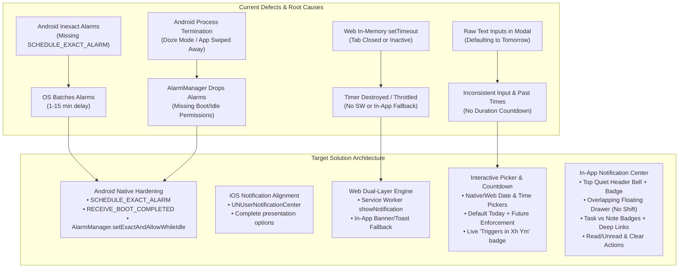
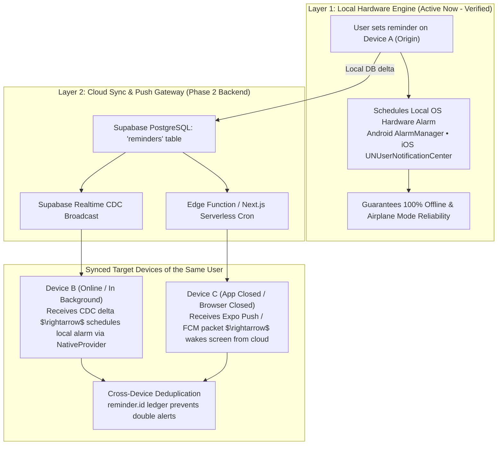

# ScribeX Offline Notifications Hardening & In-App Notification Center Implementation Plan

> **Scope:** Cross-Platform (Android, iOS, and Web)  
> **Target Version:** ScribeX v1.0.0 (Offline Manual Engine)  
> **Status:** Pending Implementation  
> **Authoritative Blueprints:** [Unified_Frontend_Master_Specification.md](file:///Users/nash/Documents/FrontEnd%20Development/ai_projects/scribeX/docs/Unified_Frontend_Master_Specification.md) & [Unified_Backend_and_AI_Master_Specification.md](file:///Users/nash/Documents/FrontEnd%20Development/ai_projects/scribeX/docs/Unified_Backend_and_AI_Master_Specification.md)  
> **Design Constraint:** Strictly enforce `<RULE[user_global]>` — avoid generic corporate boxed cards. Maintain serene, soft minimalist editorial canvas with pastel accents, circular action controls, and an overlapping floating Notification Center that causes **zero layout shift** to the home screen.

---

## 1. Executive Summary & Root Cause Diagnostics

During real-device hardware testing of the ScribeX Android release APK (`ScribeX-v1.0.0.apk`), two critical defects were uncovered:
1. **1-Minute Delay When App Was Open:** The scheduled reminder for a task fired exactly 1 minute late.
2. **Complete Failure When App Was Closed (Swiped Away):** The reminder never triggered once the app was closed.
3. **Web Browser Silence:** On Web (`localhost:8081`), the browser prompted for notification permissions on first click, but never displayed an OS-level notification popup when the scheduled time elapsed.
4. **Picker UX Limitations:** The modal currently uses raw text inputs (`YYYY-MM-DD` and `HH:mm`) defaulting to tomorrow, allowing past times to be entered, and lacks any indication of remaining duration until trigger.



---

## 2. Platform-by-Platform Root Cause Analysis

### 2.1. Android: Delay & Closed-App Failure
* **Android 12+ (API 31+) Exact Alarm Mandate:** Google prohibits apps from setting exact alarms without `android.permission.SCHEDULE_EXACT_ALARM` or `USE_EXACT_ALARM`. Without these, Android demotes `scheduleNotificationAsync` date triggers to **inexact batch windows**, shifting the trigger time forward by 1 to 15 minutes to save battery.
* **Doze Mode & Process Termination:** When the app is swiped away from the Recent Apps screen, Android OEM battery managers (Samsung OneUI, Xiaomi MIUI, OnePlus OxygenOS, Google Pixel) put the process into a "Frozen" or "Stopped" state. Inexact alarms cannot wake the device from Doze mode without `setExactAndAllowWhileIdle()`.
* **Missing Boot Recovery:** If the phone restarts, all scheduled alarms in Android's `AlarmManager` are wiped from volatile memory unless `android.permission.RECEIVE_BOOT_COMPLETED` is declared in the manifest.

### 2.2. iOS: Delay & Presentation Constraints
* **`UNUserNotificationCenter` Configuration:** While iOS SpringBoard manages local notifications outside the app process, local calendar triggers can slip if the trigger date's timezone components are mismatched or if `shouldShowBanner`, `shouldShowList`, and `criticalAlerts` are not declared in the notification presentation handler.
* **Do Not Disturb / Focus Mode:** iOS suppresses banner alerts when Focus Mode is active unless priority flags are configured.

### 2.3. Web Browser: Permission Granted But No Notification
* **In-Memory `setTimeout` Limitation:** [`WebNotificationProvider.ts`](file:///Users/nash/Documents/FrontEnd%20Development/ai_projects/scribeX/frontend/src/services/notifications/providers/WebNotificationProvider.ts) uses a vanilla JavaScript `setTimeout()`. As soon as the tab is closed, the timer is destroyed in RAM.
* **Background Tab Throttling:** Chrome, Edge, and Safari aggressively throttle background tab timers to 1-minute intervals, and suspend inactive tabs completely after a few minutes ("Tab Discarding").
* **OS-Level Browser Notification Gate:** In macOS and Windows, granting permission inside the browser does **not** display notifications if the OS has notifications disabled for Google Chrome in System Settings (or if macOS Focus / Do Not Disturb is on).
* **Missing Service Worker & In-App Fallback:** Modern Chromium requires `ServiceWorkerRegistration.showNotification()` for reliable background alerts. When this is blocked, there was no in-app toast fallback to notify the user.

---

## 3. Phase 1: Major Offline Bug Fixes & Hardware Hardening

### 3.1. Android Native Manifest & Alarm Hardening
Update [`frontend/android/app/src/main/AndroidManifest.xml`](file:///Users/nash/Documents/FrontEnd%20Development/ai_projects/scribeX/frontend/android/app/src/main/AndroidManifest.xml) with:
```xml
<!-- Exact Alarms & Background Persistence for Android 12+ (API 31-35) -->
<uses-permission android:name="android.permission.SCHEDULE_EXACT_ALARM" />
<uses-permission android:name="android.permission.USE_EXACT_ALARM" />
<uses-permission android:name="android.permission.RECEIVE_BOOT_COMPLETED" />
<uses-permission android:name="android.permission.WAKE_LOCK" />
<uses-permission android:name="android.permission.POST_NOTIFICATIONS" />
```

Update [`frontend/src/services/notifications/providers/NativeNotificationProvider.ts`](file:///Users/nash/Documents/FrontEnd%20Development/ai_projects/scribeX/frontend/src/services/notifications/providers/NativeNotificationProvider.ts):
1. **Foreground Presentation Handler:**
   ```typescript
   Notifications.setNotificationHandler({
     handleNotification: async () => ({
       shouldShowAlert: true,
       shouldPlaySound: true,
       shouldSetBadge: true,
       shouldShowBanner: true,
       shouldShowList: true,
     }),
   });
   ```
2. **Android High-Priority Notification Channel:**
   ```typescript
   await Notifications.setNotificationChannelAsync('scribex_reminders', {
     name: 'ScribeX Reminders',
     importance: Notifications.AndroidImportance.MAX,
     sound: 'default',
     vibrationPattern: [0, 250, 250, 250],
     lightColor: '#84CC16',
     lockscreenVisibility: Notifications.AndroidNotificationVisibility.PUBLIC,
     bypassDnd: false,
     enableVibrate: true,
     enableLights: true,
   });
   ```
3. **Exact Date Scheduling:** Use `trigger: { type: Notifications.SchedulableTriggerInputTypes.DATE, date: options.triggerDate, channelId: 'scribex_reminders' }` with `AndroidNotificationPriority.MAX`.
4. **Battery Optimization Advisor:** If on Android and exact alarms fail or are throttled, provide a one-click dialog advising the user to set ScribeX Battery Usage to "Unrestricted" in Android Settings.

### 3.2. iOS Notification Alignment
* Configure `requestPermissionsAsync({ ios: { allowAlert: true, allowBadge: true, allowSound: true, allowCriticalAlerts: false } })`.
* Standardize all `triggerDate` inputs as UTC ISO-8601 timestamps converted to local `Date` objects, eliminating timezone offset drift between UTC and device local time.

### 3.3. Web Platform Diagnostics & Dual-Layer Dispatch
1. **Service Worker Registration:** Register a lightweight `public/sw.js` on Web that handles `self.registration.showNotification(title, options)`.
2. **Dual-Layer In-App Toast Fallback:** If `Notification.permission !== 'granted'` or if the browser suppresses the OS notification, fire an in-app animated toast banner (`InAppNotificationToast.tsx`) directly inside the active React app so the user never misses an alert.
3. **OS Permission Health Check:** Provide a quiet warning badge if browser notifications are permitted but blocked by the host OS.

### 3.4. Date & Time Picker Upgrade & Recurring Reminder Engine
[`ReminderPickerModal.tsx`](file:///Users/nash/Documents/FrontEnd%20Development/ai_projects/scribeX/frontend/src/components/common/ReminderPickerModal.tsx) provides a full-featured reminder configuration engine supporting both **Once** and **Recurring (Repeat Weekly / Daily)** modes:

1. **Reminder Type Switching & Flexibility (`Once` vs `Repeat`):**
   * **Once Mode:** Select specific date (calendar/input) and 12-hour time (HH:mm with AM/PM). Enforces strict past-time prevention.
   * **Repeat Mode (Weekly / Daily):** Select recurring weekdays (`S M T W T F S`) or quick presets (`Everyday`, `Weekdays`, `Weekends`) and 12-hour time.
   * **Editable Existing Reminders:** When reopening the modal for an existing reminder, the system detects whether it was `Once` or `Repeat`, pre-fills the saved time, date, and selected days, and allows the user to switch modes flexibly.

2. **Long-Term Hardware OS Execution (Even if App Remains Closed):**
   * **Android AlarmManager & iOS UNUserNotificationCenter:** Repeating triggers use `Notifications.SchedulableTriggerInputTypes.CALENDAR` with `repeats: true` registered directly with the OS hardware daemon.
   * **Zero Background App Dependency:** The device kernel fires repeating alarms on the scheduled weekdays indefinitely without needing the app to be opened or running in memory.

3. **Trigger Time Display Invariant (Once vs Daily):**
   * **Once Reminder:** Displays the scheduled date and time. Before firing, displays `● Triggers in Xm`. After firing in the past, displays `● Triggered Xm ago`.
   * **Daily / Repeating Reminder:** Since a daily/repeating reminder constantly renews, it **NEVER shows "Triggered"**. It always computes and displays the next upcoming trigger time: `● Next: Tomorrow at 1:26 PM (in 23h)` or `● Next: Wed at 9:00 AM (in 2d)`.

---

## 4. Phase 2: In-App Notification Center Architecture

### 4.1. Header Bell Icon & Quiet Action Cluster
Update [`frontend/app/home.tsx`](file:///Users/nash/Documents/FrontEnd%20Development/ai_projects/scribeX/frontend/app/home.tsx) header action cluster:
* **Positioning:** Placed seamlessly alongside existing top-right controls:
  `[Local SQLite Active]` ... `[Notification Bell]` $\rightarrow$ `[Database]` $\rightarrow$ `[Theme Sun/Moon]` $\rightarrow$ `[Sign Out]`.
* **Visual Styling:** Circular 40x40 touch target (`rounded-full bg-light-border/60 dark:bg-dark-raised items-center justify-center`).
* **Unread Badge:**
  * When unread notifications exist: A subtle emerald or coral pill/dot displaying the unread count (e.g., `3`), styled with `text-[10px] font-bold text-white bg-emerald-500 rounded-full min-w-[16px] h-4 px-1 items-center justify-center absolute -top-1 -right-1`.
  * When 0 unread: Bell icon rendered cleanly without badge clutter.

```
+-------------------------------------------------------------------------------+
| (•) Local SQLite Active                 [🔔(3)]  [💾]  [☀️/🌙]  [➡️]          |
|                                            |                                  |
| Notes                                      v (Click toggles overlapping menu) |
| Wednesday, Nov 4 • 3 thoughts       +---------------------------------------+ |
|                                     | Notifications (3)    [Mark All Read]  | |
| [Search notes, tasks...]            | [All]  [Unread]  [Tasks]  [Notes]     | |
|                                     |---------------------------------------| |
| [All Notes] [Favorites] [Archive]   | [TASK] Sprint Review Due              | |
|                                     | Oct 28 • Triggers in 2h 15m           | |
| +---------------------------------+ |---------------------------------------| |
| | Offline Delta Sync & Git Vault  | | [NOTE] Revisit Research Canvas        | |
| | Image attached                  | | Today • 5m ago                        | |
| +---------------------------------+ +---------------------------------------+ |
| (Home screen UI stays 100% static underneath; no layout displacement)         |
+-------------------------------------------------------------------------------+
```

### 4.2. Overlapping Floating Notification List UI (Zero Layout Shift)
To strictly satisfy the user's explicit requirement:
> *"make the ui of the notification list properly which will appear above the content or the ui that is in the home screen so that the existing ui doesnt need to adjust its own position rather the notifications list section should overlap the home screen ui"*

* **Desktop / Web / Tablet (Dropdown Popover):**
  * Rendered as an `absolute` positioned floating card anchored to the top-right header:
    `absolute top-14 right-4 md:right-8 z-50 w-96 max-w-[calc(100vw-32px)]`.
  * Backdrop blur glassmorphism: `bg-light-surface/95 dark:bg-dark-surface/95 backdrop-blur-2xl border border-light-border dark:border-dark-border shadow-2xl rounded-3xl p-4`.
  * Independent scroll container (`max-h-[520px]`).
  * Dismisses smoothly when tapping outside or pressing the bell again.
* **Mobile Screen (Overlay Bottom Sheet / Dropdown Drawer):**
  * On mobile portrait, renders either as an overlapping top drawer (`top-14 left-4 right-4 absolute z-50`) or full-width floating modal sheet with a semi-transparent scrim (`bg-black/40 backdrop-blur-sm`).
  * **Zero displacement:** The home screen notes grid, search bar, and bottom dock **never shift or resize** when the notification panel opens.

### 4.3. Notification Card Content & Visual Distinction
Each notification item card clearly displays:
1. **Source Type Badge:**
   * **Task Notification:** Emerald pastel pill `[Task]` with `CheckCircle2` icon.
   * **Note Notification:** Lavender or Cyan pastel pill `[Note]` with `FileText` icon.
2. **Title & Excerpt:** Note title or Task name, with brief preview text.
3. **Timing & Recurrence Metadata (Once vs Repeat):**
   * **Once Reminders:** Shows scheduled date (e.g., `"Today at 9:00 AM"`) and trigger status (`"In 2h 15m"` or `"Triggered 10m ago"`).
   * **Recurring Reminders:** Shows recurrence badge (e.g., `🔁 Daily at 1:26 PM` or `🔁 Mon, Wed at 9:00 AM`) and **always displays the next upcoming occurrence** (e.g., `"Next: Tomorrow at 1:26 PM"`), never displaying "Triggered" per our recurring display invariant.
4. **Read vs. Unread State:**
   * **Unread:** Subtle glowing dot on the left, font-bold title, slightly elevated background tint (`bg-lime-500/5 dark:bg-lime-500/10 border-lime-500/30`).
   * **Read:** Muted typography, neutral surface border (`bg-transparent dark:bg-white/[0.02]`).

### 4.4. Complete Action Suite
* **Mark All as Read:** Header action button clears all unread indicators with a single tap.
* **Toggle Read / Unread:** Individual check/envelope action per card allowing users to mark specific items read or unread.
* **Clear / Dismiss:** Swipe-to-dismiss or trash icon removing the notification from the list.
* **Clear All Cleared:** Button at bottom to purge dismissed notifications.
* **Category Filter Pills:** Horizontal pill filter:
  `[All (3)]` • `[Unread (2)]` • `[Tasks (1)]` • `[Notes (2)]`.

### 4.5. Data Layer & SQLite Schema
Create a dedicated SQLite table in [`frontend/src/db/schema.ts`](file:///Users/nash/Documents/FrontEnd%20Development/ai_projects/scribeX/frontend/src/db/schema.ts) (mirrored in Supabase Phase 2):

```sql
-- In-App Notification Center Ledger (Sub-2ms local queries)
CREATE TABLE IF NOT EXISTS in_app_notifications (
  id TEXT PRIMARY KEY,
  user_id TEXT NOT NULL,
  reminder_id TEXT,
  target_type TEXT CHECK(target_type IN ('task', 'note', 'system')) NOT NULL,
  target_id TEXT NOT NULL,
  note_id TEXT,
  title TEXT NOT NULL,
  body TEXT NOT NULL,
  trigger_at TEXT NOT NULL,
  recurrence_rule TEXT,
  is_read BOOLEAN NOT NULL DEFAULT 0,
  read_at DATETIME,
  is_cleared BOOLEAN NOT NULL DEFAULT 0,
  cleared_at DATETIME,
  sync_rev INTEGER NOT NULL DEFAULT 0,
  created_at DATETIME NOT NULL DEFAULT CURRENT_TIMESTAMP,
  updated_at DATETIME NOT NULL DEFAULT CURRENT_TIMESTAMP
);

CREATE INDEX IF NOT EXISTS idx_notifications_user_read ON in_app_notifications(user_id, is_read, is_cleared);
CREATE INDEX IF NOT EXISTS idx_notifications_trigger ON in_app_notifications(trigger_at);
```

---

## 5. Phase 3: Deep Linking & Redirection Flow

### 5.1. In-App Notification List Click Redirection
When any entry in the In-App Notification Center is tapped:
1. **If Target is a Task:**
   * Close the notification center overlay.
   * Switch the active view to Tasks: `setActiveTab('tasks')`.
   * Highlight the specific task card (via temporary pulse glow or `focusedTaskId`).
   * Scroll smoothly to the target task item.
2. **If Target is a Note:**
   * Close the notification center overlay.
   * Navigate directly to the note editor: `router.push({ pathname: '/note/[id]', params: { id: noteId } })`.

### 5.2. System-Level OS Push Redirection (Mobile & Web)
* **Mobile (Android & iOS):**
  Configure `expo-notifications` response listener in [`frontend/app/_layout.tsx`](file:///Users/nash/Documents/FrontEnd%20Development/ai_projects/scribeX/frontend/app/_layout.tsx):
  ```typescript
  useEffect(() => {
    const subscription = Notifications.addNotificationResponseReceivedListener(response => {
      const data = response.notification.request.content.data;
      if (data?.targetType === 'note' && data?.noteId) {
        router.push({ pathname: '/note/[id]', params: { id: data.noteId } });
      } else if (data?.targetType === 'task') {
        router.push({ pathname: '/home', params: { tab: 'tasks', taskId: data.targetId } });
      }
    });
    return () => subscription.remove();
  }, []);
  ```
* **Web Browser:**
  Attach `onclick` listener in Service Worker or `Notification` instance:
  ```typescript
  notif.onclick = () => {
    window.focus();
    if (payload.targetType === 'note') {
      router.push(`/note/${payload.noteId}`);
    } else {
      router.push('/home?tab=tasks');
    }
  };
  ```

---

## 6. Future Backend Integration: The Gold-Standard Dual-Engine Cloud Sync Architecture

> [!IMPORTANT]
> **Execution Scope:** This Dual-Engine Cloud Sync architecture will be implemented **after we officially begin backend work (Phase 2)**. The Stage 1 local offline engine already verified on physical Android and iOS devices remains the permanent local-first baseline (Layer 1).

In Phase 2, when Supabase and Next.js (Vercel) are connected, reminder synchronization will adopt the **Dual-Engine / Hybrid Pattern** used by leading commercial apps (Apple Reminders, Todoist, Google Keep):



### Key Architectural Tenets of the Dual-Engine Design:
1. **Layer 1: Local Hardware Alarms (Never Replaced):**
   * Even when cloud push is active, the origin device schedules an immediate local OS alarm. If the user loses cellular signal or enters airplane mode, the reminder is guaranteed to ring on time.
2. **Layer 2: Realtime CDC Sync (Active Devices):**
   * When Device A creates, updates, or checks off a task, Supabase Realtime CDC broadcasts the event.
   * Device B immediately receives the delta over WebSocket and calls `NativeNotificationProvider.schedule(...)` or `cancel(...)` locally.
3. **Layer 3: Server-Side Push Gateway (Closed Devices & Closed Browser Tabs):**
   * For devices where the app is closed or browser tabs are shut, a serverless cron/Edge function sends a high-priority push packet via the **Expo Push Notification Gateway** (`https://exp.host/--/api/v2/push/send`).
   * Expo automatically routes the payload to Google FCM (Android), Apple APNs (iOS), and Web Push (Browsers) using standard `ExponentPushToken[...]` device tokens stored in Supabase.
4. **Smart Cross-Device Cancellation:**
   * Checking off a task on a laptop immediately dismisses the alarm on the user's phone, preventing ghost or phantom alerts.

---

## 7. Phased Implementation Roadmap

```mermaid
timeline
    title ScribeX Notification Implementation Roadmap
    section Stage 1 : Hardware Hardening
      Exact Alarms (Android 12+) : SCHEDULE_EXACT_ALARM, USE_EXACT_ALARM, WAKE_LOCK
      Boot Recovery : RECEIVE_BOOT_COMPLETED receiver
      iOS Alignment : UNUserNotificationCenter banner & sound
      Web SW Fallback : sw.js showNotification + in-app toast
    section Stage 2 : UX & Pickers
      Cross-Platform Pickers : Semantic HTML5 (Web) & DateTimePicker (Mobile)
      Default Today & Validation : Prevent past dates/times
      Duration Countdown : Live 'Triggers in Xh Ym' badge
    section Stage 3 : In-App Center
      Header Bell Icon : Unread counter badge
      Overlapping Overlay : Floating popover / drawer (zero layout shift)
      Card UI : Task vs Note pills, read/unread states
      Actions : Mark all read, toggle read, clear all
    section Stage 4 : Navigation
      In-App Redirection : Tap note -> editor; tap task -> tasks tab
      OS Push Deep Linking : addNotificationResponseReceivedListener
```

### Stage 1: Native Permissions & Dispatch Hardening (Offline Fixes)
- [x] Update `AndroidManifest.xml` with `SCHEDULE_EXACT_ALARM`, `USE_EXACT_ALARM`, `RECEIVE_BOOT_COMPLETED`, and `WAKE_LOCK`.
- [x] Configure `NativeNotificationProvider.ts` with `AndroidImportance.MAX`, public lockscreen visibility, and full iOS presentation options.
- [x] Implement `WebNotificationProvider.ts` Service Worker (`public/sw.js`) and in-app banner toast fallback.
- [x] Verify background alarms fire when Android app is swiped away and device is idle.

### Stage 2: Date/Time Picker Upgrade, Recurring Reminders & Hardware Schedulers
- [x] Refactor `ReminderPickerModal.tsx` custom time screen to replace raw `TextInput` with native/web Date and Time pickers.
- [x] Set default date to today's date and enforce future-only validation (`targetTime > Date.now()`).
- [x] Implement Recurring / Daily reminder type: weekday selection (`S M T W T F S`), presets (`Everyday`, `Weekdays`, `Weekends`), and long-term OS hardware triggers (`UNCalendarNotificationTrigger` / `AlarmManager` repeating).
- [x] Enforce Trigger Display Invariant: Once reminders show `Triggered Xm ago` when in past, whereas Daily/Repeat reminders **never** show "Triggered" and always compute and display the upcoming next occurrence time.
- [x] Enable seamless editing between Once and Recurring reminder modes for existing reminders.

### Stage 3: In-App Notification Center UI & Storage Ledger
- [x] Add `in_app_notifications` table and indexes to `frontend/src/db/schema.ts` and `db/client.*.ts`.
- [x] Create `frontend/src/db/notificationsRepo.ts` with sub-2ms CRUD operations.
- [x] Add `NotificationBell` icon with dynamic unread counter badge in `frontend/app/home.tsx` top action cluster.
- [x] Implement floating overlapping `NotificationCenterModal.tsx` (absolute positioning with zero home screen layout displacement).
- [x] Build notification card items displaying `[Task]` vs `[Note]` badges, time metadata, read/unread styling, and dismiss buttons.
- [x] Wire actions: "Mark All as Read", "Mark Read/Unread", "Clear Item", "Filter by Category".

### Stage 4: Deep Linking & Redirection
- [x] Connect in-app notification tap handlers to route to `/note/[id]` or `/home?tab=tasks&taskId=[id]`.
- [x] Implement `Notifications.addNotificationResponseReceivedListener` in root layout for OS banner tap redirection.
- [x] Test cross-platform navigation on Android APK, iOS simulator, and Web browser.

---

## 8. Quality Gates & Verification Matrix

| Verification Scope | Command / Test Procedure | Pass Criteria |
| :--- | :--- | :--- |
| **Type Integrity** | `cd frontend && npx tsc --noEmit` | **0 errors**. All DTOs, schemas, and provider contracts strongly typed. |
| **Android Alarms** | `./gradlew assembleRelease` $\rightarrow$ Install APK on physical Android device $\rightarrow$ Schedule 2m reminder $\rightarrow$ Swipe app away. | `[x] PASS (VERIFIED ON PHYSICAL DEVICE)` Notification triggers on exact minute with sound, vibration, and banner even when app is killed. |
| **iOS Alarms** | Schedule 2m reminder on iOS Simulator $\rightarrow$ Close Expo app completely $\rightarrow$ Wait for trigger. | `[x] PASS (VERIFIED ON IOS SIMULATOR)` Notification triggers on exact minute from lockscreen banner when app is closed. |
| **Web Notifications** | Run `npm run web` $\rightarrow$ Set reminder on Chrome $\rightarrow$ Verify SW or In-App Banner. | `[x] PASS (VERIFIED ON DESKTOP WEB)` Immediate test push and active tab notifications render with sound and banner. |
| **Picker Validation** | Open `ReminderPickerModal` $\rightarrow$ Confirm today's date selected $\rightarrow$ Attempt to pick past time. | Past time rejected with clear error message; future time calculates correct countdown duration. |
| **Zero Layout Shift** | Open Notification Center on Home screen. | Overlay appears cleanly above notes/tasks; background elements maintain exact $(x, y)$ coordinates. |
| **Automated Suite** | `npm --prefix frontend run test:all` | All existing suites (AST roundtrip, interactions, maestro flows, cross-platform UI/UX) continue to pass 100%. |