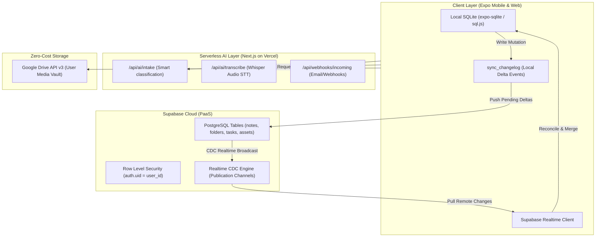

# ScribeX Phase 2: Supabase Realtime Sync, Next.js AI & Google Drive Media Vault

> **Status:** Next in Queue (Pending Kickoff)  
> **Source of Truth:** [Unified_Backend_and_AI_Master_Specification.md](file:///c:/Users/Nash/Documents/codebase/scribeX/docs/Unified_Backend_and_AI_Master_Specification.md)  
> **Prerequisite:** Phase 1 (Universal Manual Note Engine & Local SQLite) 100% completed and certified.

---

## 1. Executive Summary & Objective

Phase 2 transitions ScribeX from a standalone offline notebook to a cloud-synchronized, multi-device workspace with serverless AI backend endpoints and zero-cost user-owned cloud media storage.

### Core Architectural Pillars
1. **Supabase PostgreSQL & Realtime Sync:** Cloud database mirroring local SQLite schemas with Row Level Security (RLS) tenant isolation and Realtime CDC subscriptions.
2. **Deterministic Delta Sync Engine:** Bidirectional event-sourced sync utilizing monotonic `sync_rev` and `sync_changelog` to ensure conflict-free merges and instant offline-to-online catch-up.
3. **Next.js Serverless AI Proxy (Hosted on Vercel):** Route handlers for LLM intake, audio transcription (Whisper STT), and external webhooks without hosting costs.
4. **Zero-Cost Media Vault via Google Drive API:** Store binary assets (images, audio, PDFs, sketches) in user's personal Google Drive while storing lightweight metadata and secure links in Supabase/SQLite.

---

## 2. System Architecture



---

## 3. Detailed Implementation Steps

### Step 1: Supabase Infrastructure & Database Migrations
- Define PostgreSQL migration matching the local SQLite schema:
  - `folders`, `tags`, `notes`, `note_tags`, `tasks`, `reminders`, `assets`, `entity_relations`, `sync_changelog`.
- Configure Row Level Security (RLS) policies on all tables:
  ```sql
  CREATE POLICY "Users can only access their own notes" 
  ON notes FOR ALL 
  USING (auth.uid() = user_id);
  ```
- Enable Supabase Realtime publication on `notes`, `folders`, `tasks`, `tags`, `reminders`, and `sync_changelog`.

### Step 2: Client Delta Sync Protocol & Reconciliation Service
- Create `frontend/src/services/syncEngine.ts`:
  - **Push Pass:** Collect uncommitted entries from local `sync_changelog`, batch push to Supabase, update `last_pushed_rev`.
  - **Pull Pass:** Query Supabase for remote changes where `sync_rev > last_synced_rev`, apply deltas locally via transactional SQLite upserts.
  - **Conflict Resolution:** Last-write-wins (LWW) based on `updated_at` with block-level granular merge for concurrent edits.
- Hook sync triggers:
  - App foreground / network reconnection (`NetInfo`).
  - Debounced (2000ms) push after local note/folder/task mutations.

### Step 3: Google Drive API Media Vault Integration
- Integrate Google OAuth client with scoped drive access (`https://www.googleapis.com/auth/drive.file`).
- Create `frontend/src/services/mediaVaultService.ts`:
  - Upload recorded audio memos, canvas drawings, and camera scans to dedicated `ScribeX_Vault/` folder in Google Drive.
  - Store Drive File ID and thumbnail/download URLs in local `assets` and Supabase `assets` table.

### Step 4: Next.js Serverless AI Proxy Scaffolding (Vercel)
- Scaffold `backend/` Next.js App Router repository.
- Implement `/api/ai/intake` route for classification and structured JSON extraction.
- Implement `/api/ai/transcribe` proxy route for voice memo Whisper transcription.
- Deploy to Vercel free tier with environment variables.

---

## 4. Verification & Quality Gates

1. **Dual-Device E2E Sync Test:** Create note on Device A (iOS/Android) $\rightarrow$ appears within 500ms on Device B (Web).
2. **Offline Resilience Test:** Disconnect network, create 5 notes, reconnect $\rightarrow$ all 5 notes sync without data loss or duplicate IDs.
3. **Media Isolation Test:** Confirm binary files are uploaded to Google Drive without hitting Supabase database bandwidth limits.

