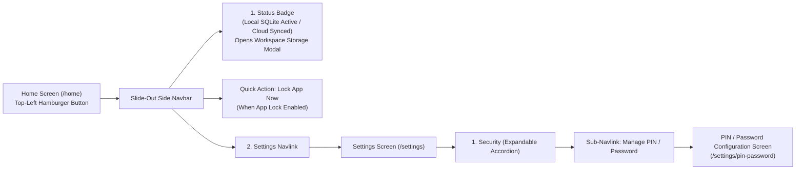

# ScribeX PIN / Password Protection & Vault Security Specification (Task 36)

> **Status:** Approved Design Specification (Aligned via `/grill-me`)  
> **Scope:** App-Start Lock (Authenticated & Guest/Skip-Login modes), Individual Note Lock, Folder Cascade Lock, Hamburger Side Navbar, Expandable Settings Screen, and Centralized PIN/Password Management Screen.  
> **Related Tracker Item:** Task 36 in [`docs/future_ideas.md`](future_ideas.md)

---

## 1. Executive Summary & Core Tenets

ScribeX provides a **zero-knowledge, local-first security layer** that protects the entire app on startup as well as individual notes and folders—working identically whether the user is **logged in (Cloud Synced)** or using **Skip Login (Guest / Local SQLite mode)**.

### Core Architectural Decisions
1. **Dual-Tier Credential Model (Master + Custom Isolation):**
   - **Master Credential:** Used for **App Startup Lock** and 1-tap quick-locking of notes and folders. Supports either a **4/6-digit numeric PIN** or an **Alphanumeric Password** (plus optional Biometric FaceID/TouchID unlock on iOS/Android).
   - **Custom Per-Item Credential:** When locking any individual Note or Folder, the user can choose **"Use Master Credential"** or **"Set Custom PIN/Password"**.
   - **Strict Cryptographic Isolation:** Items locked with a Custom PIN/Password require their own custom PIN/Password to open, view, or permanently unlock—even inside the centralized `Manage PIN / Password` configuration screen. The Master Credential cannot bypass a custom-locked item.
   - **Zero-Knowledge with Optional Hint:** No backdoor bypass exists. Users may optionally configure a non-sensitive **Password/PIN Hint** when creating a Master or Custom credential.
2. **Redacted Preview Shield (Canvas Visibility):**
   - Locked notes remain visible on the Home canvas (`NotesView`) showing only their **Title**, **Pastel Color Token**, **Folder/Timestamp pill**, and a sleek **`Locked` Shield Overlay** (`Lock` icon + `"Protected Note — Tap to Unlock"`).
   - **Zero Content Leakage:** Body markdown, checklists, media previews, full-text body search matches, and projected tasks/reminders in `TasksView` & `NotificationCenterModal` are masked as `"🔒 Locked Task / Reminder"` until the item is unlocked.
3. **Folder Lock Cascade & Hierarchy:**
   - Locking a Folder (e.g., `Work` or `Work/Projects`) acts as both a **Folder Gate** (selecting the folder filter pill or tree node prompts for the folder's credential) and an **Automatic Cascade Shield** (all notes and nested subfolders inside that folder path automatically appear locked across `"All Notes"`, `"Favorites"`, Search, and `TasksView`).
   - If a note inside an unlocked folder also carries its own **Custom PIN/Password**, opening that specific note still prompts for its individual custom credential.
4. **Configurable Session Auto-Relock Lifecycle:**
   - **Default Behavior:** Locked notes automatically re-lock immediately upon exiting the Note Editor (`/note/[id]`), and unlocked folders automatically re-lock when switching away to another folder view (plus a 1-tap `"Lock Now"` pill in the header).
   - **Configurable Timeout:** Users can configure the re-lock grace window in `Manage PIN / Password` (`Immediate on Exit`, `After 1 Minute`, `After 5 Minutes`, `After 15 Minutes`, or `On App Background / Close`).

---

## 2. Navigation & UI Architecture



### 2.1 Top App Bar & Hamburger Side Navbar (`frontend/app/home.tsx`)
- **Top-Left Hamburger Trigger:** Replaces the existing top-left `"Local SQLite Active"` / `"Cloud Synced"` pill in `frontend/app/home.tsx` across all platforms (Web, iOS, Android) with a tactile circular/pill Hamburger Menu button (`Menu` icon from `lucide-react-native`).
- **Slide-Out Side Navbar (`frontend/src/components/navigation/SideNavbarModal.tsx`):**
  1. **Option 1 — Interactive Workspace Status Badge:** Displays the `"• Local SQLite Active"` (when in Guest/Skip mode) or `"• Cloud Synced"` (when authenticated) badge at the top of the drawer. Tapping it opens the existing `WorkspaceSettingsModal` (Database health, Backup/Restore, Empty Trash).
  2. **Option 2 — `Settings` Navlink:** Navigates to `/settings`.
  3. **Conditional Quick Action (`Lock App Now`):** When App Startup Lock is enabled, provides a 1-tap button to immediately lock the active app session.

### 2.2 Settings Screen & Expandable Security Accordion (`frontend/app/settings/index.tsx`)
- Follows ScribeX's full-bleed canvas aesthetic (`bg-light-surface dark:bg-dark-surface`, zero generic boxed wrappers).
- **Settings List:**
  - Contains **1 primary expandable category** for now: **`Security`** (`Shield` icon + title + subtitle `"App startup lock, master credentials, and locked vault items"`).
  - Clicking **`Security`** smoothly expands an inline sub-navigation tree revealing:
    - **`Manage PIN / Password`** (`KeyRound` / `Lock` icon) $\rightarrow$ navigates to `/settings/pin-password`.

### 2.3 Manage PIN / Password Configuration Screen (`frontend/app/settings/pin-password.tsx`)
Divided into three clean, full-bleed canvas sections:
1. **Master Credential & App Startup Lock:**
   - **Master PIN / Password Status:** Set up Master PIN/Password (if not configured), Change Master Credential (requires current Master verification), or update optional Master Hint.
   - **Lock App on Startup Toggle:** Enables/disables the full-screen App Lock Gate on cold start and background resume (works for both Logged-In and Skip-Login Guest users).
   - **Auto-Relock Timeout Selector:** Pill selector (`Immediate`, `1 min`, `5 min`, `15 min`, `On Background`).
   - **Biometric Unlock Toggle (Mobile Only):** Optional FaceID / TouchID convenience for the Master Credential.
2. **Locked Folders Registry:**
   - Lists all folders currently protected (`Folder Name`, `Path`, badge showing `Master Lock` vs `Custom PIN/Password`, and count of cascade-protected notes).
   - **Actions per Folder:** `Unlock (Remove Lock)`, `Change Credential`, or `+ Lock a Folder` picker.
   - *Strict Isolation Enforcement:* Unlocking or modifying a `Master Lock` folder verifies the Master Credential; unlocking or modifying a `Custom Lock` folder prompts for that folder's specific Custom PIN/Password.
3. **Locked Notes Registry:**
   - Lists all individually locked notes (`Note Title`, `Folder Path`, `Color Dot`, badge showing `Master Lock` vs `Custom PIN/Password`, and whether it is also cascade-locked by a parent folder).
   - **Actions per Note:** `Unlock (Remove Lock)`, `Change Credential`, `Open Note`, or `+ Lock a Note` picker.

### 2.4 Contextual Lock Menu Entry Points
1. **Note Card (`NoteCard.tsx`):** Lock/Unlock icon button on the card header/footer action strip.
2. **Note Editor Header (`EditorHeader.tsx`):** Lock status toggle button (`Lock` / `Unlock` icon) in the top bar, plus a `"Re-lock Now"` action when viewing an unlocked note.
3. **Multi-Select Batch Bar (`NotesBatchActionBar.tsx`):** Batch `"Lock Selected"` / `"Unlock Selected"` action button in the top selection bar.
4. **Folder Context Banner & Folder Filter/Tree (`FolderContextBanners.tsx` & `NotesFilterTrack.tsx`):** `"Lock Folder"` / `"Unlock Folder"` button alongside the existing Pin, Favorite, and Archive folder controls.

---

## 3. Database Schema & Cryptographic Storage

### 3.1 SQLite Schema Migrations (`frontend/src/db/schema.ts` & `client.ts`)
We extend SQLite with non-destructive `ALTER TABLE` migrations and a dedicated `workspace_security` table:

```sql
-- 1. Workspace-level Master Security Configuration
CREATE TABLE IF NOT EXISTS workspace_security (
  id TEXT PRIMARY KEY DEFAULT 'default',
  app_lock_enabled INTEGER NOT NULL DEFAULT 0,
  master_credential_type TEXT CHECK(master_credential_type IN ('pin', 'password')) DEFAULT NULL,
  master_hash TEXT DEFAULT NULL,
  master_salt TEXT DEFAULT NULL,
  master_hint TEXT DEFAULT NULL,
  biometrics_enabled INTEGER NOT NULL DEFAULT 0,
  auto_relock_seconds INTEGER NOT NULL DEFAULT 0, -- 0 = immediate on exit
  updated_at TEXT NOT NULL DEFAULT (datetime('now'))
);

-- 2. Note-level Lock Columns on `notes`
ALTER TABLE notes ADD COLUMN is_locked INTEGER NOT NULL DEFAULT 0;
ALTER TABLE notes ADD COLUMN lock_type TEXT CHECK(lock_type IN ('master', 'custom')) DEFAULT NULL;
ALTER TABLE notes ADD COLUMN lock_credential_kind TEXT CHECK(lock_credential_kind IN ('pin', 'password')) DEFAULT NULL;
ALTER TABLE notes ADD COLUMN lock_hash TEXT DEFAULT NULL;
ALTER TABLE notes ADD COLUMN lock_salt TEXT DEFAULT NULL;
ALTER TABLE notes ADD COLUMN lock_hint TEXT DEFAULT NULL;

-- 3. Folder-level Lock Columns on `folders`
ALTER TABLE folders ADD COLUMN is_locked INTEGER NOT NULL DEFAULT 0;
ALTER TABLE folders ADD COLUMN lock_type TEXT CHECK(lock_type IN ('master', 'custom')) DEFAULT NULL;
ALTER TABLE folders ADD COLUMN lock_credential_kind TEXT CHECK(lock_credential_kind IN ('pin', 'password')) DEFAULT NULL;
ALTER TABLE folders ADD COLUMN lock_hash TEXT DEFAULT NULL;
ALTER TABLE folders ADD COLUMN lock_salt TEXT DEFAULT NULL;
ALTER TABLE folders ADD COLUMN lock_hint TEXT DEFAULT NULL;
```

### 3.2 Salted Hashing & Verification (`frontend/src/core/security/pinCrypto.ts`)
- Every PIN or Password is never stored in plaintext.
- Generates a random 16-byte cryptographic salt (`lock_salt`) and computes a multi-round salted SHA-256 / PBKDF2 digest (`lock_hash`).
- Constant-time string comparison prevents timing side-channels.
- Includes brute-force rate limiting in memory (5 failed attempts triggers a 30-second cooldown timer on the unlock keypad/modal).

---

## 4. Runtime Security Context & Session State (`SecurityContext.tsx`)

`SecurityProvider` wraps the app inside `frontend/app/_layout.tsx` (alongside `AuthProvider` and `NotesProvider`):
- **`isAppLocked: boolean`**: `true` on cold launch if `app_lock_enabled === 1` (regardless of whether `isAuthenticated` or `isGuest` is active). Renders the full-screen `AppLockGateModal` blocking access until unlocked.
- **`unlockedNoteIds: Set<string>`**: Ephemeral in-memory set of note IDs unlocked during the current session. Cleared on note exit (when `auto_relock_seconds === 0`), after the configured timer, on manual `"Lock Now"`, or when `AppState` transitions to `background`.
- **`unlockedFolderPaths: Set<string>`**: Ephemeral in-memory set of folder paths unlocked during the current session.
- **Helper Selectors:**
  - `isNoteEffectivelyLocked(note)`: Returns `true` if `note.isLocked` is true OR any ancestor folder in `note.folderPath` has `folder.isLocked === true`, AND the required locks are not currently in `unlockedNoteIds` / `unlockedFolderPaths`.
  - When a folder is locked AND a note inside it also has a custom lock: opening the note from `"All Notes"` requires unlocking the note's effective lock(s).
- **Direct Route Protection (`/note/[id].tsx`):**
  - If a user navigates directly to `/note/[id]` via deep link, notification tap, or browser URL on Web while the note (or its parent folder) is locked, `note/[id].tsx` renders the inline `UnlockPromptModal` before mounting `BlockEditor`.

---

## 5. Phased Implementation Plan

### Phase 1: Database Schema, Cryptographic Utility & Repository Layer
- **Files:**
  - `frontend/src/core/security/pinCrypto.ts` (New: salted hash generation, verification, PIN/Password format validation, rate-limit helper)
  - `frontend/src/db/schema.ts` & `frontend/src/db/client.ts` (Add `workspace_security` table + `ALTER TABLE` migrations for `notes` and `folders`)
  - `frontend/src/db/types.ts` & `frontend/src/types/note.ts` (Add lock fields to `DBNote`, `DBFolder`, `NoteItem`, `FolderItem`, and `WorkspaceSecurityConfig`)
  - `frontend/src/db/securityRepo.ts` (New: CRUD for `workspace_security` and lock/unlock updates for notes and folders)
  - `frontend/src/db/notesRepo.ts` & `frontend/src/state/slices/useFolderStoreActions.ts` (Map lock fields in queries and folder/note store actions; include `workspace_security` in JSON backup/restore)

### Phase 2: `SecurityContext` & Reusable Lock/Unlock Modals
- **Files:**
  - `frontend/src/context/SecurityContext.tsx` (New: Master config state, `isAppLocked`, `unlockedNoteIds`, `unlockedFolderPaths`, `AppState` background listener, auto-relock timers, cascade check helpers)
  - `frontend/src/components/security/PinPasswordPromptModal.tsx` (New: Unified modal for verifying PIN/Password, choosing `'Use Master Credential'` vs `'Set Custom PIN/Password'`, setting optional hint, and displaying brute-force cooldown)
  - `frontend/src/components/security/AppLockScreenOverlay.tsx` (New: Full-bleed startup lock screen rendered over `_layout.tsx` when `isAppLocked` is true)
  - `frontend/app/_layout.tsx` (Mount `SecurityProvider` and `AppLockScreenOverlay`)

### Phase 3: Hamburger Side Navbar, Expandable Settings Screen & Manage PIN/Password Screen
- **Files:**
  - `frontend/src/components/navigation/SideNavbarModal.tsx` (New: Slide-out drawer with Option 1: `"Local SQLite Active" / "Cloud Synced"` interactive badge, Option 2: `Settings` navlink, plus quick `"Lock App Now"` action)
  - `frontend/app/home.tsx` (Replace top-left status badge with Hamburger Menu button across all platforms; wire `SideNavbarModal`)
  - `frontend/app/settings/index.tsx` (New: Settings screen with expandable `Security` accordion revealing `Manage PIN / Password` sub-navlink)
  - `frontend/app/settings/pin-password.tsx` (New: Centralized configuration screen for Master Credential, App Startup Lock toggle, Auto-Relock timer, Locked Folders list, and Locked Notes list with strict custom-credential isolation)

### Phase 4: Contextual Menus, Redacted Previews & Search/Task Masking
- **Files:**
  - `frontend/src/components/notes/NoteCard.tsx` (Render `"Locked"` shield replacing body/checklist preview when effectively locked; add Lock/Unlock button in card actions; intercept tap to open `PinPasswordPromptModal`)
  - `frontend/src/components/notes/NotesBatchActionBar.tsx` (Add batch Lock/Unlock action)
  - `frontend/src/components/notes/FolderContextBanners.tsx` & `frontend/src/components/notes/NotesFilterTrack.tsx` (Add Lock/Unlock folder action, lock icon indicator on locked folders, and PIN/Password prompt when selecting a locked folder)
  - `frontend/src/components/editor/components/EditorHeader.tsx` & `frontend/app/note/[id].tsx` (Lock/Unlock toggle in editor header, `"Re-lock Now"` button, auto-relock on unmount when configured, and route gate on direct navigation)
  - `frontend/src/core/noteQueryEngine.ts`, `frontend/src/components/TasksView.tsx`, & `frontend/src/components/common/NotificationCenterModal.tsx` (Exclude locked note body text from search queries until unlocked; mask tasks/reminders belonging to locked notes as `"🔒 Locked Task"`)

---

## 6. Verification & Quality Gates
- **TypeScript Verification:** `cd frontend && npx tsc --noEmit` (0 errors)
- **Cross-Platform UI/UX Audit:** `npm --prefix frontend run test:uiux` (Update assertions for top-left Hamburger Menu and Side Navbar badge placement)
- **Headless Security & Cascade Unit Suite:** `node scripts/test_pin_password_security.mjs` verifying Master vs. Custom isolation, folder cascade locking, search/task redaction, and auto-relock lifecycle.

