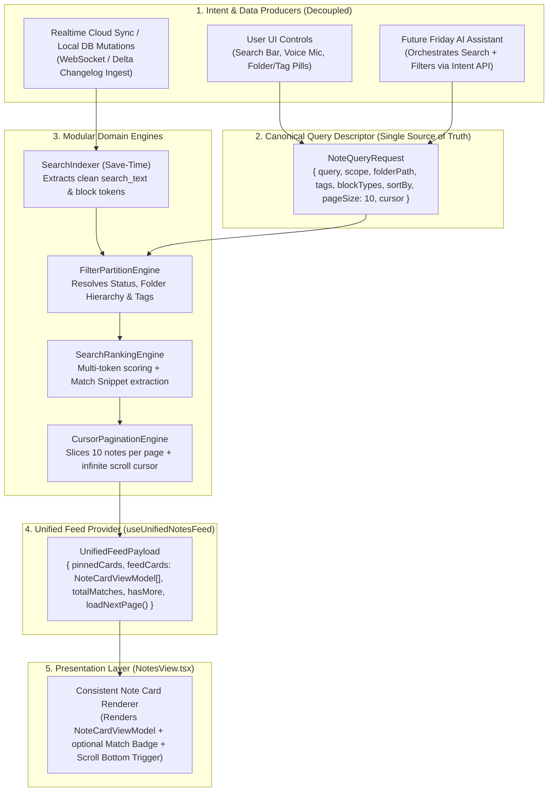

# ScribeX Unified Notes Feed & Universal Local Search — Architecture & Implementation Plan

> **Status:** Architecture & Planning Phase (No code implementation yet)  
> **Related Audit:** [`docs/Block_Storage_and_Searchability_Audit.md`](file:///Users/nash/Documents/FrontEnd%20Development/ai_projects/scribeX/docs/Block_Storage_and_Searchability_Audit.md)  
> **Core Goal:** Establish a **single, unified, paginated Notes Feed & Query Pipeline** that powers normal browsing (`All Notes`), folder/tag/status filtering, ranked text & voice searching, real-time cloud sync ingestion, and future AI Assistant orchestration—guaranteeing **zero UI or data mismatch** on the Home screen.

---

## Prerequisite Architecture: Unified Notes Query, Sync & Feed Pipeline

### Why We Need a Unified Pipeline Before Adding Search
Currently, [`useNotesStore.tsx`](file:///Users/nash/Documents/FrontEnd%20Development/ai_projects/scribeX/frontend/src/state/useNotesStore.tsx) loads all notes at once and [`NotesView.tsx`](file:///Users/nash/Documents/FrontEnd%20Development/ai_projects/scribeX/frontend/src/components/NotesView.tsx) performs ad-hoc array filtering (`activeNotes`, `pinnedNotes`, `displayedNotes`) inside the component. If we bolt search, pagination, cloud sync, or AI assistant filters separately onto `NotesView.tsx`, different views will quickly drift out of sync (e.g., pinned notes duplicating in search results, pagination resetting unpredictably, or AI filters conflicting with folder pills).

Instead, **every** way of viewing notes (Default All Notes, Folder/Tag Filter, Search Query, Cloud Sync Delta, or AI Assistant Action) must flow through **one canonical `NoteQueryEngine` -> `UnifiedNotesFeedProvider` -> `NotesView` card renderer**.



---

### Layer-by-Layer Responsibility Breakdown

#### Layer 1: In-Memory Search Selector (`searchIndexer.ts`) & Upper-Level Workspace Activity Ledger
- **Zero Extra Search Database for Note Content (Single Source of Truth in `notes`):** Because `astSerializer.ts` and `notesRepo.ts` already persist all block content and metadata inside the `notes` table, we do **not** maintain a second search index table for note content. Instead, `buildNoteSearchDocument(note)` runs purely in memory (`useMemo` in `useNotesStore`) to derive clean searchable tiers (`titleLower`, `folderLower`, `tagsLower`, `blockTitlesLower`, `bodyTextLower`, and `cleanPreviewText`).
- **Local SQLite Persistence for Upper-Level Workspace Activity & Search History (Cloud-Sync Ready):** While `ActionHistoryManager.ts` tracks block-level Undo/Redo *inside* a note editor, Layer 1 persists **Search History & Upper-Level Workspace Operations** in local SQLite (alongside `sync_rev` and `sync_changelog` delta entries) so that recent searches and workspace activity survive app restarts locally now and can be synced across devices when the Cloud Sync backend is connected later:
  1. **Local SQLite Search History Table (`search_history`):** Stores user search queries (`id`, `user_id`, `query_text`, `source` `'text' | 'voice' | 'ai'`, `filter_snapshot_json`, `use_count`, `sync_rev`, `last_used_at`) in local SQLite (`schema.ts` + `searchHistoryRepo.ts`) and records `sync_changelog` deltas so search history seamlessly syncs to other devices later.
  2. **Note Lifecycle Operations:** Create, Pin/Unpin, Favorite/Unfavorite, Move to Folder, Tag updates, Archive/Unarchive, Soft-Delete to Trash, Restore, and Permanent Delete.
  3. **Folder & Tag Management:** Create nested folder, Rename folder, Delete folder.
  4. **Global Tasks Board Operations & Realtime Cloud Sync Ingest (`sync_changelog`).**

#### Layer 2: Canonical `NoteQueryRequest` State (AI & UI Orchestration Contract)
Both the human user (clicking pills or typing/speaking in the search bar) and the future **Friday AI Assistant** control the Home screen by reading and updating a single serializable query object:
```ts
export interface NoteQueryRequest {
  searchQuery: string;                  // Typed text or Voice-to-Text transcript
  statusScope: 'active' | 'favorites' | 'archived' | 'trashed' | 'all_non_trashed';
  folderPath?: string | null;           // e.g. "Work/Projects/ScribeX"
  includeSubfolders?: boolean;          // Default true or configurable
  tags?: string[];                      // e.g. ["urgent", "sprint"]
  hasBlockTypes?: BlockType[];          // Allows AI or user to ask: "Show notes with audio or drawing blocks"
  sortBy: 'relevance' | 'updated_desc' | 'created_desc' | 'title_asc';
  pageSize: number;                     // Fixed default: 10 notes per batch
  page: number;                         // Current infinite-scroll page (1, 2, 3...)
}
```
- **Why this makes AI Assistant integration effortless:** When you later ask the AI *"Find my voice notes about the sprint in the Work folder"*, the AI simply dispatches:
  `setQueryRequest({ searchQuery: 'sprint', folderPath: 'Work', hasBlockTypes: ['audio'], sortBy: 'relevance' })`
  and the exact same Home feed updates automatically.

#### Layer 3: Decoupled Processing Pipeline (`frontend/src/core/noteQueryEngine.ts`)
Every time `NoteQueryRequest` or the underlying `notes` store changes, the pipeline runs three deterministic stages:
1. **Stage A — Scope & Filter Partitioning:**
   - Filters by `statusScope` (`active`, `favorites`, `archived`, `trashed`), `folderPath`, `tags`, and optional `hasBlockTypes`.
   - Computes global badge counts (`All Notes`, `Favorites`, `Trash`, per-folder counts) so filter pills never show stale numbers.
2. **Stage B — Search Scoring & Match Snippet Resolution:**
   - **If `searchQuery` is empty:** Preserves standard chronological ordering (`updatedAt DESC`), separating `pinnedNotes` (top shelf) and `unpinnedNotes` (main grid), with `matchSnippet = undefined`.
   - **If `searchQuery` is active:** Runs the Multi-Token Ranked Scoring Engine across the filtered partition, attaches `matchScore` and `matchBadge` (e.g. `🎨 Sketch: "System Topology"`) to each matching note, and orders by `relevance DESC` (with pinned matches either boosted or shown in a unified ranked list so cards never duplicate).
3. **Stage C — Dynamic 10-Note Pagination Engine (`pageSize = 10`):**
   - Slices the resolved list into batches of **10 notes at a time** (`visibleCount = page * 10`).
   - Exposes `{ visibleNotes, totalMatchingCount, hasMore, isLoadingMore, loadNextPage, resetPagination }`.
   - Whenever `searchQuery`, `statusScope`, `folderPath`, or `tags` change, `page` automatically resets to `1` (first 10 notes).
   - When the user scrolls near the bottom of `NotesView.tsx` (`onMomentumScrollEnd` / `onScroll` threshold within `160px` of the bottom), `loadNextPage()` increments `page` and seamlessly appends the next 10 relevant notes.

#### Layer 4: Unified Card View-Model (`NoteCardViewModel`)
`NotesView.tsx` never inspects raw markdown or guesses how to render a card. The Unified Provider outputs a consistent `NoteCardViewModel[]`:
```ts
export interface NoteCardViewModel {
  note: NoteItem;
  cleanPreviewText: string;             // Pre-cleaned 2-line preview (stripped of <!-- scribex:block --> comments)
  matchBadge?: {                        // Present ONLY when a search query matched a specific block/field
    iconType: BlockType | 'title' | 'tag' | 'folder';
    label: string;                      // e.g. "Sketch", "Audio", "Task", "Scan"
    snippet: string;                    // e.g. "System Topology Diagram"
  };
  score?: number;
}
```
*(Bonus fix: Notice in your screenshot how `Untitled Note` currently displays raw `<!-- scribex:block type=diagram data='...' -->` in its card preview. `cleanPreviewText` in `NoteCardViewModel` will automatically replace raw HTML comment syntax with clean human-readable summaries on all note cards!)*

---

## Core Feature Pillars (Built on Top of the Unified Pipeline)

### Pillar 1: Pre-Extracted Search Index (`search_text` — Save-Time Extraction, Zero Search-Time Overhead)

#### Why Not Query Raw `content_markdown` or `blocks_json`?
1. **Binary & Coordinate Pollution:** `blocks_json` and `content_markdown` store base64 media payloads (`data:audio/webm;base64,...`), raw SVG path coordinates (`M 12.4 88.1 L...`), and internal HTML comment syntax (`<!-- scribex:block type=kanban ... -->`).
2. **Zero Media-to-Text Conversion at Search Time:** Search never runs heavy OCR or audio-to-text conversion while typing. All media blocks rely strictly on their saved human-readable metadata fields.

#### Save-Time Extraction Matrix (`frontend/src/core/searchIndexer.ts`)

| Division | Block Types | Extracted Fields for Search Index | Excluded (Ignored) Fields |
| :--- | :--- | :--- | :--- |
| **Note Header** | Note-level metadata | `title`, `folderPath`, `tags[]` | `id`, `colorToken`, timestamps |
| **Division A: Core Text, Lists & Code** | `paragraph`, `heading`, `quote`, `callout`, `code`, `equation`, `bulleted_list`, `numbered_list`, `checklist`, `toggle`, `table` | `block.content`, `metadata.items[].text`, `metadata.title` (toggle), `metadata.fileName` & `language` (code), `metadata.columns` & `rows` (table) | Internal task IDs (`id=task-...`), style flags, boolean `checked` state |
| **Division B: Structured & Productivity** | `habit`, `kanban`, `event`, `contact`, `expense`, `reading`, `meeting_notes`, `lecture_note`, `message_thread`, `web_clip`, `bookmark`, `location`, `sheet`, `diagram`, `note_link` | `title`, `name`, `subject`, `merchant`, `author`, `speaker`, `placeName`, `address`, `company`, `role`, `email`, `phone`, `summary`, `decisions[]`, `actionItems[].text`, `checkpoints[].note`, `messages[].content`, `highlights[]`, `description`, `tabs[].columns/rows`, `targetNoteTitle` | Streak history maps, kanban column colors/IDs, geo lat/lng floats, preview thumbnail URLs |
| **Division C: Media & Binary Blocks** | `image`, `video`, `audio`, `voice_dictation`, `scan`, `file`, `drawing` | • `image`: `metadata.caption`<br>• `video`: `metadata.caption`, `metadata.transcript`<br>• `audio`: `metadata.title`, `metadata.caption`, `metadata.transcription`<br>• `voice_dictation`: `metadata.transcript`<br>• `scan`: `metadata.documentName`, `metadata.ocrText`<br>• `file`: `metadata.fileName`<br>• `drawing`: `metadata.title`, `metadata.caption` | Base64 data URIs, blob URLs, `waveform[]` numbers, `sizeBytes`, SVG vector `paths[]` |
| **Division D: Structural** | `divider` | *(None)* | `---` |

---

### Pillar 2: Multi-Token Ranked Scoring Engine (Accuracy & Relevance)

User queries (e.g., `"sprint architecture audio"`) are tokenized into normalized search terms (`["sprint", "architecture", "audio"]`) and scored against each note's pre-extracted fields:

| Match Tier | Target Field(s) | Score Boost | Rationale |
| :--- | :--- | :--- | :--- |
| **Tier 1: Note Title** | `note.title` (Exact / Prefix / Substring) | **+100 pts** (Exact/Prefix)<br>**+75 pts** (Substring) | Highest user intent when searching by note title. |
| **Tier 2: Organization** | `note.tags[]`, `note.folderPath` | **+60 pts** | Rapidly surfaces project folders and tagged collections. |
| **Tier 3: Block Titles & Media Captions** | Media `caption`/`title`, `fileName`, `documentName`, `bookmark.title`, `event.title`, `contact.name`, `expense.merchant`, `reading.title` | **+45 pts** | Directly surfaces labeled sketches, voice memos, PDFs, bookmarks, and structured cards. |
| **Tier 4: Body Text & Transcripts** | Paragraph/list/table/code content, `audio.transcription`, `voice_dictation.transcript`, `scan.ocrText`, meeting/lecture notes | **+20 pts** | Matches deep body text, checklists, and speech/OCR transcripts. |
| **Multi-Token Completeness Multiplier** | Note matches **all** query tokens (`AND` match) | **×1.5 multiplier** | Ensures multi-word voice or text queries prioritize notes containing every word over partial hits. |

---

### Pillar 3: Matched-Block Snippet Preview & Clean Card Previews

1. **Clean Human-Readable Previews Always (Default & Search):**
   - Strip `<!-- scribex:block ... -->` comments from card previews so notes starting with Diagrams, Kanbans, Habits, or Media blocks show clean summaries (e.g., `📐 Diagram: System Topology & Data Flow`) instead of raw JSON comments.
2. **Contextual Match Badge During Search:**
   - When a search query matches a specific block inside a note, display a compact badge on the card showing *why* it matched:
     - 🎨 **Sketch:** *"System Topology Diagram"*
     - 🎙️ **Audio:** *"Q4 Product Roadmap Sync"*
     - 🖼️ **Image:** *"Whiteboard wireframes"*
     - 🎬 **Video:** *"React Native Skia keynote"*
     - 📎 **File:** *"Architecture_Spec_v2.pdf"*
     - 📄 **Scan:** *"Invoice #4092 — AWS Cloud"*
     - ☑️ **Task:** *"Configure SQLite WAL mode"*

---

### Pillar 4: Universal Search Bar UI, Voice-to-Text Search & Infinite Scroll Pagination

1. **Universal Search Bar (Replaces Quick Capture in `NotesView.tsx`):**
   - Leading `Search` icon + `TextInput` (`"Search notes, tasks, audio, sketches, or files..."`).
   - Trailing `×` button to clear the search query and reset to page 1.
   - **Mic Button (Voice-to-Text Search):** Toggles live speech recognition directly into `searchQuery` (using Web `SpeechRecognition` on Web with real-time streaming tokens, and native recording/STT adapter hook on mobile).
2. **Dynamic 10-Note Pagination with Scroll-to-Bottom Auto-Load:**
   - Initially renders up to **10 notes** (`PAGE_SIZE = 10`).
   - ScrollView `onScroll` (throttled `scrollEventThrottle={16}`) detects when the user reaches within `160px` of the bottom and automatically triggers `loadNextPage()`, appending the next 10 ranked/filtered notes.
   - Subtle footer indicator at the bottom of the grid:
     - When `hasMore === true`: *"Showing 10 of 24 notes • Scroll for more"* (plus a tappable *"Load More"* fallback for large desktop monitors where 10 cards might not overflow the viewport height).
     - When `hasMore === false`: *"All matching notes loaded"*.

---

## Phased Implementation Tracker (4 Modular Phases)

> **Execution Strategy:** Build bottom-up in 4 isolated phases so each layer is independently verifiable before touching the Home screen search UI.

### Phase 1: Pure In-Memory Data & View-Model Layer (`frontend/src/core/searchIndexer.ts`)
- **Status:** `[x] Completed`
- **Scope & Deliverables:**
  - [x] Create standalone `frontend/src/core/searchIndexer.ts` with zero UI or extra DB dependencies.
  - [x] Implement `buildNoteSearchDocument(note)` to extract tiered searchable tokens across all 34 block types directly from existing `note.blocks` metadata (saved by `astSerializer.ts`):
    - **Tier 1:** `titleText` (`note.title`)
    - **Tier 2:** `organizationText` (`note.folderPath`, `note.tags[]`)
    - **Tier 3:** `mediaAndBlockTitles` (`caption`, `title`, `fileName`, `documentName`, `merchant`, `placeName`, etc.)
    - **Tier 4:** `bodyAndTranscripts` (paragraphs, lists, tables, code, `transcription`, `transcript`, `ocrText`, structured notes)
    - Strictly exclude base64 `data:...` URIs, binary URLs, and SVG `paths[]`.
  - [x] Implement `formatCleanNotePreview(note)` to strip raw `<!-- scribex:block ... -->` comments and generate human-readable 2-line card previews (e.g. `📐 Diagram: System Topology & Data Flow`).
  - [x] Wire derived `searchIndexMap` via `useMemo` in [`useNotesStore.tsx`](file:///Users/nash/Documents/FrontEnd%20Development/ai_projects/scribeX/frontend/src/state/useNotesStore.tsx) (no redundant search DB table).

---

### Phase 2: Modular Query, Filter, Ranking & Pagination Engine (`frontend/src/core/noteQueryEngine.ts`)
- **Status:** `[x] Completed`
- **Scope & Deliverables:**
  - [x] Create pure pipeline module `frontend/src/core/noteQueryEngine.ts`.
  - [x] Define canonical `NoteQueryRequest` (`searchQuery`, `statusScope`, `folderPath`, `includeSubfolders`, `tags`, `hasBlockTypes`, `sortBy`, `pageSize: 10`, `page`) and `NoteCardViewModel` interfaces.
  - [x] Implement **Stage A (`FilterPartitionEngine`)**: Resolve status scopes (`active`, `favorites`, `archived`, `trashed`), folder hierarchy paths, tag filters, and block-type filters, plus compute live badge counts.
  - [x] Implement **Stage B (`SearchRankingEngine`)**:
    - When `searchQuery` is empty: preserve chronological order (`updatedAt DESC`) and split `pinnedCards` vs `feedCards`.
    - When `searchQuery` is active: run multi-token weighted scoring (`+100` Title, `+60` Tags/Folder, `+45` Media/Block Titles, `+20` Body/Transcripts, `×1.5` AND-completeness multiplier) and extract `matchBadge` (`iconType`, `label`, `snippet`).
  - [x] Implement **Stage C (`CursorPaginationEngine`)**: Slice resolved cards into batches of **10 notes at a time** (`visibleCount = page * 10`), returning `{ pinnedCards, feedCards, totalMatches, hasMore, currentPage }`.

---

### Phase 3: Modular `<NoteCard />` Component & Unified Feed Provider (`NoteCard.tsx` & `useNotesStore.tsx`)
- **Status:** `[x] Completed`
- **Scope & Deliverables:**
  - [x] Extract duplicate note card JSX out of [`NotesView.tsx`](file:///Users/nash/Documents/FrontEnd%20Development/ai_projects/scribeX/frontend/src/components/NotesView.tsx) into a single reusable component: `frontend/src/components/notes/NoteCard.tsx`.
  - [x] Render `NoteCardViewModel` inside `<NoteCard />`:
    - Folder & tag pills + Pin, Favorite, Archive, Restore, and Trash actions
    - Note title + `viewModel.cleanPreviewText` (no raw HTML comments)
    - Optional contextual `viewModel.matchBadge` pill (`🎨 Sketch`, `🎙️ Audio`, `🖼️ Image`, `📎 File`, `☑️ Task`, etc.) when returned by search or AI filter.
  - [x] Upgrade [`useNotesStore.tsx`](file:///Users/nash/Documents/FrontEnd%20Development/ai_projects/scribeX/frontend/src/state/useNotesStore.tsx) to maintain the pre-extracted search index map and expose the Unified Feed contract:
    - `queryRequest`, `setSearchQuery`, `setQueryRequest` (ready for UI & future Friday AI Assistant orchestration)
    - `pinnedCards`, `feedCards`, `totalMatches`, `hasMore`, `loadNextPage`, `resetPagination`
    - `upsertSyncedNote(note)` entry point for future real-time Cloud Sync delta ingestion.

---

### Phase 4: Universal Search Bar, Voice-to-Text Mic & Infinite Scroll in [`NotesView.tsx`](file:///Users/nash/Documents/FrontEnd%20Development/ai_projects/scribeX/frontend/src/components/NotesView.tsx)
- **Status:** `[x] Completed`
- **Scope & Deliverables:**
  - [x] Replace the old *"Capture a thought, task, or paste markdown..."* box in [`NotesView.tsx`](file:///Users/nash/Documents/FrontEnd%20Development/ai_projects/scribeX/frontend/src/components/NotesView.tsx) with the **Universal Search Bar**:
    - Instant text search input (`"Search notes, tasks, audio, sketches, or files..."`) + Clear (`×`) button.
    - **Voice-to-Text Mic Button:** Live speech recognition on Web (`SpeechRecognition` / `webkitSpeechRecognition`) and native mobile voice search state with pulsing active indicator.
  - [x] Replace inline card loops in `NotesView.tsx` with `<NoteCard />` consuming `pinnedCards` and `feedCards` from the Unified Feed Provider.
  - [x] Wire 10-note infinite scroll pagination on the main `ScrollView` (`onScroll` bottom threshold trigger -> `loadNextPage()`) + footer status indicator (*"Showing X of Y notes • Scroll for more"* / *"Load More"* button).
  - [x] Run full verification gates: `npx tsc --noEmit`, `npm run audit:all`, and `node scripts/test_cross_platform_ui_ux.mjs`.

---

### Phase 5: Local SQLite Search & Workspace History Persistence (Cloud-Sync Ready) (`schema.ts` & `searchHistoryRepo.ts`)
- **Status:** `[x] Completed`
- **Why Local DB for Search History (Unlike Note Content Index):**
  - While note content search indexing (`searchIndexer.ts`) is derived in-memory from `notes` to avoid duplicate note storage, **user search history (`recentSearches`) and upper-level workspace activity** are independent user data that are *not* stored inside any note's AST.
  - Persisting search history in local SQLite (`expo-sqlite` on iOS/Android, `sql.js` + IndexedDB on Web) ensures recent searches survive app restarts offline today and can be replicated across devices via `sync_changelog` when the Cloud Sync backend is implemented later.
- **Scope & Deliverables:**
  - [x] **SQLite Schema Extension ([`frontend/src/db/schema.ts`](file:///Users/nash/Documents/FrontEnd%20Development/ai_projects/scribeX/frontend/src/db/schema.ts)):**
    ```sql
    CREATE TABLE IF NOT EXISTS search_history (
      id TEXT PRIMARY KEY,
      user_id TEXT NOT NULL,
      query_text TEXT NOT NULL,
      source TEXT CHECK(source IN ('text', 'voice', 'ai')) NOT NULL DEFAULT 'text',
      filter_snapshot_json TEXT DEFAULT '{}',
      use_count INTEGER NOT NULL DEFAULT 1,
      sync_rev INTEGER NOT NULL DEFAULT 0,
      created_at DATETIME NOT NULL DEFAULT CURRENT_TIMESTAMP,
      last_used_at DATETIME NOT NULL DEFAULT CURRENT_TIMESTAMP,
      UNIQUE (user_id, query_text)
    );
    CREATE INDEX IF NOT EXISTS idx_search_history_recent ON search_history(user_id, last_used_at DESC);
    ```
  - [x] **Local Repository ([`frontend/src/db/searchHistoryRepo.ts`](file:///Users/nash/Documents/FrontEnd%20Development/ai_projects/scribeX/frontend/src/db/searchHistoryRepo.ts)):**
    - `loadRecentSearches(limit = 8)`: Loads most recent searches ordered by `last_used_at DESC`.
    - `upsertSearchQuery(queryText, source, filterSnapshot)`: Deduplicates by `LOWER(query_text)`, increments `use_count`, updates `last_used_at`, increments `sync_rev`, and appends a delta entry to `sync_changelog` (`entity_type = 'search_history'`) for future multi-device cloud sync.
    - `deleteSearchHistoryItem(id)` & `clearAllSearchHistory()`: Removes entries locally and logs `delete` deltas in `sync_changelog`.
  - [x] **Store Hydration ([`frontend/src/state/useNotesStore.tsx`](file:///Users/nash/Documents/FrontEnd%20Development/ai_projects/scribeX/frontend/src/state/useNotesStore.tsx)):**
    - Hydrate `recentSearches` from `searchHistoryRepo.loadRecentSearches()` on boot alongside `notes` and `tasks`.
    - Connect `recordSearchHistory(query)`, `deleteSearchHistoryItem(query)`, and `clearSearchHistory()` in `useNotesStore.tsx` to persist into `searchHistoryRepo`.
