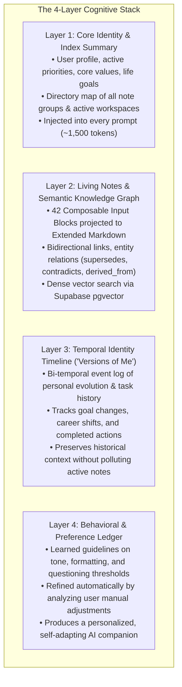

# ScribeX Unified Backend & Universal AI Master Specification

> **Document Classification:** Master High-Level Specification & Single Source of Truth (SSOT)  
> **Scope:** Cloud Backend, Real-Time Synchronization, Client-Direct AI, Single Source of Action, and Universal MCP Connector  
> **Design Philosophy:** Local-First, Zero-Cloud-Cost ($0/mo Hosting), Client-Direct AI (Zero-Server-Intervention), and Universal Action Symmetry  
> **Status:** Authoritative Architectural Master

---

## 1. Executive Summary & Core Architectural Goals

ScribeX is a local-first personal intelligence operating system and universal note-taking canvas. The system transitions from a standalone offline notebook into a cloud-synchronized, multi-device intelligence platform via five non-negotiable tenets:

1. **Manual Canvas First, AI Assistant Second:**  
   The foundation of ScribeX is a friction-free note-taking engine with sub-2ms local SQLite speed. The user is never blocked by forced AI onboarding, mandatory categorization, or network spinners. Human manual typing, block reordering, and task checking execute 100% offline directly against local SQLite.
2. **Single Source of AI Orchestration (SSAO — Direct Supabase RPC):**  
   Every AI action across the entire ScribeX ecosystem—whether invoked by **In-App Friday on Mobile**, **In-App Friday on Web**, **Claude Desktop via MCP**, **ChatGPT via Custom Actions**, or **Cursor/Antigravity**—executes through the **exact same Supabase PostgreSQL RPCs** (`create_note`, `toggle_task`, `schedule_reminder`, `search_vault`). There is no duplicate local orchestration for AI, eliminating dual-maintenance bugs and state drift.
3. **Instant Realtime CDC Convergence:**  
   When any AI assistant executes an action via Supabase RPC, Supabase commits the transaction, appends a monotonic delta to `sync_changelog`, and immediately broadcasts the event via Supabase Realtime CDC to all connected devices in ~50ms. Local client apps receive the delta, apply it to local SQLite, update the UI, and register or cancel native hardware push alarms.
4. **Client-Direct AI (Zero-Server-Intervention BYOK):**  
   The in-app AI assistant on Mobile and Web interacts directly with cloud AI model providers (OpenAI, Google Gemini, Anthropic Claude) using the user's locally stored API keys. Context gathering, prompt assembly, and LLM completions happen directly on the device with zero server proxy overhead. Once the LLM selects a tool action, the device dispatches it straight to the Supabase RPC endpoint.
5. **Zero-Cost Cloud Infrastructure ($0/mo Baseline):**  
   * **Supabase Cloud:** Managed PostgreSQL 15+, Supabase Realtime (CDC), Supabase Auth, Row-Level Security (`RLS`), and `pgvector` semantic embeddings.
   * **Google Drive API v3:** User-owned media storage utilizing each user’s free 15 GB Google Drive quota for binary assets (audio recordings, camera scans, drawings, PDFs).

---

## 2. High-Level System Architecture

```mermaid
flowchart TD
    subgraph HumanInput ["1. Human Manual Actions (Local-First Canvas)"]
        A1["User Manual Input<br>(Taps, Typing, Checklists, Drag-and-Drop)"]
        A2[("Local SQLite Ledger (expo-sqlite / Wasm)<br>• Sub-2ms optimistic reads/writes<br>• 100% Offline Capability")]
    end

    subgraph AllAI ["2. All AI Assistants & Surfaces"]
        C1["In-App Assistant: Mobile Friday<br>(BYOK Direct LLM)"]
        C2["In-App Assistant: Web Friday<br>(BYOK Direct LLM)"]
        C3["Universal AI Connector (connector/)<br>• Claude Desktop (MCP Client)<br>• Cursor / Antigravity<br>• ChatGPT Custom Actions"]
    end

    subgraph SupabasePaaS ["3. Supabase Cloud (Single Source of AI Orchestration)"]
        B1["PostgreSQL RPC Tool Layer (90% Data Actions)<br>• create_note()<br>• toggle_task()<br>• schedule_reminder()<br>• search_vault()"]
        B2[("PostgreSQL Tables<br>• notes, folders, tasks, reminders<br>• sync_changelog with monotonic sync_rev<br>• Row-Level Security (auth.uid = user_id)")]
        B3["Supabase Realtime CDC Engine<br>(Instant multi-device WebSocket broadcast)"]
    end

    subgraph NextjsBackend ["4. Serverless Micro-Routes (10% Complex Actions)"]
        E1["Next.js on Vercel ($0 Hosting)<br>• /api/ai/transcribe (Whisper STT)<br>• /api/clip-webpage (Readability parser)<br>• /api/auth/google-drive (OAuth secret exchange)<br>• /api/webhooks/* (Stripe billing / webhooks)"]
    end

    subgraph DeviceRuntimes ["5. Local Device Notification & Alarm Dispatch"]
        D1["Hardware Push Notification Service<br>• Android AlarmManager (MAX heads-up)<br>• iOS UNUserNotificationCenter<br>• Web Browser Notification API"]
    end

    A1 -->|Instant Local Write (2ms)| A2
    A2 <-->|Silent Background CDC Sync| B3

    C1 -->|90% Vault Tools| B1
    C2 -->|90% Vault Tools| B1
    C3 -->|90% Vault Tools| B1

    C1 -.->|10% Heavy Media| E1
    C2 -.->|10% Heavy Media| E1
    C3 -.->|10% Heavy Media| E1
    E1 -->|Saves Resulting Note/Task| B1

    B1 -->|Atomic Commit & Log Delta| B2
    B2 -->|Realtime Change Event| B3
    B3 -->|Instant Delta Push (50ms)| A2
    B3 -->|Triggers/Cancels Native Push Alarms| D1
```

---

## 3. Single Source of AI Orchestration (Direct Supabase RPC) & Client-Direct BYOK

### 3.1. Zero-Server Client-Direct Model (BYOK)
* **Direct Provider Integration:** The app holds the user's API key locally in secure device storage (`SecureStore` on mobile, encrypted localStorage on web).
* **Direct Transport:** When the user prompts the in-app assistant (Friday), the client device packages the 4-layer context and calls `generativelanguage.googleapis.com`, `api.anthropic.com`, or `api.openai.com` directly via standard HTTPS.
* **No Middleman Server:** No backend server processes, logs, or proxies the conversation. The app runs with maximum privacy, zero server egress overhead, and optimal latency.

### 3.2. Single Source of AI Orchestration (SSAO via Supabase RPC)
To eliminate duplicate orchestration code and avoid concurrent write locks on the local client device:
* **All AI Actions Run on Supabase RPC:** Whether an action is triggered by the **in-app Friday assistant (Mobile/Web)**, **Claude Desktop (MCP)**, **Cursor**, or **ChatGPT Custom Actions**, the action executes through the **exact same Supabase PostgreSQL RPC functions** (`rpc/create_note`, `rpc/toggle_task`, `rpc/schedule_reminder`).
* **Zero Local Device AI Orchestration:** The client app does not manage complex local AI write queues or separate local tool dispatchers. All AI actions execute in the cloud database in 40–80ms.
* **Atomic PostgreSQL Guarantees:**
  1. Every RPC validates block AST schemas before committing.
  2. Every RPC automatically appends an entry to `sync_changelog` with an incrementing `sync_rev`.
  3. When an AI completes a task, the RPC automatically updates the `reminders` table to cancel the pending alarm in the same atomic transaction.

### 3.3. Instant Real-Time CDC Convergence & Hardware Alarm Dispatch
* When Supabase commits an RPC transaction, the **Supabase Realtime CDC engine** broadcasts the delta event to all connected devices in ~50ms.
* **Screen Convergence:** All active devices (Mobile, Laptop, Web) receive the CDC delta and apply it to their local SQLite databases, updating the UI in real time.
* **Hardware Alarm Convergence:** If an AI created or completed a task with a reminder:
  * The mobile device's background sync listener ingests the delta.
  * The mobile device's local `NotificationService` registers or cancels the native OS hardware alarm (`AlarmManager` with a MAX heads-up channel on Android, `UNUserNotificationCenter` on iOS).
* **Result:** Actions taken from any AI surface (in-app Friday or external Claude Desktop) appear live across all screens and trigger native phone alarms synchronously.

### 3.4. Architectural Defense: Why Local SQLite + Supabase CDC Beats Direct Cloud + Flat Files
A critical architectural evaluation was conducted on whether to eliminate Local SQLite in favor of direct Supabase writes with flat-file offline fallback. The analysis established that **Local SQLite must remain the primary local engine** for four non-negotiable reasons:

1. **The Keystroke Budget (1.5ms vs 120ms):** Typing in a canvas requires sub-16ms latency. Local SQLite commits in ~1.5ms, guaranteeing buttery smooth typing, zero cursor jumping, and immediate checklist responsiveness. Direct cloud writes add 80–300ms network roundtrips to every keystroke or state change.
2. **The Elevator Trap (Spotty Internet Resilience):** Real-world networks drop irregularly. A direct-to-cloud app encounters 10–30s TCP timeouts in elevators or tunnels, freezing the UI before discovering it is offline. With Local SQLite, the UI never waits for network—it saves instantly to disk, and the background sync engine handles transmission whenever connectivity resumes.
3. **Sub-5ms Offline Search & Relational Queries:** With Local SQLite, full-text search, tag sorting, and graph queries across 5,000 notes execute in under 3ms offline. Storing offline notes in flat files would require loading all notes into RAM and writing a custom query engine in JavaScript.
4. **The Industry Standard Gold Standard:** This Local-First with Optimistic Sync pattern is the exact proven architecture powering **Linear, Apple Notes, Superhuman, and WhatsApp**. It guarantees zero user-perceived latency while maintaining continuous cloud synchronization.

### 3.5. Universal Invocation Platform Context (`PlatformContext`)
While all AI interactions share the **exact same 4-layer cognitive memory stack and tool catalog**, every AI prompt assembly and tool execution receives a standardized `PlatformContext` metadata envelope. This makes the AI assistant and the database fully conscious of the physical device or external runtime executing the command:

```typescript
export interface PlatformContext {
  /** The calling runtime surface */
  platform: 'mobile_native' | 'web_browser' | 'desktop_mcp' | 'cursor_antigravity' | 'chatgpt_custom_action';
  /** Persistent device installation UUID */
  device_id: string;
  /** Hardware & runtime capabilities */
  runtime_capabilities: {
    can_schedule_hardware_alarms: boolean; // True on mobile native (AlarmManager / UNUserNotificationCenter)
    has_active_display: boolean;           // True on mobile/web foreground; false on headless MCP
    supports_local_file_system: boolean;   // True on mobile native and desktop MCP daemon
    supports_optimistic_ui: boolean;       // True on mobile/web React Native client
  };
  /** Device clock & temporal reference */
  client_timestamp: string; // ISO 8601 string from device clock
  timezone: string;         // e.g. "Asia/Kolkata", "America/New_York"
}
```

#### How Platform Context Powers the Unified System:
1. **Context-Aware Prompt Formulation:**  
   The AI companion (Friday or external Claude) knows where the user is communicating from and adapts its responses appropriately:  
   * When asked *"Remind me in 30 minutes"* on **Mobile**, the AI confirms: *"Alarm set for 6:15 PM directly on this phone."*  
   * When asked on **Claude Desktop (MCP)** or **ChatGPT Web**, the AI confirms: *"Reminder saved; your phone will alert you at 6:15 PM."*
2. **Audit Traceability in `sync_changelog`:**  
   Every RPC call passes `p_caller_platform: text`. The changelog explicitly tags whether an edit was made by `mobile_native`, `web_browser`, `desktop_mcp`, or `chatgpt_custom_action`, preserving perfect historical audit fidelity in Layer 3 ("Versions of Me").
3. **Smart Hardware Alarm Routing:**  
   When an external platform (`desktop_mcp` or `chatgpt_custom_action`) invokes `rpc/schedule_reminder`, Supabase recognizes that the caller cannot sound a native alarm itself. Supabase Realtime CDC immediately triggers high-priority downstream delivery to the user's registered physical mobile device(s), ensuring the mobile app's local `NotificationService` registers the native hardware push alarm without delay.

### 3.4. Architectural Defense: Why Local SQLite + Supabase CDC Beats Direct Cloud + Flat Files
A critical architectural evaluation was conducted on whether to eliminate Local SQLite in favor of direct Supabase writes with flat-file offline fallback. The analysis established that **Local SQLite must remain the primary local engine** for four non-negotiable reasons:

1. **The Keystroke Budget (1.5ms vs 120ms):** Typing in a canvas requires sub-16ms latency. Local SQLite commits in ~1.5ms, guaranteeing buttery smooth typing, zero cursor jumping, and immediate checklist responsiveness. Direct cloud writes add 80–300ms network roundtrips to every keystroke or state change.
2. **The Elevator Trap (Spotty Internet Resilience):** Real-world networks drop irregularly. A direct-to-cloud app encounters 10–30s TCP timeouts in elevators or tunnels, freezing the UI before discovering it is offline. With Local SQLite, the UI never waits for network—it saves instantly to disk, and the background sync engine handles transmission whenever connectivity resumes.
3. **Sub-5ms Offline Search & Relational Queries:** With Local SQLite, full-text search, tag sorting, and graph queries across 5,000 notes execute in under 3ms offline. Storing offline notes in flat files would require loading all notes into RAM and writing a custom query engine in JavaScript.
4. **The Industry Standard Gold Standard:** This Local-First with Optimistic Sync pattern is the exact proven architecture powering **Linear, Apple Notes, Superhuman, and WhatsApp**. It guarantees zero user-perceived latency while maintaining continuous cloud synchronization.

### 3.5. Universal Invocation Platform Context (`PlatformContext`)
While all AI interactions share the **exact same 4-layer cognitive memory stack and tool catalog**, every AI prompt assembly and tool execution receives a standardized `PlatformContext` metadata envelope. This makes the AI assistant and the database fully conscious of the physical device or external runtime executing the command:

```typescript
export interface PlatformContext {
  /** The calling runtime surface */
  platform: 'mobile_native' | 'web_browser' | 'desktop_mcp' | 'cursor_antigravity' | 'chatgpt_custom_action';
  /** Persistent device installation UUID */
  device_id: string;
  /** Hardware & runtime capabilities */
  runtime_capabilities: {
    can_schedule_hardware_alarms: boolean; // True on mobile native (AlarmManager / UNUserNotificationCenter)
    has_active_display: boolean;           // True on mobile/web foreground; false on headless MCP
    supports_local_file_system: boolean;   // True on mobile native and desktop MCP daemon
    supports_optimistic_ui: boolean;       // True on mobile/web React Native client
  };
  /** Device clock & temporal reference */
  client_timestamp: string; // ISO 8601 string from device clock
  timezone: string;         // e.g. "Asia/Kolkata", "America/New_York"
}
```

#### How Platform Context Powers the Unified System:
1. **Context-Aware Prompt Formulation:**  
   The AI companion (Friday or external Claude) knows where the user is communicating from and adapts its responses appropriately:  
   * When asked *"Remind me in 30 minutes"* on **Mobile**, the AI confirms: *"Alarm set for 6:15 PM directly on this phone."*  
   * When asked on **Claude Desktop (MCP)** or **ChatGPT Web**, the AI confirms: *"Reminder saved; your phone will alert you at 6:15 PM."*
2. **Audit Traceability in `sync_changelog`:**  
   Every RPC call passes `p_caller_platform: text`. The changelog explicitly tags whether an edit was made by `mobile_native`, `web_browser`, `desktop_mcp`, or `chatgpt_custom_action`, preserving perfect historical audit fidelity in Layer 3 ("Versions of Me").
3. **Smart Hardware Alarm Routing:**  
   When an external platform (`desktop_mcp` or `chatgpt_custom_action`) invokes `rpc/schedule_reminder`, Supabase recognizes that the caller cannot sound a native alarm itself. Supabase Realtime CDC immediately triggers high-priority downstream delivery to the user's registered physical mobile device(s), ensuring the mobile app's local `NotificationService` registers the native hardware push alarm without delay.

---

## 4. The 4-Layer Shared Cognitive Memory Model

Both the In-App Friday Assistant and External AI clients read from and write to this unified 4-layer memory model:



### 4.1. The Ask-Before-Write Ambiguity Gate
* **Core Rule:** The AI must never silently guess, assume, or hallucinate note destinations, folder structures, or task priorities.
* **Evaluation:** When new content is ingested (via chat, voice, web clip, or AI action), the engine evaluates semantic clarity against Layer 1 and Layer 2.
* **Action:** If clarity is below 0.85 or a contradiction is detected, the AI pauses execution and triggers a concise clarification question to the user. Once answered, the update commits cleanly to SQLite and Supabase.

---

## 5. Universal AI Tooling: Direct Supabase RPC & Next.js Serverless Micro-Routes

### 5.1. The 90 / 10 Division of Labor
To combine maximum speed, zero server costs, and the power to handle complex tasks, ScribeX separates AI actions into two clear categories:

1. **The 90% (Vault & Data Actions) $\rightarrow$ Direct Supabase RPC:**  
   Everything related to notes, tasks, checklists, tags, vector embeddings, and reminders runs directly against Supabase PostgreSQL RPCs in 40–80ms. No custom backend server sits in the middle.
2. **The 10% (Heavy & External Actions) $\rightarrow$ Next.js Serverless Micro-Routes:**  
   Operations requiring external network fetching, sensitive secrets, or heavy compute (audio transcription with Whisper, web page clipping/scraping, Google OAuth token exchange, Stripe payment webhooks) route through specialized Next.js serverless endpoints on Vercel. Once the task finishes, Next.js commits the resulting note/task through the exact same Supabase RPC.

```mermaid
flowchart TD
    subgraph AllAI ["1. Any AI Assistant (In-App Friday / Claude Desktop / ChatGPT / Cursor)"]
        AI["AI decides on an action/tool"]
    end

    subgraph Decision ["2. Tool Router"]
        Check{"Is it a Vault Data Action<br>or Heavy External Task?"}
    end

    subgraph SupabaseDirect ["3. Supabase Cloud ($0 PaaS — 40-80ms)"]
        RPC["PostgreSQL RPC Functions<br>• create_note()<br>• toggle_task()<br>• schedule_reminder()<br>• search_vault (pgvector)"]
        CloudDB[("PostgreSQL Tables<br>• notes, tasks, reminders<br>• sync_changelog (monotonic)")]
        CDC["Supabase Realtime CDC"]
    end

    subgraph NextjsBackend ["4. Serverless Micro-Routes (Next.js on Vercel)"]
        Next["Next.js Route Handlers<br>• /api/ai/transcribe (Whisper STT)<br>• /api/clip-webpage (Readability parser)<br>• /api/auth/google-drive (OAuth secret exchange)<br>• /api/webhooks/* (Stripe / 3rd-party webhooks)"]
    end

    subgraph LocalDevices ["5. User Devices (Mobile & Web)"]
        LocalDB[("Local SQLite Ledger")]
        Alarms["Hardware Push Alarms<br>(AlarmManager / UNUserNotificationCenter)"]
    end

    AI --> Check
    Check -->|90% Vault & Data Actions| RPC
    Check -->|10% Heavy External Tasks| Next

    Next -->|Commits processed note/task| RPC
    RPC -->|Atomic Commit & Log Delta| CloudDB
    CloudDB -->|Realtime CDC Event (instant)| CDC
    CDC -->|Updates Screen & Syncs DB| LocalDB
    CDC -->|Registers or Cancels Alarms| Alarms
```

---

### 5.2. Standardized Tool Catalog

#### A. Direct Supabase RPC Tools (40–80ms Execution)
* `rpc/create_note(title, content_markdown, folder_id, tags, color_token, reminder_at, caller_platform)`: Safely creates notes, verifies block AST, writes to `notes`, and logs delta with caller platform to `sync_changelog`.
* `rpc/update_note(note_id, title, append_markdown, tags, reminder_at, caller_platform)`: Modifies or appends to living notes and registers changelog delta.
* `rpc/create_task(title, priority, due_date, reminder_at, note_id, caller_platform)`: Registers a task linked to the unified task ledger and optional reminder.
* `rpc/toggle_task(task_id, is_completed, caller_platform)`: Atomically toggles task completion AND automatically dismisses/cancels any associated reminder in the `reminders` table.
* `rpc/schedule_reminder(target_type, target_id, trigger_at, title, body, caller_platform)`: Writes a hardware notification alarm record that broadcasts via CDC to physical mobile devices.
* `rpc/search_vault(query, folder_path, tags, limit)`: Full-text and `pgvector` semantic similarity search across the user's notes.
* `rpc/read_note(note_id, include_relations, include_backlinks)`: Retrieves the note AST, bidirectional references, and graph edges.
* `rpc/query_timeline(topic, start_date, end_date)`: Inspects historical evolution across Layer 3 ("Versions of Me").

#### B. Next.js Serverless Micro-Route Tools (Heavy External Tasks)
* `POST /api/ai/transcribe`: Ingests binary voice audio, passes it to OpenAI Whisper, and formats transcripts into speech blocks.
* `POST /api/clip-webpage`: Fetches external HTML, extracts article content with Mozilla Readability, converts to extended markdown blocks, and commits via `rpc/create_note`.
* `POST /api/auth/google-token-exchange`: Securely exchanges Google OAuth tokens with the user's personal Google Drive without exposing the OAuth client secret to client devices.
* `POST /api/webhooks/stripe`: Cryptographically verifies incoming Stripe billing webhooks (HMAC signature) to manage tier entitlements.

---

### 5.3. Headless Orchestration for MCP & External Chatbots
Every external client (Claude Desktop via MCP, Cursor, Antigravity, or ChatGPT Custom Actions) has access to the exact same tool catalog:
1. **MCP Server (`connector/`):** A lightweight Node.js CLI daemon running on the user's PC. When Claude Desktop invokes a tool, the MCP server calls the corresponding Supabase RPC or Next.js route using the user's personal JWT token.
2. **ChatGPT Custom Actions:** ChatGPT web uses Supabase's auto-generated OpenAPI schema and Next.js OpenAPI routes to execute actions directly.
3. **Hardware Push Notification Convergence:** Regardless of which external AI chatbot creates a task or reminder, the RPC writes to `reminders` and `sync_changelog`. The moment the user's mobile phone receives the Realtime CDC event, the phone's native `NotificationService` automatically registers the OS alarm (`AlarmManager` on Android, `UNUserNotificationCenter` on iOS).
1. The external action invokes `supabase.rpc('schedule_reminder', ...)`, writing a record into the `reminders` table and logging an insert delta to `sync_changelog`.
2. Supabase Realtime CDC broadcasts the new delta event to all connected client devices.
3. The moment the user's **Mobile Phone** connects or receives the CDC event, the phone's local `NotificationService` automatically parses the reminder record and registers the native hardware push alarm into the mobile operating system (`AlarmManager` on Android with a MAX-importance heads-up channel, `UNUserNotificationCenter` on iOS).  
4. **Result:** Reminders created from any external AI chatbot ring reliably on the user's phone, even though the chatbot had no direct access to the mobile operating system!

---

## 6. Serverless Local Push Notifications & Hardware Reminders

### 6.1. Hardware Alarms Without a Backend Daemon
* **Serverless Dispatch:** ScribeX does not rely on an expensive cloud server running 24/7 cron jobs to fire reminders.
* **Mobile (iOS & Android):** Reminders are scheduled directly into the mobile operating system's native alarm daemons (`AlarmManager` on Android with a MAX-importance heads-up channel, and `UNUserNotificationCenter` on iOS). Reminders fire reliably even if the app is terminated or in airplane mode.
* **Web:** The standard browser `Notification` API with active-tab scheduling and Service Worker background delivery.

### 6.2. Cross-Device Synchronization & Auto-Cancellation
* **Cross-Device Completion Invariant:** If a task with a reminder is completed on **Device A (Web)**, a dismiss delta is pushed to Supabase CDC. When **Device B (Phone)** receives the event, its local `NotificationService` cancels the pending OS alarm immediately, preventing phantom notifications.
* **Past-Date Guardrails:** If a reminder has an elapsed trigger ($T \le \text{now}$), it is gracefully dismissed rather than raising OS scheduling errors.

---

## 7. Remote PC Agentic Execution & Pluggable CLI Daemon

### 7.1. Concept & Roles
When the user needs real technical or operational work done on their personal computer (coding, running builds, managing local files, running local models):
* **The Orchestrator (Friday / Client App):** Translates high-level user goals and note context into a **Context-Enriched Execution Spec**.
* **The Personal PC Bridge (`pc-agent-bridge`):** A lightweight daemon running on the user's computer connected via an outbound persistent connection (no open ports or firewall configuration needed).

### 7.2. Pluggable CLI Agent Support (`cli_agents.yaml`)
The local bridge is provider-agnostic and can delegate work to any installed CLI agent:
* **Claude Code** (`claude -p {prompt}`)
* **Google Gemini CLI** (`gemini -p {prompt}`)
* **OpenAI Codex CLI / Aider / Goose / OpenCode**
* Users can switch providers or route different tasks to different CLI agents seamlessly.

### 7.3. The 3-Stage Independent Verification Loop (Zero Blind Trust)
The orchestrator never assumes a worker agent succeeded just because it finished:
1. **Stage 1 (Process Telemetry):** Captures process exit codes, duration, and output logs.
2. **Stage 2 (Deterministic Environment Proof):** The bridge collects objective evidence outside the agent:
   * `git status --porcelain` and `git diff` (exact lines changed).
   * File creation, checksums, and size validation.
   * Execution of verification suites (`pytest`, `npm test`, `tsc`).
3. **Stage 3 (Acceptance Review & Self-Correction):** The orchestrator evaluates the proof against the original requirements:
   * If errors or missing criteria are found, it dispatches targeted corrective feedback back to the agent session (up to 3 retries).
   * If verified, it marks tasks complete in Supabase, logs changes in Layer 3 (Task History), updates project notes in Layer 2, and notifies the user.

---

## 8. Multi-Tenancy, Commercial Billing & Security

### 8.1. Privacy-First Multi-Tenancy
* **Database Isolation:** Every relational table (`notes`, `folders`, `tags`, `tasks`, `reminders`, `assets`, `entity_relations`, `sync_changelog`) contains an indexed `user_id` column.
* **Row-Level Security (`RLS`):** Supabase PostgreSQL policies strictly enforce `auth.uid() = user_id`. No tenant can query or receive CDC real-time events belonging to another tenant.
* **Media Isolation:** Google Drive assets reside in tenant-isolated folders within the user's personal Google Drive account.

### 8.2. LLM Cost Control & BYOK
* **Client-Direct BYOK (Primary):** Users enter their own API keys in settings. The app calls cloud models directly, meaning zero token costs or markup for the ScribeX platform.
* **Managed Proxy Option:** For users who prefer a single subscription, Next.js serverless routes can route requests through a spend-governance proxy with per-user monthly budgets.

---

## 9. Phased Delivery Roadmap

* **Phase 1: Universal Manual Note Engine (COMPLETED & AUDITED):**  
  42 input blocks, local SQLite with sub-5ms speed, nested checklists, habits, kanban, full-bleed canvas, drag-and-drop, hierarchical folders, search, and serverless local push notification reminders.
* **Phase 2: Supabase Realtime Sync & Google Drive Media Vault (NEXT IN QUEUE):**  
  Supabase PostgreSQL schema, RLS policies, `@supabase/supabase-js` bidirectional Realtime CDC sync, and Google Drive API v3 media storage.
* **Phase 3: Client-Direct Cognitive Memory & Friday In-App Assistant (PENDING):**  
  In-app Friday assistant calling cloud models directly from device via user's API key, Single Source of Action (SSOA) tool execution, 4-layer cognitive memory, and Ask-Before-Write Ambiguity Gate.
* **Phase 4: Remote PC Agent Bridge Daemon & Pluggable CLI Loop (PENDING):**  
  `pc-agent-bridge` outbound WebSocket daemon, `cli_agents.yaml` adapter registry, and 3-stage independent verification loop.
* **Phase 5: Universal MCP Connector & Direct Supabase RPC Integration (PENDING):**  
  Deploy `connector/` (Node.js MCP server for Claude Desktop / Cursor) and OpenAPI schema for ChatGPT Actions calling direct Supabase RPC endpoints with Realtime CDC broadcast to devices.
