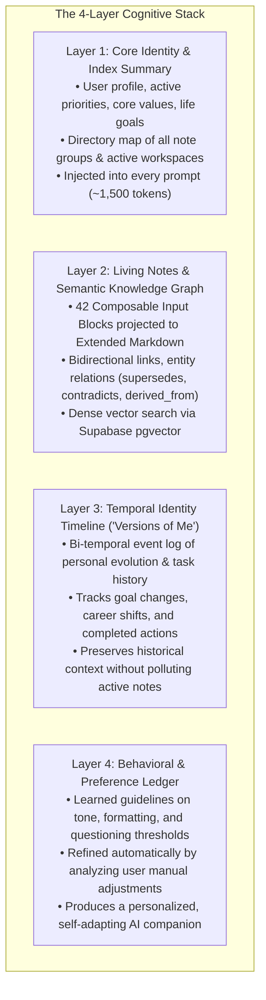

# ScribeX Unified Backend & Universal AI Master Specification

> **Document Classification:** Master High-Level Specification & Single Source of Truth (SSOT)  
> **Scope:** Cloud Backend, Real-Time Synchronization, Cognitive Memory, Remote Agentic Execution, and Universal MCP Connector  
> **Design Philosophy:** Local-First, Zero-Cloud-Cost ($0/mo Hosting), Privacy-First Isolated Multi-Tenancy, and Open Cross-AI Interoperability  
> **Status:** Authoritative Architectural Master

---

## 1. Executive Summary & Core Architectural Goals

ScribeX is a local-first personal intelligence operating system and universal note-taking canvas. The system transitions from a standalone offline notebook into a cloud-synchronized, multi-device intelligence platform via three non-negotiable tenets:

1. **Manual Canvas First, AI Assistant Second:**  
   The foundation of ScribeX is a friction-free note-taking engine with sub-5ms local SQLite speed. The user is never blocked by forced AI onboarding, mandatory categorization, or network spinners. The AI assistant functions as an intelligent, autonomous force multiplier built on top of this foundation.
2. **Zero-Cost Cloud Infrastructure ($0/mo Baseline):**  
   Rather than maintaining an expensive dedicated Linux VPS server ($20–$50/mo), the backend coordinates three specialized, generous free tiers:
   * **Supabase Cloud:** Managed PostgreSQL 15+, Supabase Realtime (CDC), Supabase Auth, Row-Level Security (`RLS`), and `pgvector` semantic embeddings.
   * **Next.js on Vercel:** Hobby serverless execution for stateless AI API proxy endpoints, cognitive workflows, Cloud Whisper STT, and inbound webhooks.
   * **Google Drive API v3:** User-owned media storage utilizing each user’s free 15 GB Google Drive quota for binary assets (audio recordings, camera scans, drawings, PDFs).
3. **The Dual-Surface AI Architecture (Zero Vendor Lock-in):**  
   ScribeX’s cognitive memory, vault query engine, and agentic tools are a **Single Source of Truth (SSOT)**. Users can interact with their AI companion with identical context, tool execution, and memory depth through either:
   * **Surface A (In-App):** The native "Friday" conversational assistant drawer inside the mobile and web app.
   * **Surface B (Universal Connector):** A standard Model Context Protocol (MCP) server and REST gateway allowing external AI clients (**Claude Desktop, Google Gemini, OpenAI ChatGPT, Cursor, Antigravity, local Ollama**) to mount the ScribeX vault with 100% feature parity.

---

## 2. High-Level System Architecture

```mermaid
flowchart TD
    subgraph Clients ["1. Client Interaction Surfaces"]
        A1["Expo App (iOS, Android, Web)<br>• Native Canvas & Block Editor<br>• In-App Friday Assistant"]
        A2["External AI Applications<br>• Claude Desktop / Claude Code<br>• Gemini CLI / Google AI Studio<br>• ChatGPT Custom Actions<br>• Cursor / Antigravity IDE"]
    end

    subgraph Gateway ["2. Universal AI Connector & Gateway Layer"]
        B1["Model Context Protocol (MCP) Server<br>(stdio & SSE transports)"]
        B2["OpenAI & Anthropic REST Proxy (/v1)"]
        B3["Next.js Serverless AI Routes (Vercel)"]
    end

    subgraph Cognitive_Core ["3. ScribeX Shared Cognitive Brain"]
        C1["Context Assembler (Layers 1 to 4)"]
        C2["Ask-Before-Write Ambiguity Gate"]
        C3["Universal Agentic Tool Executor"]
    end

    subgraph Data_Layer ["4. Cloud Data & Media Layer"]
        D1[("Supabase Cloud PostgreSQL<br>• notes, folders, tasks, tags, reminders<br>• pgvector semantic embeddings<br>• Row-Level Security (RLS)")]
        D2["Supabase Realtime CDC Engine<br>(Instant multi-device WebSocket broadcast)"]
        D3["Google Drive Media Vault<br>(User-owned 15GB zero-cost asset storage)"]
    end

    subgraph Local_Device ["5. Local Device Execution Engine"]
        E1[("Local SQLite Ledger (expo-sqlite / Wasm)<br>• Sub-5ms optimistic reads/writes<br>• sync_changelog with monotonic sync_rev")]
        E2["NotificationService (Hardware OS Alarms)<br>• Android AlarmManager & iOS UNUserNotificationCenter<br>• Offline & Serverless Local Push"]
        E3["PC Agent Bridge (Personal Computer)<br>• Outbound WebSocket CLI Daemon<br>• Deterministic 3-Stage Verification"]
    end

    Clients <--> Gateway
    Gateway <--> Cognitive_Core
    Cognitive_Core <--> Data_Layer
    Cognitive_Core <--> Local_Device
    Data_Layer <-->|Bidirectional CDC Sync| Local_Device
```



---

## 3. Bidirectional Real-Time Delta Synchronization Engine

### 3.1. Architectural Principles
* **Local-First Autonomy:** The user can create, edit, organize, and delete notes, tasks, and folders completely offline. All operations commit immediately to local SQLite in under 5ms.
* **Event-Sourced Changelog:** Every local mutation writes an immutable delta entry into `sync_changelog` with an auto-incrementing integer revision counter (`sync_rev`) and an entity discriminator (`note`, `folder`, `tag`, `task`, `reminder`, `relation`, `asset`).
* **Supabase Realtime CDC (Change Data Capture):**
  * When online, local deltas are pushed to Supabase PostgreSQL in batched transactions.
  * PostgreSQL triggers broadcast updates across Supabase Realtime channels.
  * Subscribed peer devices receive remote deltas and apply them locally, updating their local monotonic `sync_rev`.
* **Guaranteed Reconnection Catch-Up:**  
  When a dormant or offline device reconnects:
  1. The client sends a handshake: `{ client_sync_rev: 42 }`.
  2. The server queries `sync_changelog WHERE sync_rev > 42 ORDER BY sync_rev ASC`.
  3. Missing deltas are streamed and applied inside a single local transaction, followed by a flush of any local pending offline mutations.
* **Multi-Device Concurrency & Conflict Resolution:**
  * **Metadata & Tasks:** Field-level Last-Write-Wins (LWW) utilizing monotonic revisions and UTC timestamps.
  * **Note Body Text:** Three-way merge on the Extended Markdown AST. Non-conflicting block edits merge cleanly; overlapping block conflicts are preserved with visible conflict blocks for quick synthesis.

---

## 4. The 4-Layer Shared Cognitive Memory Model

ScribeX replaces fragmented chat memory with a structured 4-layer cognitive architecture that mirrors how an elite personal assistant thinks. Both the In-App Friday Assistant and External AI clients (via MCP) read from and write to this exact memory model:



### 4.1. The Ask-Before-Write Ambiguity Gate
* **Core Rule:** The AI must never silently guess, assume, or hallucinate note destinations, folder structures, or task priorities.
* **Evaluation:** When new content is ingested (via chat, voice, web clip, or MCP tool call), the engine evaluates semantic clarity and potential contradictions against Layer 1 and Layer 2.
* **Action:** If clarity is below the acceptable threshold (0.85) or a contradiction is detected, the AI pauses execution and triggers a concise clarification question to the user. Once answered, the update commits cleanly to SQLite and Supabase.

---

## 5. Universal AI Connector & Model Context Protocol (MCP) Architecture

### 5.1. Dual-Surface Parity Guarantee
The Universal AI Connector ensures that external frontier models (Claude, Gemini, ChatGPT) act as first-class citizens in your ScribeX ecosystem:

| Capability | In-App Friday Assistant | External AI via MCP Connector (Claude, Gemini, ChatGPT, Cursor) |
| :--- | :--- | :--- |
| **Cognitive Memory** | Injected with Layers 1–4 | **100% Identical** (mounted via MCP resources & system prompts) |
| **Vault Search** | Hybrid full-text + `pgvector` | **100% Identical** (`search_vault` MCP tool) |
| **Note Creation & AST** | Sanitized via `astSerializer` (42 blocks) | **100% Identical** (`create_note` passes through `astSerializer`) |
| **Push Reminders & Alarms**| Schedules native hardware alarm | **100% Identical** (`schedule_reminder` triggers local device alarm) |
| **Event Delta Logging** | Appends to `sync_changelog` | **100% Identical** (logged with monotonic `sync_rev` for cloud sync) |

### 5.2. Transport Protocols
1. **Local `stdio` Transport (IPC):**  
   Zero-latency, zero-network, local process communication designed for desktop tools like **Claude Desktop**, **Antigravity IDE**, and **Cursor**. Operates directly on the local PC without exposing network ports.
2. **Server-Sent Events (SSE) / HTTP (`localhost:3721`):**  
   Lightweight local HTTP/SSE interface for local browser extensions, web UIs, and local dev scripts.
3. **OpenAI & Anthropic REST Gateway (`/v1/chat/completions`, `/v1/messages`):**  
   Allows **ChatGPT Custom GPTs / Actions**, n8n, LangChain, or custom webhooks to communicate with ScribeX using standard API schemas.

### 5.3. Standardized Agentic Tool Catalog
* `search_vault(query, folder_path, tags, limit)`: Semantic and keyword search across notes and attachments.
* `read_note(note_id, include_relations, include_backlinks)`: Retrieves the note AST, bidirectional references, and graph edges.
* `create_note(title, content_markdown, folder_path, tags, color_token, reminder_at)`: Safely creates notes with AST validation.
* `update_note(note_id, title, append_markdown, tags, reminder_at)`: Modifies or appends to existing living notes.
* `create_task(title, priority, due_date, reminder_at, note_id)`: Registers a task linked to the unified task ledger.
* `toggle_task(task_id, is_completed)`: Marks task completion and automatically cancels scheduled alarms.
* `schedule_reminder(target_type, target_id, trigger_at, title, body)`: Schedules an exact hardware notification alarm.
* `query_timeline(topic, start_date, end_date)`: Inspects historical evolution across Layer 3 ("Versions of Me").

---

## 6. Serverless Local Push Notifications & Hardware Reminders

### 6.1. Hardware Alarms Without a Backend Daemon
* **Serverless Dispatch:** ScribeX does not rely on an expensive cloud server running 24/7 cron jobs to fire reminders.
* **Mobile (iOS & Android):** Reminders are scheduled directly into the mobile operating system's native alarm daemons (`AlarmManager` on Android with a MAX-importance heads-up channel, and `UNUserNotificationCenter` on iOS). Reminders fire reliably even if the app is terminated or in airplane mode.
* **Web:** The standard browser `Notification` API with active-tab scheduling and Service Worker background delivery.

### 6.2. Cross-Device Synchronization & Auto-Cancellation
* **Cross-Device Completion Invariant:** If a task with a reminder is completed on **Device A (Web)**, a dismiss delta is pushed to Supabase CDC. When **Device B (Phone)** receives the event, its local `NotificationService` cancels the pending OS alarm immediately, preventing phantom notifications.
* **Past-Date Guardrails:** If a reminder has an elapsed trigger ($T \le \text{now}$), it is gracefully dismissed rather than raising OS scheduling errors.

---

## 7. Remote PC Agentic Execution & Pluggable CLI Daemon

### 7.1. Concept & Roles
When the user needs real technical or operational work done on their personal computer (coding, running builds, managing local files, running local models):
* **The Orchestrator (Friday / Next.js):** Translates high-level user goals and note context into a **Context-Enriched Execution Spec**.
* **The Personal PC Bridge (`pc-agent-bridge`):** A lightweight daemon running on the user's computer connected via an outbound persistent connection (no open ports or firewall configuration needed).

### 7.2. Pluggable CLI Agent Support (`cli_agents.yaml`)
The local bridge is provider-agnostic and can delegate work to any installed CLI agent:
* **Claude Code** (`claude -p {prompt}`)
* **Google Gemini CLI** (`gemini -p {prompt}`)
* **OpenAI Codex CLI / Aider / Goose / OpenCode**
* Users can switch providers or route different tasks to different CLI agents seamlessly.

### 7.3. The 3-Stage Independent Verification Loop (Zero Blind Trust)
The orchestrator never assumes a worker agent succeeded just because it finished:
1. **Stage 1 (Process Telemetry):** Captures process exit codes, duration, and output logs.
2. **Stage 2 (Deterministic Environment Proof):** The bridge collects objective evidence outside the agent:
   * `git status --porcelain` and `git diff` (exact lines changed).
   * File creation, checksums, and size validation.
   * Execution of verification suites (`pytest`, `npm test`, `tsc`).
3. **Stage 3 (Acceptance Review & Self-Correction):** The orchestrator evaluates the proof against the original requirements:
   * If errors or missing criteria are found, it dispatches targeted corrective feedback back to the agent session (up to 3 retries).
   * If verified, it marks tasks complete in Supabase, logs changes in Layer 3 (Task History), updates project notes in Layer 2, and notifies the user.

---

## 8. Multi-Tenancy, Commercial Billing & Security

### 8.1. Privacy-First Multi-Tenancy
* **Database Isolation:** Every relational table (`notes`, `folders`, `tags`, `tasks`, `reminders`, `assets`, `entity_relations`, `sync_changelog`) contains an indexed `user_id` column.
* **Row-Level Security (`RLS`):** Supabase PostgreSQL policies strictly enforce `auth.uid() = user_id`. No tenant can query or receive CDC real-time events belonging to another tenant.
* **Media Isolation:** Google Drive assets reside in tenant-isolated folders within the user's personal Google Drive account.

### 8.2. LLM Cost Control & BYOK
* **Token Quota Management:** Next.js routes route external LLM requests through a spend-governance proxy with per-user monthly budgets.
* **Bring-Your-Own-Key (BYOK):** Users can supply their own API keys (Anthropic, Google AI Studio, OpenAI, OpenRouter) in settings to unlock unlimited AI workflows with zero platform token markup.

---

## 9. Monorepo Architecture Blueprint

For future implementation and planning, the monorepo is structured into five decoupled modules:

```text
scribex/
├── frontend/                           # Universal Expo App (iOS, Android, Web)
│   ├── app/                            # Expo Router file-based screens
│   ├── src/
│   │   ├── components/                 # Composable Block Editor, Canvas, TasksView
│   │   ├── db/                         # Local SQLite client, schema.ts, repositories
│   │   ├── services/notifications/     # Hardware notification drivers (native & web)
│   │   ├── sync/                       # Supabase Realtime CDC delta sync client
│   │   └── state/                      # useNotesStore (reactive local state)
│
├── backend/                            # Next.js Serverless AI & API Gateway (Vercel)
│   ├── app/api/ai/                     # Route handlers: intake, chat, briefing, transcribe
│   ├── app/api/webhooks/               # Inbound email-to-note & external integrations
│   ├── lib/ai/                         # FridayBrain, memory retrieval, ambiguity gate
│   ├── lib/storage/                    # Google Drive API v3 media vault client
│   └── supabase/migrations/            # PostgreSQL DDL, RLS policies, pgvector setup
│
├── connector/                          # Universal AI Connector & MCP Server
│   ├── src/server.ts                   # Model Context Protocol (MCP) server (stdio/SSE)
│   ├── src/rest/                       # OpenAI & Anthropic compatible REST proxy
│   ├── src/context/                    # 4-Layer Cognitive Context Assembler
│   └── src/tools/                      # Unified Agentic Tools (search, note, task, reminder)
│
├── pc-agent-bridge/                    # Lightweight PC Execution Daemon (Personal PC)
│   ├── bridge/daemon.py                # Outbound WebSocket tunnel & executor
│   ├── bridge/verifier_hooks.py        # Independent git diff & test verifier
│   └── cli_agents.yaml                 # Provider registry (Claude Code, Gemini, Codex)
│
└── docs/                               # Harmonized specifications & active blueprints
```

---

## 10. Phased Delivery Roadmap

* **Phase 1: Universal Manual Note Engine (COMPLETED & AUDITED):**  
  42 input blocks, local SQLite with sub-5ms speed, nested checklists, habits, kanban, full-bleed canvas, drag-and-drop, hierarchical folders, search, and serverless local push notification reminders.
* **Phase 2: Supabase Realtime Sync, Next.js AI & Google Drive Media Vault (NEXT IN QUEUE):**  
  Supabase PostgreSQL schema, RLS policies, `@supabase/supabase-js` bidirectional Realtime CDC sync, Next.js Vercel serverless AI routes, and Google Drive API v3 media storage.
* **Phase 3: Cognitive Memory, Friday AI Assistant & Universal MCP Connector (PENDING):**  
  In-app Friday conversational assistant, 4-layer cognitive memory with `pgvector`, Ask-Before-Write Ambiguity Gate, and the `connector/` MCP server for Claude, Gemini, Cursor, and ChatGPT parity.
* **Phase 4: Remote PC Agent Bridge Daemon & Pluggable CLI Loop (PENDING):**  
  `pc-agent-bridge` outbound WebSocket daemon, `cli_agents.yaml` adapter registry, and 3-stage independent verification loop.
* **Phase 5: SaaS Multi-Tenancy, Commercial Billing & Production Launch (PENDING):**  
  Stripe subscription billing, LiteLLM token metering, BYOK settings, and enterprise security.
