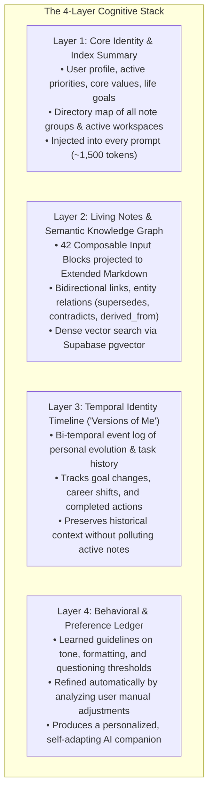

# ScribeX Unified Backend & Universal AI Master Specification

> **Document Classification:** Master High-Level Specification & Single Source of Truth (SSOT)  
> **Scope:** Cloud Backend, Real-Time Synchronization, Unified Backend AI Engine, Action Pipeline Symmetry (Shared Supabase RPC), Two-Tier Reminder Architecture, and Universal MCP Connector  
> **Design Philosophy:** Local-First, Zero-Cloud-Cost ($0/mo Hosting), Client-Direct BYOK Ephemeral Passthrough, and Universal Action Symmetry  
> **Status:** Authoritative Architectural Master

---

## 1. Executive Summary & Core Architectural Goals

ScribeX is a local-first personal intelligence operating system and universal note-taking canvas. The system transitions from a standalone offline notebook into a cloud-synchronized, multi-device intelligence platform via five non-negotiable tenets:

1. **Manual Canvas First, AI Assistant Second:**  
   The foundation of ScribeX is a friction-free note-taking engine with sub-2ms local SQLite speed. The user is never blocked by forced AI onboarding, mandatory categorization, or network spinners. Human manual typing, block reordering, and task checking execute 100% offline directly against local SQLite.
2. **Action Pipeline Symmetry (Shared Supabase PostgreSQL RPC Pipeline):**  
   Both manual frontend user actions (syncing notes, checklists, and folders to the cloud) and backend AI actions (tool executions) execute through the **exact same Supabase PostgreSQL RPC functions** (`rpc_create_note`, `rpc_update_note`, `rpc_toggle_task`, `rpc_schedule_reminder`, `rpc_search_vault`). When the user edits on the client device, the client writes optimistically to local SQLite and syncs directly to these Supabase RPCs without routing through our custom backend. When an AI assistant takes action, the unified backend engine calls the identical Supabase RPCs. Zero dual-codebase drift and complete behavioral symmetry.
3. **Two-Tier Hardware Reminder Routing (Offline Local vs Multi-Device CDC):**  
   * **Guest / Logged-Out Mode:** Reminders operate 100% locally on the device (identical to current behavior). They are saved solely to local SQLite and scheduled straight into the device's native hardware alarms (`AlarmManager` on Android, `UNUserNotificationCenter` on iOS, browser Notification API on web) with zero network calls, zero database writes, and zero syncing actions.  
   * **Authenticated / Logged-In Mode:** When logged in, reminders commit to Supabase (`reminders` table) via `rpc_schedule_reminder` and log to `sync_changelog`. Supabase Realtime CDC immediately broadcasts the reminder event to all connected user devices in ~50ms, where each device registers a native hardware push alarm. When completed or dismissed on any device, the cancellation propagates everywhere to dismiss pending alarms.
4. **Unified Backend AI Engine with Frontend BYOK Ephemeral Passthrough:**  
   All AI prompt assembly, 4-layer cognitive memory context injection, agent reasoning loops, tool routing, and external connectors/MCP run through **one unified backend engine** (Next.js serverless API routes / Supabase Edge Functions). The in-app AI assistant (Mobile & Web) delegates AI execution to this unified endpoint (`/api/ai/chat` & `/api/ai/agent`). External clients (Claude Desktop MCP, Cursor, ChatGPT Actions) call this same unified engine, eliminating dual-orchestration divergence. Users enter their model API keys (Google Gemini, Anthropic Claude, OpenAI) in the frontend Settings UI (`SecureStore` on mobile, encrypted storage on web). The client passes the key in an ephemeral request header (`x-gemini-key`, `x-anthropic-key`, `x-openai-key`). The backend uses the key in-memory for the LLM request and immediately discards it—preserving $0 server token spend and zero key storage in backend `.env` or databases.
5. **Zero-Cost Cloud Infrastructure ($0/mo Baseline):**  
   * **Supabase Cloud:** Managed PostgreSQL 15+, Supabase Realtime (CDC), Supabase Auth, Row-Level Security (`RLS`), and `pgvector` semantic embeddings.
   * **Google Drive API v3:** User-owned media storage utilizing each user’s free 15 GB Google Drive quota for binary assets (audio recordings, camera scans, drawings, PDFs).

---

## 2. High-Level System Architecture

```mermaid
flowchart TD
    subgraph HumanInput ["1. Human Manual Actions (Client Devices: Mobile & Web)"]
        A1["User Manual Input<br>(Taps, Typing, Checklists, Drag-and-Drop)"]
        A2[("Local SQLite Ledger (expo-sqlite / Wasm)<br>• Sub-2ms optimistic reads/writes<br>• 100% Offline Capability")]
        A3{"User Logged In?"}
        A4["Local Hardware Push Alarms (Offline Mode)<br>• Android AlarmManager (MAX heads-up)<br>• iOS UNUserNotificationCenter<br>• Web Browser Notification API"]
        A5["Secure Storage<br>(BYOK API Keys: SecureStore / Encrypted Web)"]
    end

    subgraph AllAI ["2. All AI Assistants & Surfaces"]
        C1["In-App Assistant: Mobile Friday UI"]
        C2["In-App Assistant: Web Friday UI"]
        C3["Universal AI Connector (connector/)<br>• Claude Desktop (MCP Client)<br>• Cursor / Antigravity<br>• ChatGPT Custom Actions"]
    end

    subgraph UnifiedBackendAI ["3. Unified Backend AI Gateway (Next.js / Edge Functions)"]
        BE1["Unified AI Gateway (/api/ai/chat & /api/ai/agent)<br>• Ingests ephemeral BYOK header (x-gemini-key, etc.)<br>• Zero key persistence ($0 server token spend)"]
        BE2["4-Layer Cognitive Memory Engine<br>• Injects Identity, Living Vault, Versions of Me, Behavioral Ledger"]
        BE3["LLM Provider Call & Agentic Loop<br>(Google Gemini / Anthropic Claude / OpenAI)"]
        BE4["Heavy Micro-Routes (10% Complex Actions)<br>• /api/ai/transcribe (Whisper STT)<br>• /api/clip-webpage (Readability parser)<br>• /api/auth/google-drive (OAuth exchange)<br>• /api/webhooks/* (Stripe billing / webhooks)"]
    end

    subgraph SupabasePaaS ["4. Supabase Cloud (Single Source of Action - Shared RPC Pipeline)"]
        B1["Shared PostgreSQL RPC Pipeline (Action Symmetry)<br>• rpc_create_note()<br>• rpc_update_note()<br>• rpc_toggle_task()<br>• rpc_schedule_reminder()<br>• rpc_search_vault()"]
        B2[("PostgreSQL Tables & pgvector<br>• notes, folders, tasks, reminders<br>• sync_changelog with monotonic sync_rev<br>• Row-Level Security (auth.uid = user_id)")]
        B3["Supabase Realtime CDC Engine<br>(Instant multi-device WebSocket broadcast)"]
    end

    subgraph MultiDeviceAlarms ["5. Multi-Device Hardware Push Alarms (Logged-In Mode)"]
        D1["Hardware Push Notification Service<br>• Remote CDC delta pushes alarm to Mobile Phone<br>• Cross-device auto-cancel on task completion"]
    end

    %% Manual client flow
    A1 -->|Instant 2ms Local Write| A2
    A2 --> A3
    A3 -->|Logged Out / Guest| A4
    A3 -->|Logged In: Direct Cloud Sync (No Backend Hop)| B1

    %% AI invocation flow
    C1 -->|Prompt + Ephemeral BYOK Header| BE1
    C2 -->|Prompt + Ephemeral BYOK Header| BE1
    A5 -.->|Provides Key to UI| C1
    A5 -.->|Provides Key to UI| C2
    C3 -->|Tool Invocation via MCP| BE1

    BE1 --> BE2
    BE2 --> BE3
    BE3 -->|90% Vault Tool Actions| B1
    BE3 -.->|10% Heavy Media/Scraping| BE4
    BE4 -->|Saves Resulting Note/Task| B1

    %% Database commit and CDC broadcast
    B1 -->|Atomic Commit & Log Delta| B2
    B2 -->|Realtime Change Event| B3
    B3 -->|Instant Delta Push (50ms)| A2
    B3 -->|Triggers/Cancels Push Alarms on All Devices| D1
```

---

## 3. Unified Backend AI Engine, Action Pipeline Symmetry & Two-Tier Reminders

### 3.1. Unified Backend AI Gateway with Ephemeral Client BYOK Passthrough
To completely prevent codebase duplication and prompt drift between mobile/web in-app Friday and external connectors/MCP:
* **Single AI Gateway:** All AI prompt assembly, 4-layer cognitive memory context synthesis, reasoning loops, and tool-calling agent cycles run through a **single, unified backend engine** (Next.js serverless API routes or Supabase Edge Functions: `/api/ai/chat` & `/api/ai/agent`).
* **All AI Surfaces Connect to One Brain:** In-app Friday on Mobile, In-App Friday on Web, Claude Desktop via MCP (`connector/`), Cursor/Antigravity, and ChatGPT Custom Actions all invoke this identical backend AI gateway.
* **Frontend UI Key Management (BYOK):** The user provides and manages their model API keys (Google Gemini, Anthropic Claude, OpenAI) directly through the ScribeX frontend Settings UI (`WorkspaceSettingsModal` / dedicated AI Settings tab). The keys are stored exclusively on-device in secure local storage (`SecureStore` on iOS/Android, encrypted storage on Web). They are NEVER stored in a backend `.env` file, database table, or server disk.
* **Ephemeral Header Passthrough:** When invoking an AI action, the client app passes the key in an encrypted request header (`x-gemini-key`, `x-anthropic-key`, `x-openai-key`). The backend engine extracts the key into volatile memory for the duration of the LLM call, routes the request to the upstream AI provider, processes the response or tool calls, and immediately drops the key from memory.
* **Cost & Privacy Invariant:** Zero token markup, zero server token spend ($0 baseline hosting), and absolute user privacy.

### 3.1.1. Architectural Model (Option A: Managed Multi-Tenant Supabase with RLS & Realtime CDC) & Strict Auth Gate

* **Managed Multi-Tenant Cloud Architecture (Option A):**
  * ScribeX operates on a **single, managed Supabase project** providing instant, zero-friction Realtime CDC (Change Data Capture) synchronization out of the box. Users never have to manually generate, configure, or paste Supabase URLs or API keys.
  * **Database Responsibility:** The cloud database primarily stores user authentication credentials and profile state (`auth.users`, `public.users`) to authenticate users, issue secure JWTs, and authorize backend and RPC actions.
  * **Data Privacy & Isolation via RLS:** All user data (`notes`, `folders`, `tasks`, `reminders`, `workspace_security`) is strictly isolated using PostgreSQL Row-Level Security (`auth.uid() = user_id`). Notes and folders support client-side PIN encryption and Master PIN hashing for zero-knowledge privacy.
* **Google OAuth as the Exclusive Sign-In Provider (Dual-Purpose Auth & Media Sync):**
  * ScribeX uses **Google OAuth exclusively** (via Supabase Auth Google provider) as its sole sign-in method across Mobile and Web.
  * **Strategic Dual Purpose:**
    1. **Authentication & Identity:** Secures the user's cloud session, issuing an authenticated `auth.uid()` that unlocks Supabase Realtime synchronization, cloud-backed Master PIN/locks, and backend AI features.
    2. **Zero-Cost Google Drive Media Sync:** The Google OAuth token seamlessly provisions Google Drive OAuth scopes (`drive.file` / `drive.appdata`), enabling ScribeX to sync heavy media attachments (images, audio recordings, video, PDFs) directly to the user's personal Google Drive without incurring server storage costs or requiring secondary authentication.
* **Global Invariant — No Cloud Sync or AI Access Without Login:**
  * A user who has not signed in (`!isAuthenticated` / `isGuest === true`) **cannot access Cloud Sync or any AI features** (Friday Assistant, In-Editor AI Co-Pilot, Scoped Multi-Agents, BYOK AI execution, or Cloud Connectors). Whenever any implementation plan is drafted or code is written for Sync or AI features, those controls **must be disabled/locked in the UI** for unauthenticated/guest users, displaying a clear prompt to sign in with Google (`/signin`) to unlock them.
* **Strict Auth Requirement for Cloud Sync & AI:** Cloud synchronization (Supabase RPC sync, Realtime CDC subscriptions, and Google Drive media upload) and all AI endpoints (`/api/ai/chat`, `/api/ai/agent`, `/api/ai/transcribe`) are **strictly disabled unless the user is authenticated via Google OAuth (`isAuthenticated === true`)**.
* **Skipped Sign-In (Guest Mode = 100% Manual Offline On-Device):** If the user skips sign-in during onboarding (`isGuest === true`), ScribeX operates strictly as a 100% manual offline notebook in local SQLite (`user_id = 'user-default'`) with zero background network calls, zero cloud sync attempts, and all AI/Sync UI entry points disabled.
* **Completing Onboarding Sign-In to Unlock Cloud Sync & AI:** Whenever a guest user taps a disabled Cloud Sync or AI control in the Sidebar, Note Editor, or Workspace Settings, the app routes them to complete the Google OAuth sign-in flow (`/signin`).
* **Lossless Guest-to-Account Vault Claim:** Upon completing Google OAuth sign-in for the first time on a device with existing guest notes (`user_id = 'user-default'`), the client atomically re-assigns all local SQLite records (`notes`, `folders`, `tags`, `tasks`, `reminders`, `in_app_notifications`, `entity_relations`, `workspace_security`, `sync_changelog`) to the authenticated `auth.uid()` and queues an initial delta sync push so zero offline data is lost.
* **Master PIN Cloud Sync vs. Device-Only Biometrics:**
  * **Synced to Cloud (`workspace_security`, `notes`, `folders`):** The user's Master PIN/Password cryptographic hash/salt/hint (`workspace_security`), `app_lock_enabled`, `auto_relock_seconds`, and per-note/per-folder lock configurations (`is_locked`, `lock_type`, `lock_credential_kind`, `lock_hash`, `lock_salt`, `lock_hint`) are synced to Supabase so protected notes, folders, and master credentials remain consistent across all signed-in devices.
  * **Device-Only (`biometrics_enabled`):** Biometric unlock preference (`biometrics_enabled` — Face ID, Touch ID, Fingerprint) is **strictly a device-local setting** (stored on-device only and excluded from Supabase `workspace_security` sync) because biometric hardware and enrollment vary per physical device.

### 3.1.2. In-Editor AI Assistant, Scoped Multi-Agent Orchestration & Note/Folder AI Context Exclusion
* **In-Editor AI Co-Pilot (Direct Note Editing):** Inside the Note Editor (`note/[id].tsx`), users can invoke the AI assistant with a natural-language prompt to draft, rewrite, summarize, or restructure blocks directly inside the active note via AST diff mutations (tracked in the 50-step Undo/Redo history).
* **Hierarchical Multi-Agent Support (Friday + Scoped Sub-Agents):** Users can spawn specialized task sub-agents scoped to a specific note or folder/group of notes. The main assistant (**Friday**, holding global 4-layer context) orchestrates and delegates bounded tasks to these sub-agents while enforcing strict **scoped context boundaries** (a sub-agent can only read/write within its assigned note or folder scope).
* **Note & Folder Level AI Context Privacy Controls (`ai_context_excluded`):** Users can toggle **"Exclude from AI Context"** on any individual note or folder. This flag is persisted in both local SQLite and Supabase (`notes.ai_context_excluded`, `folders.ai_context_excluded`). Any note (or note inside an excluded folder, or locked note/folder) with `ai_context_excluded = true` is strictly filtered out from Layer 1/2 memory injection, `pgvector` semantic search (`rpc_search_vault`), Friday prompts, sub-agents, and external MCP queries.

### 3.2. Action Pipeline Symmetry (Shared Supabase PostgreSQL RPC Pipeline)
To ensure complete consistency across human actions and autonomous AI operations:
* **Direct Client Sync for Manual Actions (Zero Custom Backend Hop):** Whatever the user does manually on the device (typing notes, reordering blocks, toggling checklists, creating folders, setting reminders) saves optimistically to local SQLite (1.5ms) and syncs **directly from the client device to Supabase PostgreSQL RPCs** (`rpc_create_note`, `rpc_update_note`, `rpc_toggle_task`, `rpc_schedule_reminder`, `rpc_search_vault`) via `@supabase/supabase-js`. Our custom Next.js backend server is NEVER involved in manual note-taking or canvas edits.
* **Backend AI Tool Invocations Use the Exact Same Pipeline:** When any AI assistant executes an action (e.g., creating a note, completing a task, scheduling a reminder), the unified backend AI engine calls the **exact same Supabase PostgreSQL RPC functions**.
* **Atomic PostgreSQL Guarantees:**
  1. Every RPC validates block AST schemas before committing.
  2. Every RPC automatically appends an entry to `sync_changelog` with an incrementing monotonic `sync_rev`.
  3. When a task is marked complete (manually or by AI), `rpc_toggle_task` automatically updates the `reminders` table to cancel the pending alarm in the same atomic transaction.

### 3.3. Two-Tier Hardware Reminder Architecture: Offline Local-Only vs Multi-Device CDC Sync
Reminders adapt automatically to the user's authentication state:

```mermaid
flowchart TD
    A["User Sets Reminder (Picker / Task / AI)"] --> B{"Is User Logged In?"}

    subgraph Tier1 ["Tier 1: Guest / Logged-Out Mode (100% On-Device)"]
        C1["Save strictly to Local SQLite (reminders table)"]
        C2["Schedule Native Hardware Push Alarm<br>• Android AlarmManager (MAX heads-up)<br>• iOS UNUserNotificationCenter<br>• Web Browser Notification API"]
        C3["Zero Network Calls • Zero Cloud Sync • Zero DB Writes"]
        C1 --> C2 --> C3
    end

    subgraph Tier2 ["Tier 2: Authenticated / Logged-In Mode (Multi-Device CDC)"]
        D1["Save to Local SQLite (optimistic UI)"]
        D2["Direct Supabase Sync via rpc_schedule_reminder()"]
        D3[("Supabase Cloud DB<br>• reminders table<br>• sync_changelog insert delta")]
        D4["Supabase Realtime CDC Broadcast (~50ms)"]
        D5["All Connected User Devices Ingest Delta"]
        D6["Local NotificationService on Each Device<br>Registers Native Hardware Push Alarm"]
        D7["Cross-Device Auto-Cancellation<br>Completing task on ANY device cancels alarm everywhere"]
        D1 --> D2 --> D3 --> D4 --> D5 --> D6 --> D7
    end

    B -->|No (Offline Guest)| C1
    B -->|Yes (Authenticated)| D1
```

* **Tier 1 (Logged-Out / Guest Mode):**
  * Operates identically to the current standalone offline app.
  * Reminders are persisted exclusively in local SQLite.
  * Scheduled directly into the operating system's native hardware alarm managers.
  * Completely offline, instantaneous, with zero cloud dependency.
* **Tier 2 (Logged-In / Cloud-Synchronized Mode):**
  * When logged in, the reminder is saved locally and synced directly to Supabase via `rpc_schedule_reminder`.
  * Supabase Realtime CDC broadcasts the new delta to all registered devices in ~50ms.
  * Every receiving device's local `NotificationService` registers the native hardware push alarm.
  * When a task with a reminder is toggled complete on Device A, a dismiss delta is pushed to Supabase. When Device B (e.g. phone) receives the CDC event, its local `NotificationService` cancels the pending OS alarm immediately, preventing phantom notifications.

### 3.4. Architectural Defense: Why Local SQLite + Supabase CDC Beats Direct Cloud + Flat Files
A critical architectural evaluation was conducted on whether to eliminate Local SQLite in favor of direct Supabase writes with flat-file offline fallback. The analysis established that **Local SQLite must remain the primary local engine** for four non-negotiable reasons:

1. **The Keystroke Budget (1.5ms vs 120ms):** Typing in a canvas requires sub-16ms latency. Local SQLite commits in ~1.5ms, guaranteeing buttery smooth typing, zero cursor jumping, and immediate checklist responsiveness. Direct cloud writes add 80–300ms network roundtrips to every keystroke or state change.
2. **The Elevator Trap (Spotty Internet Resilience):** Real-world networks drop irregularly. A direct-to-cloud app encounters 10–30s TCP timeouts in elevators or tunnels, freezing the UI before discovering it is offline. With Local SQLite, the UI never waits for network—it saves instantly to disk, and the background sync engine handles transmission whenever connectivity resumes.
3. **Sub-5ms Offline Search & Relational Queries:** With Local SQLite, full-text search, tag sorting, and graph queries across 5,000 notes execute in under 3ms offline. Storing offline notes in flat files would require loading all notes into RAM and writing a custom query engine in JavaScript.
4. **The Industry Standard Gold Standard:** This Local-First with Optimistic Sync pattern is the exact proven architecture powering **Linear, Apple Notes, Superhuman, and WhatsApp**. It guarantees zero user-perceived latency while maintaining continuous cloud synchronization.

### 3.5. Universal Invocation Platform Context (`PlatformContext`)
While all AI interactions share the **exact same 4-layer cognitive memory stack and tool catalog**, every AI prompt assembly and tool execution receives a standardized `PlatformContext` metadata envelope. This makes the AI assistant and the database fully conscious of the physical device or external runtime executing the command:

```typescript
export interface PlatformContext {
  /** The calling runtime surface */
  platform: 'mobile_native' | 'web_browser' | 'desktop_mcp' | 'cursor_antigravity' | 'chatgpt_custom_action';
  /** Persistent device installation UUID */
  device_id: string;
  /** Hardware & runtime capabilities */
  runtime_capabilities: {
    can_schedule_hardware_alarms: boolean; // True on mobile native (AlarmManager / UNUserNotificationCenter)
    has_active_display: boolean;           // True on mobile/web foreground; false on headless MCP
    supports_local_file_system: boolean;   // True on mobile native and desktop MCP daemon
    supports_optimistic_ui: boolean;       // True on mobile/web React Native client
  };
  /** Device clock & temporal reference */
  client_timestamp: string; // ISO 8601 string from device clock
  timezone: string;         // e.g. "Asia/Kolkata", "America/New_York"
}
```

#### How Platform Context Powers the Unified System:
1. **Context-Aware Prompt Formulation:**  
   The AI companion (Friday or external Claude) knows where the user is communicating from and adapts its responses appropriately:  
   * When asked *"Remind me in 30 minutes"* on **Mobile**, the AI confirms: *"Alarm set for 6:15 PM directly on this phone."*  
   * When asked on **Claude Desktop (MCP)** or **ChatGPT Web**, the AI confirms: *"Reminder saved; your phone will alert you at 6:15 PM."*
2. **Audit Traceability in `sync_changelog`:**  
   Every RPC call passes `p_caller_platform: text`. The changelog explicitly tags whether an edit was made by `mobile_native`, `web_browser`, `desktop_mcp`, or `chatgpt_custom_action`, preserving perfect historical audit fidelity in Layer 3 ("Versions of Me").
3. **Smart Hardware Alarm Routing:**  
   When an external platform (`desktop_mcp` or `chatgpt_custom_action`) invokes `rpc_schedule_reminder`, Supabase recognizes that the caller cannot sound a native alarm itself. Supabase Realtime CDC immediately triggers downstream delivery to the user's registered physical mobile device(s), ensuring the mobile app's local `NotificationService` registers the native hardware push alarm without delay.


---

## 4. The 4-Layer Shared Cognitive Memory Model

Both the In-App Friday Assistant and External AI clients read from and write to this unified 4-layer memory model:



### 4.1. The Ask-Before-Write Ambiguity Gate
* **Core Rule:** The AI must never silently guess, assume, or hallucinate note destinations, folder structures, or task priorities.
* **Evaluation:** When new content is ingested (via chat, voice, web clip, or AI action), the engine evaluates semantic clarity against Layer 1 and Layer 2.
* **Action:** If clarity is below 0.85 or a contradiction is detected, the AI pauses execution and triggers a concise clarification question to the user. Once answered, the update commits cleanly to SQLite and Supabase.

---

## 5. Universal AI Tooling: Shared Supabase RPC & Next.js Serverless Micro-Routes

### 5.1. The 90 / 10 Division of Labor & Action Symmetry
To combine maximum speed, zero server costs, and the power to handle complex tasks, ScribeX unifies all operational actions across two clear categories:

1. **The 90% (Vault & Data Actions) $\rightarrow$ Shared Supabase PostgreSQL RPC Pipeline:**  
   Everything related to notes, tasks, checklists, tags, vector embeddings, and reminders runs through strongly typed PostgreSQL RPC functions (`rpc_create_note`, `rpc_update_note`, `rpc_toggle_task`, `rpc_schedule_reminder`, `rpc_search_vault`).  
   * **Manual Frontend Sync:** The React Native / Web client syncs manual edits directly to these Supabase RPCs via `@supabase/supabase-js` without calling our custom backend server.
   * **Backend AI Execution:** The Unified Backend AI Gateway executes tool actions by invoking the exact same Supabase RPCs.
2. **The 10% (Heavy & External Actions) $\rightarrow$ Next.js Serverless Micro-Routes:**  
   Operations requiring external network fetching, sensitive secrets, or heavy compute (audio transcription with Whisper, web page clipping/scraping, Google OAuth token exchange, Stripe payment webhooks) route through specialized Next.js serverless endpoints on Vercel. Once the task finishes, Next.js commits the resulting note/task through the exact same Supabase RPC.

```mermaid
flowchart TD
    subgraph AllTriggers ["1. Action Triggers"]
        Manual["Manual Frontend Edits<br>(Logged-In User Sync)"]
        AI["Unified Backend AI Gateway<br>(Tool Invocations)"]
    end

    subgraph Decision ["2. Action Routing"]
        Check{"Is it a Vault Data Action<br>or Heavy External Task?"}
    end

    subgraph SupabaseDirect ["3. Supabase Cloud ($0 PaaS — 40-80ms)"]
        RPC["Shared PostgreSQL RPC Pipeline<br>• rpc_create_note()<br>• rpc_update_note()<br>• rpc_toggle_task()<br>• rpc_schedule_reminder()<br>• rpc_search_vault()"]
        CloudDB[("PostgreSQL Tables<br>• notes, tasks, reminders<br>• sync_changelog (monotonic)")]
        CDC["Supabase Realtime CDC Engine"]
    end

    subgraph NextjsBackend ["4. Serverless Micro-Routes (Next.js on Vercel)"]
        Next["Next.js Route Handlers<br>• /api/ai/transcribe (Whisper STT)<br>• /api/clip-webpage (Readability parser)<br>• /api/auth/google-drive (OAuth secret exchange)<br>• /api/webhooks/* (Stripe / 3rd-party webhooks)"]
    end

    subgraph LocalDevices ["5. User Devices (Mobile & Web)"]
        LocalDB[("Local SQLite Ledger")]
        Alarms["Hardware Push Alarms<br>(AlarmManager / UNUserNotificationCenter)"]
    end

    Manual -->|Direct RPC Sync| RPC
    AI --> Check
    Check -->|90% Vault & Data Actions| RPC
    Check -->|10% Heavy External Tasks| Next

    Next -->|Commits processed note/task| RPC
    RPC -->|Atomic Commit & Log Delta| CloudDB
    CloudDB -->|Realtime CDC Event (instant)| CDC
    CDC -->|Updates Screen & Syncs DB| LocalDB
    CDC -->|Registers or Cancels Alarms| Alarms
```

---

### 5.2. Standardized Tool Catalog

#### A. Shared Supabase PostgreSQL RPC Pipeline (40–80ms Execution)
* `rpc_create_note(p_title, p_content_markdown, p_folder_id, p_tags, p_color_token, p_reminder_at, p_caller_platform)`: Safely creates notes, verifies block AST, writes to `notes`, and logs delta with caller platform to `sync_changelog`.
* `rpc_update_note(p_note_id, p_title, p_append_markdown, p_tags, p_reminder_at, p_caller_platform)`: Modifies or appends to living notes and registers changelog delta.
* `rpc_create_task(p_title, p_priority, p_due_date, p_reminder_at, p_note_id, p_caller_platform)`: Registers a task linked to the unified task ledger and optional reminder.
* `rpc_toggle_task(p_task_id, p_is_completed, p_caller_platform)`: Atomically toggles task completion AND automatically dismisses/cancels any associated reminder in the `reminders` table.
* `rpc_schedule_reminder(p_target_type, p_target_id, p_trigger_at, p_title, p_body, p_caller_platform)`: Writes a hardware notification alarm record that broadcasts via CDC to physical user devices. (Used exclusively when user is authenticated; guest reminders remain 100% local on-device).
* `rpc_search_vault(p_query, p_folder_path, p_tags, p_limit)`: Full-text and `pgvector` semantic similarity search across the user's notes.
* `rpc_read_note(p_note_id, p_include_relations, p_include_backlinks)`: Retrieves the note AST, bidirectional references, and graph edges.
* `rpc_query_timeline(p_topic, p_start_date, p_end_date)`: Inspects historical evolution across Layer 3 ("Versions of Me").

#### B. Next.js Serverless Micro-Route Tools (Heavy External Tasks)
* `POST /api/ai/transcribe`: Ingests binary voice audio, passes it to OpenAI Whisper, and formats transcripts into speech blocks.
* `POST /api/clip-webpage`: Fetches external HTML, extracts article content with Mozilla Readability, converts to extended markdown blocks, and commits via `rpc_create_note`.
* `POST /api/auth/google-token-exchange`: Securely exchanges Google OAuth tokens with the user's personal Google Drive without exposing the OAuth client secret to client devices.
* `POST /api/webhooks/stripe`: Cryptographically verifies incoming Stripe billing webhooks (HMAC signature) to manage tier entitlements.

---

### 5.3. Headless Orchestration for MCP & External Chatbots
Every external client (Claude Desktop via MCP, Cursor, Antigravity, or ChatGPT Custom Actions) has access to the exact same capabilities by calling the Unified Backend AI Gateway:
1. **MCP Server (`connector/`):** A lightweight Node.js CLI daemon running on the user's PC. When Claude Desktop or Cursor invokes a tool, the MCP server calls the Unified Backend AI Gateway (`/api/ai/agent`) using the user's personal auth token and ephemeral BYOK headers.
2. **ChatGPT Custom Actions:** ChatGPT web uses Supabase's auto-generated OpenAPI schema and Next.js OpenAPI routes to execute actions through the same gateway.
3. **Cross-Device Reminder Convergence:** When an external chatbot schedules a reminder via `rpc_schedule_reminder`, the record is written to `reminders` and `sync_changelog`. Supabase Realtime CDC immediately pushes the event to the user's mobile device, where the mobile app's local `NotificationService` automatically registers the native hardware push alarm (`AlarmManager` on Android, `UNUserNotificationCenter` on iOS).

---

## 6. Two-Tier Hardware Push Notifications & Reminders

### 6.1. Tier 1: Logged-Out / Guest Mode (100% On-Device, Zero Sync)
* **Zero Network Dependency:** When a user is not logged in, reminders operate 100% locally on the device (matching current standalone behavior).
* **Storage:** Saved exclusively to the device's local SQLite database (`reminders` table).
* **Hardware Dispatch:** Scheduled directly into native operating system alarm daemons:
  * **Android:** `AlarmManager` with a MAX-importance heads-up channel and exact alarm scheduling.
  * **iOS:** `UNUserNotificationCenter` local notification requests.
  * **Web:** Standard browser `Notification` API with active-tab timers and Service Worker background delivery.
* **No Cloud Overhead:** No Supabase RPCs, no network roundtrips, and zero database writes occur while logged out.

### 6.2. Tier 2: Logged-In Mode (Multi-Device CDC Synchronization)
* **Database Commitment:** When logged in, the reminder is saved locally in SQLite and synchronized to Supabase via `rpc_schedule_reminder`, writing to `reminders` and appending an insert delta to `sync_changelog`.
* **Multi-Device Broadcast:** Supabase Realtime CDC broadcasts the delta event to all connected devices in ~50ms.
* **Hardware Registration:** Each receiving device's local `NotificationService` schedules the native OS hardware alarm locally.
* **Cross-Device Auto-Cancellation:** If a task with a reminder is marked complete on **Device A (Web)**, `rpc_toggle_task` cancels the reminder in Supabase and issues a CDC delete/dismiss delta. When **Device B (Phone)** receives the CDC event, its local `NotificationService` cancels the pending OS alarm immediately, preventing phantom notifications.
* **Past-Date Guardrails:** If a reminder has an elapsed trigger ($T \le \text{now}$), it is gracefully dismissed rather than raising OS scheduling errors.

---

## 7. Remote PC Agentic Execution & Pluggable CLI Daemon

### 7.1. Concept & Roles
When the user needs real technical or operational work done on their personal computer (coding, running builds, managing local files, running local models):
* **The Orchestrator (Friday / Client App):** Translates high-level user goals and note context into a **Context-Enriched Execution Spec**.
* **The Personal PC Bridge (`pc-agent-bridge`):** A lightweight daemon running on the user's computer connected via an outbound persistent connection (no open ports or firewall configuration needed).

### 7.2. Pluggable CLI Agent Support (`cli_agents.yaml`)
The local bridge is provider-agnostic and can delegate work to any installed CLI agent:
* **Claude Code** (`claude -p {prompt}`)
* **Google Gemini CLI** (`gemini -p {prompt}`)
* **OpenAI Codex CLI / Aider / Goose / OpenCode**
* Users can switch providers or route different tasks to different CLI agents seamlessly.

### 7.3. The 3-Stage Independent Verification Loop (Zero Blind Trust)
The orchestrator never assumes a worker agent succeeded just because it finished:
1. **Stage 1 (Process Telemetry):** Captures process exit codes, duration, and output logs.
2. **Stage 2 (Deterministic Environment Proof):** The bridge collects objective evidence outside the agent:
   * `git status --porcelain` and `git diff` (exact lines changed).
   * File creation, checksums, and size validation.
   * Execution of verification suites (`pytest`, `npm test`, `tsc`).
3. **Stage 3 (Acceptance Review & Self-Correction):** The orchestrator evaluates the proof against the original requirements:
   * If errors or missing criteria are found, it dispatches targeted corrective feedback back to the agent session (up to 3 retries).
   * If verified, it marks tasks complete in Supabase, logs changes in Layer 3 (Task History), updates project notes in Layer 2, and notifies the user.

### 7.4. External App Connectors Hub, GitHub Integration & Outbound WhatsApp Reminders
* **Universal App & Service Connectors Hub:** A dedicated Connectors section in ScribeX where users can connect external services and APIs to fetch data into notes or push actions outward.
* **GitHub Connector:** Allows users to link their GitHub account/repositories to browse issues, PRs, commits, and trigger repository management actions directly from ScribeX notes and tasks.
* **Outbound WhatsApp Task/Note Reminders (Meta Cloud API + `pg_cron`):** For logged-in users who configure their WhatsApp number, scheduled reminders stored in Supabase (`reminders` table) are evaluated by a Supabase `pg_cron` job & Edge Function dispatcher that delivers interactive WhatsApp reminder alerts via the Meta Cloud API when a task or note reminder triggers.

---

## 8. Multi-Tenancy, Commercial Billing & Security

### 8.1. Privacy-First Multi-Tenancy
* **Database Isolation:** Every relational table (`notes`, `folders`, `tags`, `tasks`, `reminders`, `assets`, `entity_relations`, `sync_changelog`) contains an indexed `user_id` column.
* **Row-Level Security (`RLS`):** Supabase PostgreSQL policies strictly enforce `auth.uid() = user_id`. No tenant can query or receive CDC real-time events belonging to another tenant.
* **Media Isolation:** Google Drive assets reside in tenant-isolated folders within the user's personal Google Drive account.

### 8.2. LLM Cost Control & Frontend BYOK Ephemeral Passthrough
* **Frontend UI Key Entry:** Users enter their own model API keys (Google Gemini, Anthropic Claude, OpenAI) directly in the frontend Settings UI.
* **Local Secure Storage:** Keys are saved exclusively in on-device secure storage (`SecureStore` on mobile, encrypted storage on web). No user keys are stored in backend `.env` files or backend databases.
* **Ephemeral Request Header Passthrough:** When invoking AI actions, the client attaches the key in an ephemeral request header (`x-gemini-key`, `x-anthropic-key`, `x-openai-key`). The Unified Backend AI Gateway loads the key into volatile memory for the duration of the LLM call and immediately discards it upon receiving the response.
* **Zero Cloud Token Costs ($0 Baseline):** The platform incurs $0 LLM hosting expense, and the user pays the raw model provider directly without subscription markups.
* **Managed Proxy Option:** For non-technical users who prefer a single subscription, Next.js serverless routes can optionally route through a spend-governance proxy with per-user monthly budgets.

---

## 9. Phased Delivery Roadmap

* **Phase 1: Universal Manual Note Engine (COMPLETED & AUDITED):**  
  42 input blocks, local SQLite with sub-2ms speed, nested checklists, habits, kanban, full-bleed canvas, drag-and-drop, hierarchical folders, search, PIN/password + native biometrics, cross-platform Share Sheet ingestion, and Tier 1 serverless local push notification reminders.
* **Phase 2: Authenticated Supabase Realtime Sync, Shared RPC Pipeline & Google Drive Media Vault (NEXT IN QUEUE):**  
  Strict Auth-Gated Cloud Sync (offline-only for skipped/guest users; requires completing onboarding login flow with automatic Guest-to-Account local vault migration), full schema parity between local SQLite and Supabase PostgreSQL (`folders` flags/locks, `notes` locks, `in_app_notifications`, `workspace_security`, `recurrence_rule`, and `ai_context_excluded`), Shared Supabase PostgreSQL RPC Pipeline preserving client IDs (`rpc_create_note`, `rpc_update_note`, `rpc_toggle_task`, `rpc_schedule_reminder`, `rpc_search_vault`), Tier 2 multi-device CDC reminder synchronization, `@supabase/supabase-js` bidirectional sync, and Google Drive API v3 media storage.
* **Phase 3: Unified Backend AI Engine, In-Editor Co-Pilot, Scoped Multi-Agents & Universal MCP Connector (PENDING):**  
  Unified Backend AI Gateway (`/api/ai/chat` & `/api/ai/agent`) on Next.js/Edge Functions, In-Editor AI Assistant for prompt-driven live note editing, Multi-Agent orchestration (Friday spawning note/folder-scoped sub-agents), strict Note/Folder AI Context Exclusion enforcement (`ai_context_excluded`), ephemeral client BYOK header ingestion, 4-layer cognitive memory stack, Ask-Before-Write Ambiguity Gate, and `connector/` MCP server.
* **Phase 4: External Connectors Hub, GitHub Integration, Outbound WhatsApp Reminders & Remote PC Agent Bridge (PENDING):**  
  Universal Connectors Hub in UI, GitHub repository management connector, Outbound WhatsApp Task/Note Reminders via Supabase `pg_cron` + Edge Functions + Meta Cloud API, `pc-agent-bridge` outbound WebSocket daemon, `cli_agents.yaml` adapter registry, and 3-stage independent verification loop.
* **Phase 5: SaaS Multi-Tenancy, Commercial Billing & Production Scaling (PENDING):**  
  Production authentication, Stripe subscription billing, LiteLLM token spend quotas, and Docker Compose deployment with Caddy reverse proxy.
