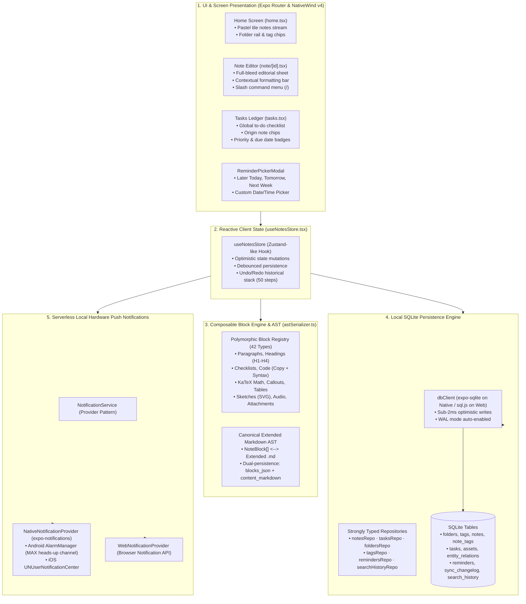
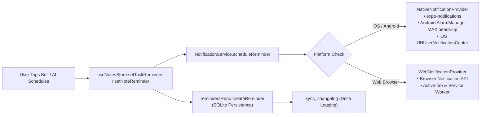

# ScribeX Unified Frontend Master Specification

> **Document Classification:** Master High-Level Specification & Single Source of Truth (SSOT) for Frontend  
> **Scope:** UI/UX Architecture, 42 Input Blocks, AST Serialization, Local SQLite Engine, Hardware Reminders, and Knowledge Graph  
> **Design Philosophy:** Local-First (<2ms Latency), Full-Bleed Editorial Canvas, Pastel Tile Design, and Non-Generic Native Aesthetics  
> **Status:** Authoritative Architectural Master  

---

## 1. Executive Summary & Core Architectural Goals

ScribeX is a modern, high-performance personal intelligence operating system and universal note-taking canvas built on React Native / Expo SDK 57 and NativeWind v4.

The frontend is guided by four non-negotiable principles:
1. **Manual Canvas First, AI Assistant Second:**  
   The core of ScribeX is a friction-free note-taking engine with sub-2ms local SQLite speed. The user is never blocked by network spinners, mandatory categorization, or forced AI onboarding. Human manual typing, block reordering, and task tracking work 100% offline.
2. **Full-Bleed Native Canvas (No Generic Boxy Cards):**  
   The interface strictly rejects cookie-cutter SaaS dashboards, outer bordered container cards (`rounded-3xl` with outer borders), and boxy widget grids. Screens (`home.tsx`, `note/[id].tsx`, `tasks.tsx`) are continuous, edge-to-edge editorial sheets with pastel color accents and circular controls.
3. **Dual-Engine Bifurcation (Notes $\leftrightarrow$ Tasks):**  
   The app is cleanly bifurcated into two primary workflows accessible via a floating minimalist bottom dock:
   * **Part 1 — Notes (The Creative Canvas):** Pastel tile stream, 42 composable input blocks, hierarchical folders, multi-tags, bidirectional `[[Note Title]]` links, and rich media capture.
   * **Part 2 — Tasks (The Execution Ledger):** Unified task board linking embedded note checklists to the global task ledger.
4. **Local-First SQLite Engine with Optimistic UI:**  
   Every user action (keystroke, block insert, task toggle, reminder scheduling) commits to local SQLite in under 2ms with optimistic UI updates. Changes append to `sync_changelog` with a monotonic `sync_rev`, making the local database cloud-sync ready for Phase 2 Supabase CDC.

---

## 2. High-Level Frontend Architecture



---

## 3. The Composable Block Engine & 42 Input Methods

Rather than maintaining separate siloed apps for text, sketches, audio, or PDFs, ScribeX unifies all 42 input methods through composable **content blocks** within a single note:

```
┌────────────────────────────────────────────────────────────────────────┐
│                        42 NOTE INPUT METHODS                           │
├────────────────────────┬───────────────────────┬───────────────────────┤
│ A. Text & Rich-Text    │ B. Lists & Tasks      │ C. Structured Data    │
│  1. Basic text note    │  6. Checklist         │ 11. Bullet/number list│
│  2. Rich-text document │  7. Nested checklist  │ 12. Tables/spreadsheet│
│  3. Long-form outline  │  8. Kanban board      │ 13. Code block        │
│  4. Markdown note      │  9. Advanced task     │ 14. Math & LaTeX      │
│  5. Template-based     │ 10. Habit tracker     │ 15. Quotes & callouts │
├────────────────────────┼───────────────────────┼───────────────────────┤
│ D. Visual & Drawings   │ E. Audio & Media      │ F. Files & Web        │
│ 16. Image attachment   │ 21. Voice recording   │ 26. Document (PDF/DOC)│
│ 17. Camera & scan OCR  │ 22. Voice dictation   │ 27. Spreadsheets/PPT  │
│ 18. Sketch canvas      │ 23. Meeting recorder  │ 28. Web bookmarks     │
│ 19. Handwritten notes  │ 24. Video attachment  │ 29. Web clipping      │
│ 20. Whiteboard/diagram │ 25. Video/lecture note│ 30. Email & messages  │
│                        │                       │ 31. Generic files     │
├────────────────────────┴───────────────────────┴───────────────────────┤
│ G. Relational & Smart Notes (32–42)                                    │
│ 32. Daily journal      36. Bidirectional link   40. Smart collection   │
│ 33. Meeting notes      37. Entity graph node    41. Email-to-note      │
│ 34. Contact / person   38. Tag index note       42. Webhook intake     │
│ 35. Project tracker    39. Timeline entry                              │
└────────────────────────────────────────────────────────────────────────┘
```

### 3.1. Canonical Extended Markdown AST (`astSerializer.ts`)
* Notes maintain **dual-persistence**:
  * `blocks_json`: Full JSON array of `NoteBlock` objects for 60fps interactive React Native rendering.
  * `content_markdown`: Canonical extended markdown for FTS5 full-text indexing, cloud exports, and LLM prompt context injection.
* **Lossless Roundtripping:** Every block parses from and serializes to extended markdown without information loss (verified by `npm run audit:all` with 36/36 tests passing).

---

## 4. Local SQLite Persistence & Repositories

### 4.1. The 10 SQLite Tables
1. `folders`: Hierarchical directory tree with recursive paths and color tokens.
2. `tags`: Unique `#tag` labels with color tokens.
3. `notes`: Core living notes ledger (title, blocks_json, content_markdown, reminder_at, status).
4. `note_tags`: Many-to-many junction table between notes and tags.
5. `tasks`: Single source of truth for all tasks (due_date, priority, is_completed, reminder_at).
6. `reminders`: Serverless hardware reminder ledger (target_type, target_id, trigger_at, is_dismissed).
7. `assets`: Binary asset metadata (storage_key, drive_file_id, mime_type, sha256_hash).
8. `entity_relations`: Knowledge graph edges (`relates_to`, `supersedes`, `derived_from`, `part_of`, `contradicts`).
9. `sync_changelog`: Event-sourced delta log tracking every insert, update, and delete with monotonic `sync_rev`.
10. `search_history`: Recent query text, source (`text`, `voice`, `ai`), and filter snapshots.

### 4.2. Repository Architecture
* `notesRepo.ts`: Note CRUD, folder assignment, status transitions (`active`, `archived`, `trashed`), and soft-delete trash cascade.
* `tasksRepo.ts`: Task CRUD, checklist block synchronization, completion toggles, and priority weights.
* `remindersRepo.ts`: Reminder CRUD, active alarm queries, and `sync_changelog` delta emission.
* `foldersRepo.ts`: Nested folder trees, rename, reparenting, and recursive path recalculations.
* `tagsRepo.ts`: Tag lookup, creation, and note-tag junction operations.
* `searchHistoryRepo.ts`: Recent search queries with usage count tracking.

---

## 5. Serverless Local Hardware Push Notifications & Reminders

ScribeX delivers reliable hardware push alarms **without requiring an external backend daemon or recurring server compute**:



### 5.1. Key Guarantees & Lifecycle Invariants
1. **Auto-Cancellation on Task Completion:** Completing a task immediately cancels the pending native hardware alarm and sets `is_dismissed = 1` in `reminders`.
2. **Cascade Cleanup:** Deleting a note or task automatically purges and cancels all associated reminders.
3. **Past-Date Guardrail:** If an alarm trigger is in the past ($T \le \text{now}$), it is gracefully rejected rather than causing OS scheduling crashes.
4. **Preset Selector Modal (`ReminderPickerModal.tsx`):** Offers instant presets (Later Today, Tomorrow Morning, Next Week, Custom Date/Time, Clear Reminder).

---

## 6. Unified Task Engine (Embedded Checklists $\leftrightarrow$ Global Tasks)

Tasks follow the **Single Source of Action (SSOA)** paradigm:
* A checklist point inside an embedded `ChecklistBlock` within a meeting note has a permanent `taskId`.
* That exact task appears on the global **Tasks Ledger** (`TasksView.tsx`).
* **Bidirectional Reactive Sync:**
  * Checking off a box in the note editor updates the global Tasks view in <2ms.
  * Checking off a task in the Tasks view updates the checkbox inside the note editor in <2ms.
* Standalone quick tasks can also be created directly in the Tasks view without creating a full note.

---

## 7. Responsive Layout & Pastel Tile Design System

* **Pastel Tile Palette:** High-contrast `#191919` dark typography set against soft, soothing pastel backgrounds:
  * `apricot` (`#FFE5D9`), `coral` (`#FFD8D8`), `lime` (`#E2F0CB`), `lavender` (`#E8D7F1`), `cyan` (`#D0F0FD`), `pink` (`#FDE2E4`), `sky` (`#D8E2DC`).
* **Invisible Editorial Sheet:** The note editor removes artificial card borders, header strips, and generic boxes, presenting an uninterrupted writing canvas.
* **Mobile-First Geometry:**
  * Viewports < 640px display a compact `EditorHeader` with an overflow menu (`...`).
  * Horizontal command bar (`EditorCommandBar`) scrolls smoothly with `flexGrow: 0` and `flexShrink: 0`.
  * Touch targets are guaranteed $\ge$ 44px with `hitSlop` protection on small icon buttons.

---

## 8. Quality Gates & Headless Verification Suites

All frontend features are guarded by automated headless test harnesses that run in low-spec environments without requiring heavy emulators or Metro bundlers:

| Test Harness Script | Command | Coverage & Invariants |
| :--- | :--- | :--- |
| `scripts/run_cross_platform_audit.mjs` | `npm --prefix frontend run audit:all` | 36/36 Block AST lossless roundtrips & schema compilation. |
| `scripts/test_headless_interactions_and_history.mjs` | `npm --prefix frontend run test:interactions` | 30/30 Headless state mutations, 50-step deep undo/redo stack. |
| `scripts/test_headless_reminders_and_notifications.mjs` | `node scripts/test_headless_reminders_and_notifications.mjs` | 25/25 Hardware alarms, provider pattern, and multi-device CDC simulation. |
| `scripts/test_cross_platform_ui_ux.mjs` | `npm --prefix frontend run test:uiux` | 13/13 Full-bleed canvas, hitSlop touch targets, and React Native flex safety. |

