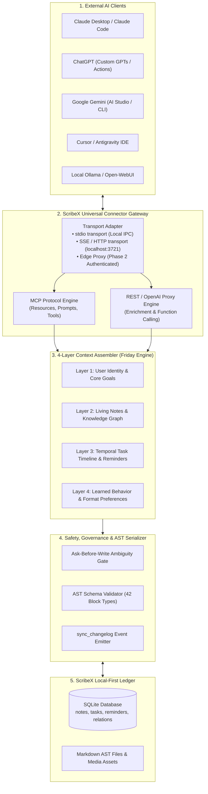

# ScribeX Universal AI Connector & MCP Server Architecture

> **Target Ecosystem:** Cross-AI (Google Gemini, Anthropic Claude, OpenAI ChatGPT, Cursor, Antigravity, Local Ollama)  
> **Protocols:** Model Context Protocol (MCP) + OpenAI-Compatible Tool-Calling REST Gateway  
> **Core Guarantee:** Gives any external AI application exact parity with the native ScribeX Friday AI assistant—sharing the same 4-layer cognitive memory, vault search, task execution engine, and serverless reminder system without vendor lock-in.

---

## 1. Executive Summary & Architectural Overview

ScribeX is designed as a user-owned, local-first intelligence operating system. The **Universal AI Connector** bridges your local SQLite vault, Markdown AST blocks, and task ledger to any external AI client through two standardized interfaces:

1. **Native MCP Server (`scribex-mcp`):** Standardized protocol for Claude Desktop, Antigravity, Cursor, Zed, and modern developer agents over `stdio` and Server-Sent Events (SSE).
2. **OpenAI & Anthropic REST Gateway (`/v1/chat/completions`):** Enables ChatGPT (Custom Actions / Custom GPTs), web frontends, and automation workflows (LangChain, n8n, Zapier) to talk directly to your ScribeX vault.



---

## 2. The 4-Layer Shared Cognitive Memory Context

Every external AI connected via the Universal Connector receives the **exact same system context** that Friday uses internally:

| Memory Layer | Source in Vault | What It Provides to Gemini / Claude / ChatGPT |
| :--- | :--- | :--- |
| **Layer 1: Identity & North Star** | `_core/identity.md` & profile | User background, communication tone, long-term goals, active projects, values. |
| **Layer 2: Living Notes & Graph** | `notes`, `tags`, `entity_relations` | Active note contents, semantic backlinks, parent-child folder paths, and knowledge graph edges. |
| **Layer 3: Temporal Task Ledger** | `tasks`, `reminders` | Pending tasks, priorities (`urgent`, `high`, `medium`, `low`), due dates, and scheduled reminder alarms. |
| **Layer 4: Learned Preferences** | `_core/learnings.jsonl` | Formatting style, preferred block types, past edits, and personalized correction history. |

---

## 3. Standardized MCP Tool Catalog (Agentic Workflows)

When an AI connects via MCP or REST function calling, it receives a strongly typed tool catalog:

### 3.1. Vault Query Tools (Read-Only)

```typescript
// 1. Semantic and Keyword Vault Search
interface SearchVaultParams {
  query: string;               // Natural language or keyword query
  folderPath?: string;         // Filter by folder e.g. "Work/Projects"
  tags?: string[];             // Filter by tags e.g. ["urgent", "client"]
  limit?: number;              // Default: 10
}

// 2. Full Note Inspection with Relations
interface ReadNoteParams {
  noteId: string;              // Note UUID
  includeBacklinks?: boolean;  // Include notes linking to this note
  includeRelations?: boolean;  // Include entity relations (supersedes, contradicts, etc.)
}

// 3. Task & Reminder Ledger Query
interface ListTasksParams {
  filter?: 'all' | 'pending' | 'completed';
  priority?: 'urgent' | 'high' | 'medium' | 'low';
  dueDate?: 'Today' | 'Tomorrow' | 'Upcoming' | string;
  hasReminder?: boolean;
}
```

### 3.2. Agentic Mutation Tools (Write & Plan)

```typescript
// 4. Create Note with Full Extended Markdown AST
interface CreateNoteParams {
  title: string;
  contentMarkdown: string;     // Extended Markdown
  folderPath?: string;         // Default: "General"
  tags?: string[];
  colorToken?: 'lime' | 'apricot' | 'cyan' | 'coral' | 'lavender' | 'pink' | 'sky';
  reminderAt?: string;         // ISO 8601 UTC timestamp
}

// 5. Update Existing Note
interface UpdateNoteParams {
  noteId: string;
  appendMarkdown?: string;     // Safely append content
  title?: string;
  tags?: string[];
  reminderAt?: string | null;  // Update or clear reminder
}

// 6. Create Task with Push Notification Reminder
interface CreateTaskParams {
  title: string;
  priority?: 'none' | 'low' | 'medium' | 'high' | 'urgent';
  dueDate?: string;            // e.g. "Today", "Tomorrow", "2026-11-15"
  reminderAt?: string;         // ISO 8601 UTC timestamp to schedule OS push alarm
  noteId?: string;             // Optional origin note link
}

// 7. Update / Complete Task
interface ToggleTaskParams {
  taskId: string;
  isCompleted: boolean;        // Automatically dismisses scheduled alarm when true
}

// 8. Explicit Reminder Scheduling
interface ScheduleReminderParams {
  targetType: 'task' | 'note' | 'event';
  targetId: string;
  triggerAt: string;           // ISO 8601 UTC timestamp
  title: string;
  body: string;
}
```

---

## 4. MCP Resource URIs & Prompts

In addition to tools, the MCP server exposes standardized **Resources** that desktop clients (like Claude Desktop) can automatically embed in their context window:

```
scribex://vault/identity         -> Full Layer 1 user profile & identity
scribex://tasks/today            -> All tasks due today with priorities
scribex://reminders/active       -> All pending scheduled alarms
scribex://notes/recent           -> Last 15 modified notes
scribex://notes/{noteId}         -> Individual note Extended Markdown AST
scribex://graph/relations        -> Knowledge graph connections
```

### Standardized MCP Prompts:
* `daily-briefing`: Generates a proactive morning briefing using pending tasks, events, and active project notes.
* `review-revisit-notes`: Surfaces notes whose `reminder_at` has elapsed for quick review or synthesis.
* `synthesize-meeting`: Ingests meeting notes, links related contact cards, and extracts action items into the tasks table.

---

## 5. Security, Invariants & AST Integrity

External AI tools cannot directly write raw SQL. All operations must pass through the **ScribeX Engine Contract**:

1. **AST Sanitization:**
   * External markdown strings are parsed through `astSerializer.ts` to convert lists, tables, callouts, and events into native `ComposableBlock[]`.
2. **Monotonic `sync_changelog` Preservation:**
   * Every creation, update, and deletion made by an external AI writes to `sync_changelog` with `entity_type: 'note'` or `'reminder'` and increments `sync_rev`.
   * Phase 2 cloud sync automatically broadcasts external AI changes to all mobile and web devices.
3. **Ask-Before-Write Ambiguity Gate:**
   * Destructive actions (`delete_note`, `empty_trash`, bulk updates) require explicit confirmation prompts before committing to SQLite.
4. **Local Hardware Push Alarms:**
   * When an external AI calls `schedule_reminder` or `create_task(reminderAt: ...)`, ScribeX's `NotificationService` immediately schedules the local device alarm (`AlarmManager` / `UNUserNotificationCenter` / Web Notifications). The user gets the notification on their hardware regardless of whether the external AI app remains open!

---

## 6. Implementation File Manifest

The connector is structured as a modular package (`packages/connector/` or `connector/`):

```
connector/
├── package.json                   # Standalone connector CLI package
├── src/
│   ├── index.ts                   # Entry-point (CLI runner)
│   ├── server.ts                  # MCP Server instance (@modelcontextprotocol/sdk)
│   ├── transports/
│   │   ├── stdio.ts               # Local IPC transport for Claude Desktop / Cursor
│   │   └── sse.ts                 # HTTP SSE transport for remote / web clients
│   ├── rest/
│   │   ├── app.ts                 # Express / Hono lightweight REST bridge
│   │   └── routes/
│   │       ├── openai.ts          # /v1/chat/completions OpenAI-compatible bridge
│   │       └── anthropic.ts       # /v1/messages Anthropic-compatible bridge
│   ├── context/
│   │   ├── layer1Identity.ts      # Identity loader
│   │   ├── layer2Vault.ts         # Note graph loader
│   │   ├── layer3Timeline.ts      # Task & reminder state loader
│   │   └── contextAssembler.ts    # Unified prompt enricher
│   ├── tools/
│   │   ├── searchTools.ts         # search_vault, read_note
│   │   ├── taskTools.ts           # create_task, toggle_task, schedule_reminder
│   │   └── noteTools.ts           # create_note, update_note
│   └── bridge/
│       └── sqliteBridge.ts        # Direct local SQLite / repositories bridge
└── tests/
    └── test_connector_headless.mjs # Zero-dependency verification harness
```

---

## 7. Connecting External AI Apps (Quick Reference)

### 1. Claude Desktop (`claude_desktop_config.json`)
```json
{
  "mcpServers": {
    "scribex": {
      "command": "node",
      "args": ["C:/Users/Nash/Documents/codebase/scribeX/connector/dist/index.js"]
    }
  }
}
```

### 2. Antigravity / Cursor IDE (`mcp.json`)
```json
{
  "servers": [
    {
      "name": "scribex",
      "transport": "stdio",
      "command": "node",
      "args": ["C:/Users/Nash/Documents/codebase/scribeX/connector/dist/index.js"]
    }
  ]
}
```

### 3. OpenAI / ChatGPT Custom Actions
```yaml
openapi: 3.1.0
info:
  title: ScribeX Vault Bridge
  version: 1.0.0
servers:
  - url: http://localhost:3721/v1
paths:
  /vault/search:
    get:
      operationId: searchVault
      parameters: ...
  /tasks/create:
    post:
      operationId: createTask
      requestBody: ...
```

---

## 8. Verification Strategy

* **Zero-Dependency Automated Runner:** `scripts/test_connector_headless.mjs`
  * Tests MCP protocol handshake (initialize, tools/list, tools/call).
  * Simulates Claude or Gemini issuing a `create_task` with a reminder and asserts that both the SQLite database row and the notification trigger are registered.
  * Simulates multi-turn context assembly ensuring Layers 1–4 are accurately injected.
