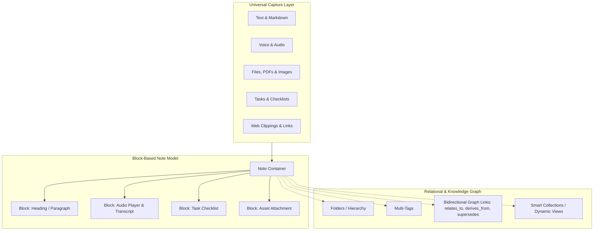
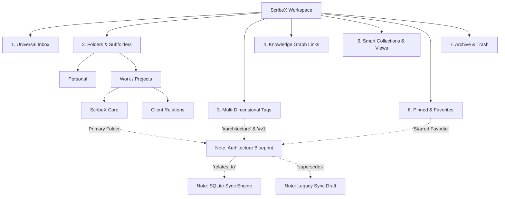
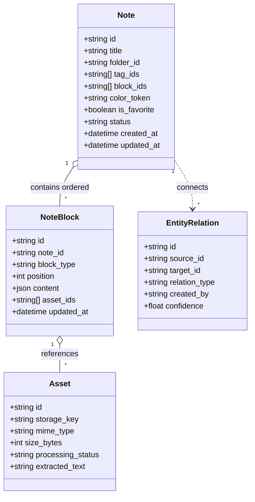
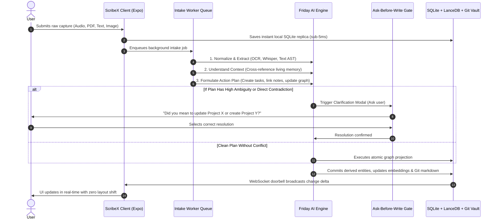

# ScribeX — Universal Note Input & AI Integration Blueprint

> **Document Status:** Reference Architecture & Specification  
> **Source Origin:** ScribeX Universal Note Input & AI Integration Blueprint  
> **Related Specifications:**  
> - [ScribeX-Pastel-Tile-UI-Design-System.md](file:///Users/nash/Documents/FrontEnd%20Development/ai_projects/scribeX/docs/ScribeX-Pastel-Tile-UI-Design-System.md)  
> - [Technical_System_Architecture.md](file:///Users/nash/Documents/FrontEnd%20Development/ai_projects/scribeX/docs/Technical_System_Architecture.md)  
> - [Product_Requirements.md](file:///Users/nash/Documents/FrontEnd%20Development/ai_projects/scribeX/docs/Product_Requirements.md)  
> - [Phase_2_Implementation_Plan.md](file:///Users/nash/Documents/FrontEnd%20Development/ai_projects/scribeX/docs/Phase_2_Implementation_Plan.md)

---

## Executive Summary & Core Principle

The ScribeX note-taking and knowledge architecture is founded upon one foundational principle:

> **The user must be able to capture anything in the fastest possible friction-free way, while the AI assistant ("Friday") handles organization, synthesis, cross-note connections, and follow-up actions.**

ScribeX transcends traditional note apps: it unifies a focused block-based notes editor, a living personal knowledge base, a unified task engine, an asset file vault, continuous episodic memory, and an proactive AI assistant. 

### Fundamental Design Axiom: Notes vs. Content Blocks
**Not every input method requires a separate note type or isolated subsystem.**  
A single note can seamlessly contain a checklist, a voice recording, an uploaded PDF, and an interactive sketch canvas as composable **content blocks**. Meanwhile, **folders, tags, smart collections, and knowledge graph links** define the multi-dimensional relationships across notes without forcing arbitrary data duplication.

### Core Two-Part Dual Engine: 1 — Notes & 2 — Tasks
At the root user journey level, the application interface is cleanly bifurcated into two high-velocity workspaces unified by a floating minimalist bottom navigation dock:

1. **Part 1 — Notes (The Creative Canvas):**
   - Houses the full pastel tile stream (`apricot`, `coral`, `lime`, `lavender`, `cyan`, `pink`, `sky`) with high-contrast `#191919` dark text.
   - Houses the **Universal Quick Capture Ribbon (Level 0 Ingest)** for instant thought capture (<5ms write).
   - Houses all 42 input types structured into composable blocks (rich markdown, code, math, audio memos, drawings, attachments, and bidirectional backlinks).
   - Filterable by folder hierarchy, multi-tags, and starred favorites.

2. **Part 2 — Tasks (The Execution Ledger):**
   - A dedicated, high-velocity checklist interface reflecting atomic action items.
   - **Single Source of Truth:** Tasks embedded inside note checklist blocks are automatically projected into the global Tasks ledger. Checking off a task in Tasks instantly updates the origin note checklist.
   - **Origin Note Chips:** Tasks originating from a note display a subtle pastel chip linking directly to their parent note.
   - **Standalone Quick Tasks:** Users can capture tasks directly into the ledger without creating a full note.




---

## 1. Complete Catalog of Note Creation and Input Methods (42 Methods)

The 42 note creation and input methods synthesize industry patterns (Apple Notes, Google Keep, Notion, Obsidian, OneNote, Evernote) adapted to ScribeX’s AI-first cognitive vault.

```
┌────────────────────────────────────────────────────────────────────────┐
│                        42 NOTE INPUT METHODS                           │
├────────────────────────┬───────────────────────┬───────────────────────┤
│ A. Text & Rich-Text    │ B. Lists & Tasks      │ C. Structured Data    │
│  1. Basic text note    │  6. Checklist         │ 11. Bullet/number list│
│  2. Rich-text document │  7. Nested checklist  │ 12. Tables/spreadsheet│
│  3. Long-form outline  │  8. Kanban board      │ 13. Code block        │
│  4. Markdown note      │  9. Advanced task     │ 14. Math & LaTeX      │
│  5. Template-based     │ 10. Habit tracker     │ 15. Quotes & callouts │
├────────────────────────┼───────────────────────┼───────────────────────┤
│ D. Visual & Drawings   │ E. Audio & Media      │ F. Files & Web        │
│ 16. Image attachment   │ 21. Voice recording   │ 26. Document (PDF/DOC)│
│ 17. Camera & scan OCR  │ 22. Voice dictation   │ 27. Spreadsheets/PPT  │
│ 18. Sketch canvas      │ 23. Meeting recorder  │ 28. Web bookmarks     │
│ 19. Handwritten notes  │ 24. Video attachment  │ 29. Web clipping      │
│ 20. Whiteboard/diagram │ 25. Video/lecture note│ 30. Email & messages  │
│                        │                       │ 31. Generic files     │
├────────────────────────┴───────────────────────┴───────────────────────┤
│ G. Contextual & Specialized Inputs                                     │
│ 32. Location note              38. Share-sheet capture                 │
│ 33. Date and event note        39. Drag-and-drop capture               │
│ 34. Contact or person note     40. Import and migration                │
│ 35. Expense or receipt note    41. Email-to-note capture               │
│ 36. Reading list bookmark      42. External integration capture        │
│ 37. Clipboard quick capture                                            │
└────────────────────────────────────────────────────────────────────────┘
```

### A. Text and Rich-Text Notes

| # | Input Method | Description | Implementation & AI Capability |
|---|---|---|---|
| **1** | **Basic Text Note** | Quick thoughts, spontaneous ideas, personal observations, and unstructured journal entries. | Autosaves on keystroke. AI analyzes raw text to infer cognitive intent, extract topics, and suggest an accurate title. |
| **2** | **Rich-Text Document** | Formatted text including headings (H1–H4), bold, italic, underline, strikethrough, highlights, text colors, and inline links. | WYSIWYG editing surface with clean typography. Inline formatting markers parsed into structured AST tokens. |
| **3** | **Structured Long-Form Note** | Document with nested headings, collapsible disclosure toggles, table of contents, and document outlines. | Collapsible sections preserve focus in deep documents. Outline generator builds navigable hierarchy tree. |
| **4** | **Markdown Note** | Full CommonMark and GitHub Flavored Markdown (GFM) syntax with live preview for technical documentation and developer notes. | Direct two-way sync with local Git projection vault. Preserves raw `.md` fidelity with YAML frontmatter. |
| **5** | **Template-Based Note** | Pre-structured layouts for 1:1 meetings, daily journals, retrospective analysis, project specs, and interviews. | Parameterized templates instantiate recurring scaffolding with pre-configured block structures and metadata tags. |

> **Implementation Rule:** Treat Category A inputs as different editor configurations and templates rather than distinct storage schemas.

---

### B. Lists, Tasks, and Actionable Notes

| # | Input Method | Description | Implementation & AI Capability |
|---|---|---|---|
| **6** | **Checklist / To-Do List** | Tappable checkboxes with checked/unchecked states, drag-and-drop reordering, and bulk-completion toggles. | Items maintain reactive completion states. Checked items sync completion timestamps into local SQLite. |
| **7** | **Nested Checklist** | Multi-level hierarchy with parent tasks, sub-tasks, and recursive task decomposition. | Parent checkbox reflects aggregated child completion percentage. Supports tab/shift-tab indentation. |
| **8** | **Kanban Board** | Task cards distributed across customizable workflow columns (`Inbox`, `To Do`, `In Progress`, `Blocked`, `Done`). | Drag-and-drop state transitions. Updates status metadata on underlying task entities in real-time. |
| **9** | **Advanced Task** | Rich task records with due dates, reminder alerts, priority weights (Low/Med/High/Urgent), recurrence rules, and dependency links. | Maps to unified task engine. Due dates feed notification triggers; dependencies block downstream tasks. |
| **10** | **Habit Tracker** | Daily or recurring check-ins with streak counters, completion history logs, and trend visualizations. | Recurring reset intervals. AI calculates completion consistency and detects habit decay over time. |

> **Critical Architectural Rule (Unified Task Model):** A checklist item embedded inside a note and an advanced task in the global task manager refer to the **same underlying task entity**. Completing a task inside a meeting note immediately updates the global task board, and vice versa.

---

### C. Structured Data and Visual Organization

| # | Input Method | Description | Implementation & AI Capability |
|---|---|---|---|
| **11** | **Bulleted & Numbered Lists** | Unordered bullet lists, ordered procedural steps, alphabetical lists, and multi-level outlines. | Keyboard shortcut support (`- `, `1. `). Preserves hierarchical indentation in local markdown projection. |
| **12** | **Tables and Spreadsheets** | Interactive grid with editable rows, columns, headers, formula evaluation, and sorting/filtering controls. | Supports CSV/TSV copy-paste and export. Structured tabular data stored as JSON blocks for relational querying. |
| **13** | **Code Block** | Monospace code container with syntax highlighting for 50+ languages, line numbering, and one-click clipboard copy. | Formatted using Prism/Highlight engines. Code language detected automatically by AI if unspecified. |
| **14** | **Math and Equations** | Inline and display LaTeX equations rendered via KaTeX with real-time formula previews. | Mathematical notation stored as raw LaTeX source strings; rendered client-side into accessible SVG/MathML. |
| **15** | **Quote, Callout & Divider Blocks** | Distinct colored callout boxes (Info, Warning, Success, Quote) and thin section dividers. | Visual emphasis for key insights, disclaimers, and section boundaries without polluting body text hierarchy. |

---

### D. Image, Drawing, and Handwriting Inputs

| # | Input Method | Description | Implementation & AI Capability |
|---|---|---|---|
| **16** | **Image Attachment** | Inline raster/vector images (PNG, JPEG, WebP, SVG) with captions, full-screen lightbox, and ordering controls. | Stored in asset storage; thumbnails cached locally. Visual recognition engine generates captions and topic tags. |
| **17** | **Camera & Document Scanning** | Native mobile camera capture with edge detection, perspective rectification, contrast optimization, and multipage batching. | Built-in OCR pipeline extracts text from paper documents, whiteboard photos, receipts, and business cards into searchable text. |
| **18** | **Drawing & Sketch Canvas** | Vector-based freehand sketch pad with pen, highlighter, shape snapping, eraser, color palette, and undo/redo stacks. | Canvas strokes stored as vector paths (JSON/SVG) enabling infinite scaling and non-destructive re-editing. |
| **19** | **Handwritten Notes** | Stylus/Apple Pencil input surface with pressure sensitivity and palm rejection. | On-device handwriting recognition converts handwriting strokes into editable, indexable plain text. |
| **20** | **Whiteboard & Diagram** | Infinite spatial canvas with sticky notes, connected flowcharts, mind maps, and entity relation diagrams. | Nodes and connector edges maintain spatial coordinates. Graph layout algorithm enables structural navigation. |

---

### E. Audio, Voice, and Video

| # | Input Method | Description | Implementation & AI Capability |
|---|---|---|---|
| **21** | **Voice Recording** | Embedded audio recorder with waveform visualizer, playback speed controls (1x/1.5x/2x), and scrub bar. | Audio preserved in original fidelity. Derives lightweight compressed audio for streaming across clients. |
| **22** | **Voice-to-Text Dictation** | Real-time speech recognition converting live speech directly into editable markdown text. | Sub-second streaming transcription. Distinguishes live dictation from persistent audio file retention. |
| **23** | **Meeting Recorder** | Extended multi-speaker audio capture with speaker diarization, synchronized timestamped transcripts, and key takeaway generation. | Generates structured meeting minutes: executive summary, decisions made, and explicit action items assigned to participants. |
| **24** | **Video Attachment** | Direct video uploads or streaming links (MP4, MOV, WebM) with inline player and frame thumbnail generator. | Video assets indexed with metadata; keyframe extraction generates visual checkpoints for scrubbing. |
| **25** | **Video / Lecture Notes** | Video player paired side-by-side with timestamped notes, allowing clicks on notes to jump directly to specific video moments. | Timestamps link directly to video timecodes (`mm:ss`). Transcripts parsed into searchable vector embeddings. |

---

### F. Documents, Links, and External Content

| # | Input Method | Description | Implementation & AI Capability |
|---|---|---|---|
| **26** | **Document Attachment** | Embedded PDF, DOCX, EPUB, and TXT files with document viewer and page thumbnail sidebar. | Original binary preserved in asset vault. Background worker extracts plain text, layout headings, and tables. |
| **27** | **Spreadsheet & Presentation Files** | Embedded XLSX, CSV, PPTX, and Keynote files with preview thumbnails and sheet selector tabs. | Tabular sheets converted into searchable datasets; presentation slides indexed with extracted slide text. |
| **28** | **Web Link & Bookmark** | Rich link preview cards displaying OpenGraph title, description, thumbnail image, favicon, and canonical domain. | Headless fetcher extracts OpenGraph metadata and caches clean reader-mode text snapshots. |
| **29** | **Web Clipping** | Browser extension capture saving entire web articles, selected text snippets, or screenshots directly into ScribeX. | HTML sanitized into clean Markdown. Strips ads, navigation bars, and tracking scripts while retaining source URL and timestamp. |
| **30** | **Email & Message Capture** | Forwarded emails or captured chat messages preserving sender, recipient list, date, subject line, and attachments. | Email headers normalized into note metadata; thread messages rendered in chronological conversational order. |
| **31** | **Generic File Attachment** | Universal container supporting archives (ZIP), code repositories, raw data files, and audio assets. | Binary files stored securely with MIME type detection, cryptographic SHA-256 hash validation, and virus checking. |

---

### G. Location, Time, and Specialized Inputs

| # | Input Method | Description | Implementation & AI Capability |
|---|---|---|---|
| **32** | **Location Note** | Geographic checkpoint with place name, street address, GPS coordinates (lat/lng), and map thumbnail. | Reverse geocoding resolves raw coordinates to human locations. Enables geo-fenced spatial search. |
| **33** | **Date & Event Note** | Calendar event link with scheduled start/end dates, all-day flags, location links, and reminder triggers. | Synchronizes with system calendar; links meeting participants to personal contact cards in the vault. |
| **34** | **Contact / Person Note** | Living cognitive profile for an individual (name, organization, role, interaction history, relationship notes). | Privacy-gated profile card. Links all meetings, notes, and tasks where this person is tagged or mentioned. |
| **35** | **Expense / Receipt Note** | Financial record capturing total amount, currency, merchant name, purchase date, category, and receipt image. | OCR pipeline extracts line items, taxes, and totals into structured JSON, linking to monthly budget buckets. |
| **36** | **Bookmark / Reading List Item** | Reading queue item with consumption status (`Unread`, `Reading`, `Finished`), rating, and reading notes. | Tracks reading progress. AI provides synthesized executive summaries of articles or book chapters. |
| **37** | **Clipboard Quick Capture** | Floating global shortcut or menu bar listener that captures clipboard text, screenshots, or URLs instantly. | Instant background write to Universal Inbox without interrupting the user's active desktop workflow. |
| **38** | **Share-Sheet Capture** | Mobile OS Share Extension receiver (iOS / Android) enabling 1-tap ingest from Safari, Twitter, YouTube, etc. | Normalizes incoming shared payloads (URLs, images, text, PDFs) into pending Inbox entities. |
| **39** | **Drag-and-Drop Capture** | Dragging files, images, browser URLs, or text selections directly onto the ScribeX desktop window or note editor. | Dynamic drop target indicates target insertion position; immediately begins non-blocking background upload. |
| **40** | **Import & Migration** | Batch importer supporting Evernote ENEX, Notion ZIP, Apple Notes, Obsidian vaults, and Markdown folders. | Parses legacy formats, normalizes attachment links, migrates tags, and recreates folder hierarchy in SQLite. |
| **41** | **Email-to-Note Ingest** | Dedicated inbound email address (`username@inbox.scribex.ai`) that parses inbound emails into Inbox notes. | Cryptographic DKIM/SPF verification; extracts email body and attachments into a structured note container. |
| **42** | **External Integration Ingest** | Webhook connectors syncing events from Google Calendar, GitHub PRs, Slack saved messages, and Readwise. | Event listener ingests external events and automatically links them to corresponding projects in the knowledge graph. |

---

## 2. Note Organization Methods, Hierarchy & Relational Model

Input methods govern **how content enters the system**; organization methods govern **where content lives and how knowledge connects**.



### The 8 Structural Organization Mechanisms

1. **Universal Inbox:**  
   The zero-friction landing zone for every uncategorized capture, voice note, web clipping, or imported document. The user never needs to select a category before writing. The AI processes the Inbox in the background and proposes clean destinations.
2. **Folders & Nested Folders:**  
   Hierarchical containers for explicit project nesting (e.g. `Work → Projects → ScribeX → Architecture`). Kept quiet and thin.
3. **Groups & Functional Collections:**  
   High-level functional domains (e.g. `Cognitive Identity`, `Long-Term Goals`, `Reference Vault`, `Active Operations`).
4. **Multiple Tags:**  
   Orthogonal classification labels (e.g. `#urgent`, `#idea`, `#finance`, `#draft`, `#meeting`). A note can have any number of user-defined or AI-suggested tags.
5. **Linked Notes & Knowledge Graph:**  
   Explicit bidirectional links connecting notes across categories. Relationship taxonomy includes:
   - `related_to`: General contextual connection.
   - `part_of`: Sub-component of a larger project or document.
   - `derived_from`: Generated from a meeting transcript, PDF, or interview.
   - `contradicts`: Conflicting facts between an old note and a new note.
   - `supersedes`: Replaces an older version or deprecated plan.
6. **Smart Collections (Dynamic Filtered Databases):**  
   Virtual views computed on the fly by querying attributes (e.g. `Show all notes tagged #meeting from the last 14 days with uncompleted tasks`). Can be rendered as a **Grid, List, Table, Board, or Timeline**.
7. **Pinning, Favorites & Quick Access:**  
   Surfaces critical active notes to the top of the interface without moving them out of their logical folders.
8. **Archive and Trash:**  
   - **Archive:** Inactive knowledge preserved for search and AI retrieval, but hidden from the primary workspace.
   - **Trash:** Soft-deleted items retained for a 30-day recovery window before permanent purge.

### Cardinal Architectural Rule: Cross-Boundary Relational Traversal
> **Do NOT force every note into a single mutually exclusive folder.**  
> A note has an optional primary folder, but tags, priorities, task links, and knowledge graph relationships cross folder boundaries freely. Smart collections query dynamic filters over underlying records; notes are **never duplicated** across views.

---

## 3. Universal Content Block Architecture

Rather than maintaining 42 isolated editor engines, ScribeX implements **one unified block-based editor** where every document is composed of ordered content blocks.



### Complete Content Block Registry

| Block Type (`block_type`) | Core Payload Schema (`content`) | Background AI Worker Action |
|---|---|---|
| `paragraph` | `{ text: string, marks?: Mark[] }` | Semantic vector embedding & entity extraction |
| `heading` | `{ text: string, level: 1\|2\|3\|4 }` | Document outline & table of contents indexing |
| `bulleted_list` | `{ items: string[] }` | Summary generation & key point extraction |
| `numbered_list` | `{ items: string[] }` | Sequential procedure & workflow extraction |
| `checklist` | `{ items: { id: string, text: string, checked: boolean }[] }` | Task state synchronization & progress tracking |
| `task` | `{ taskId: string, priority: string, dueDate?: string }` | Global task engine sync, reminders & planning |
| `table` | `{ columns: string[], rows: Cell[][] }` | Tabular data extraction & structured SQL querying |
| `image` | `{ assetId: string, caption?: string, width?: number }` | Vision analysis, object detection & OCR text indexing |
| `drawing` | `{ assetId: string, pathsJson: string, previewUrl: string }` | Shape & visual diagram understanding |
| `audio` | `{ assetId: string, durationSec: number }` | Whisper audio transcription & speech-to-text |
| `transcript` | `{ segments: { speaker: string, start: number, text: string }[] }` | Speaker diarization, decision mining & executive summary |
| `video` | `{ assetId?: string, url?: string, chapters?: Chapter[] }` | Scene indexing, visual OCR & timecode alignment |
| `file` | `{ assetId: string, fileName: string, size: number }` | Deep document parsing (PDF, DOCX, CSV) |
| `bookmark` | `{ url: string, title: string, description: string, previewUrl: string }` | Web page reader-mode scraping & topic indexing |
| `code` | `{ code: string, language: string, fileName?: string }` | Syntax highlighting & programming language analysis |
| `equation` | `{ latex: string, displayMode: boolean }` | LaTeX formula verification & mathematical parsing |
| `callout` | `{ text: string, variant: 'info'\|'warning'\|'success'\|'quote' }` | Key takeaway & insight classification |
| `embed` | `{ provider: string, url: string, config: json }` | Third-party metadata extraction (Figma, GitHub, Loom) |
| `divider` | `{ style: 'subtle'\|'dashed' }` | Visual separator (no AI action required) |
| `location` | `{ lat: number, lng: number, placeName: string, address: string }` | Spatial geocoding & location-based memory linking |

---

## 4. ScribeX AI Assistant ("Friday") Integration Pipeline

The AI assistant transforms raw incoming media into actionable, interconnected knowledge.



### 5-Stage Processing Engine
1. **Capture:** Instant optimistic local SQLite write; user is never blocked by a network spinner.
2. **Normalize & Extract:** Background workers perform Whisper transcription, document text extraction, vision OCR, or link scraping.
3. **Understand Context:** Maps entities against Layer 1 (Personal Identity & Mental Models) and Layer 2 (Episodic Timeline Graph).
4. **Decide Action:** Formulates specific propositions: create new note, update existing note, link notes, create global tasks, or flag contradictions.
5. **Apply & Verify:** Verifies provenance, records before-and-after audit logs, and commits changes.

### Content-to-AI Behavior Matrix

| Incoming Input Type | Friday AI Behavior |
|---|---|
| **Random Thought** | Parses meaning, identifies related ongoing projects, suggests ideal folder and tag destination. |
| **Meeting Audio** | Transcribes recording, diarizes speakers, generates executive summary, extracts explicit action items with assignees, and links to the parent project note. |
| **PDF Document** | Extracts raw text and tables, generates a 3-sentence executive summary, tags relevant topics, and connects to existing domain notes. |
| **Screenshot / Photo** | Runs OCR to extract phone numbers, dates, receipts, or error logs; suggests contextual actions based on detected text. |
| **Checklist** | Analyzes checklist items; suggests converting complex items into formal tasks with due dates. |
| **Web Article** | Scrapes core article body into clean reader Markdown, extracts key takeaways, and indexes into semantic vector search. |
| **Code Snippet** | Identifies language, analyzes purpose, links snippet to corresponding tech stack notes, and formats clean code block. |
| **Receipt / Expense** | Extracts merchant, total amount, currency, and date; logs expense item into financial tracking database. |
| **Contradicting Info** | Detects contradiction against an older stored note; pauses automatic overwrite and prompts user via Ask-Before-Write gate. |
| **Duplicate Info** | Detects redundant content; proposes merging notes or attaching as a revision without silently dropping data. |

### 4 Mandatory AI Governance Controls
1. **Preview Before Commit:** The user can inspect proposed AI updates, merges, or moves before they become permanent.
2. **Clarification Over Assumption (Ask-Before-Write Gate):** When input contains ambiguity or conflicts with established facts, Friday pauses and asks concise clarifying questions instead of hallucinating.
3. **Full Provenance & Citations:** Every AI-generated summary, fact, or task retains a clickable link back to its exact source block or file timestamp.
4. **Reversible History & Non-Destructive Edits:** All changes maintain complete revision diffs; original attachments are never modified or deleted by background processes.

---

## 5. Technical Data Architecture & Schemas

### Core Data Models (TypeScript / JSON Schemas)

```ts
/** Core Note Container */
export interface Note {
  id: string;
  user_id: string; // Multi-tenant Day-1 SaaS convention (defaults to 'default_user')
  title: string;
  folder_id?: string; // Optional folder path ID
  group_name: string; // High-level functional domain (e.g. 'Work', 'Personal', 'General')
  tag_ids: string[];
  block_ids: string[];
  color_token: 'apricot' | 'coral' | 'lime' | 'lavender' | 'cyan' | 'pink' | 'sky';
  is_favorite: boolean;
  is_pinned: boolean;
  status: 'inbox' | 'active' | 'archived' | 'trashed';
  content_markdown: string; // Canonical Extended Markdown AST representation
  blocks_json: string; // Serialized NoteBlock[] AST for instant atomic UI rendering
  priority_score: number; // 0.0 to 1.0
  sync_rev: number;
  created_at: string; // ISO 8601
  updated_at: string; // ISO 8601
  trashed_at?: string; // ISO 8601 for 30-day recovery window
}

/** Composable Content Block */
export interface NoteBlock {
  id: string;
  note_id: string;
  block_type: 
    | 'paragraph'
    | 'heading'
    | 'bulleted_list'
    | 'numbered_list'
    | 'checklist'
    | 'task'
    | 'table'
    | 'image'
    | 'drawing'
    | 'audio'
    | 'transcript'
    | 'video'
    | 'file'
    | 'bookmark'
    | 'code'
    | 'equation'
    | 'callout'
    | 'embed'
    | 'divider'
    | 'location';
  position: number;
  content: Record<string, unknown>;
  asset_ids?: string[];
  created_at: string;
  updated_at: string;
}

/** Hierarchical Folder */
export interface Folder {
  id: string;
  user_id: string;
  name: string;
  parent_id?: string; // Nullable recursive parent for nested hierarchies
  path: string; // Full physical vault directory mirror, e.g. 'Work/Projects/ScribeX'
  color_token?: 'apricot' | 'coral' | 'lime' | 'lavender' | 'cyan' | 'pink' | 'sky';
  icon?: string;
  sync_rev: number;
  created_at: string;
  updated_at: string;
}

/** Multi-Dimensional Tag */
export interface Tag {
  id: string;
  user_id: string;
  name: string; // Tag name without '#', e.g. 'architecture'
  color_token?: string;
  created_at: string;
}

/** Note-Tag Relation */
export interface NoteTag {
  note_id: string;
  tag_id: string;
}

/** Unified Task Entity (Shared between embedded note checklists & global task engine) */
export interface UnifiedTask {
  id: string;
  user_id: string;
  note_id?: string; // Nullable: tasks can exist globally or inside a note
  block_id?: string; // Nullable: links directly to the embedded checklist block
  title: string;
  is_completed: boolean;
  priority: 'low' | 'medium' | 'high' | 'urgent';
  due_date?: string; // ISO 8601
  sync_rev: number;
  created_at: string;
  updated_at: string;
}

/** Binary Asset Storage */
export interface Asset {
  id: string;
  user_id: string;
  storage_key: string; // Relative path in vault/_assets/
  file_name: string;
  mime_type: string;
  size_bytes: number;
  sha256_hash: string;
  processing_status: 'pending' | 'processing' | 'completed' | 'failed';
  extracted_text?: string;
  metadata?: Record<string, unknown>;
  created_at: string;
}

/** Explicit Knowledge Graph Relationship (Layer 2 Memory Edges) */
export interface EntityRelation {
  id: string;
  user_id: string;
  source_id: string; // Note ID or Entity ID
  target_id: string; // Note ID or Entity ID
  relation_type: 
    | 'related_to'
    | 'part_of'
    | 'derived_from'
    | 'contradicts'
    | 'supersedes';
  created_by: 'user' | 'ai';
  confidence_score: number; // 0.0 to 1.0
  created_at: string;
}

/** Event-Sourced Delta Sync Ledger */
export interface SyncChangelogRecord {
  id: number;
  user_id: string;
  sync_rev: number;
  entity_type: 'note' | 'folder' | 'tag' | 'task' | 'relation' | 'asset';
  entity_id: string;
  change_type: 'INSERT' | 'UPDATE' | 'DELETE';
  delta_payload: Record<string, unknown>;
  created_at: string;
}
```

---

### 5.1. Operational SQLite Schemas (DDL & Multi-Tenancy)

To guarantee sub-5ms local reads and concurrent multi-device sync, the backend and client SQLite replicas implement the following operational tables:

```sql
-- 1. Hierarchical Folders Table (Physical Vault Directory Mirror)
CREATE TABLE IF NOT EXISTS folders (
    id TEXT PRIMARY KEY,
    user_id TEXT NOT NULL,
    name TEXT NOT NULL,
    parent_id TEXT,                    -- Recursive parent for nested subfolders
    path TEXT NOT NULL,                -- Full mirror path, e.g. 'Work/Projects/ScribeX'
    color_token TEXT DEFAULT 'apricot',
    icon TEXT,
    sync_rev INTEGER NOT NULL,
    created_at TIMESTAMP DEFAULT CURRENT_TIMESTAMP,
    updated_at TIMESTAMP DEFAULT CURRENT_TIMESTAMP,
    FOREIGN KEY(parent_id) REFERENCES folders(id) ON DELETE CASCADE
);

CREATE INDEX IF NOT EXISTS idx_folders_user ON folders(user_id);
CREATE INDEX IF NOT EXISTS idx_folders_parent ON folders(parent_id);

-- 2. Multi-Dimensional Tags Table
CREATE TABLE IF NOT EXISTS tags (
    id TEXT PRIMARY KEY,
    user_id TEXT NOT NULL,
    name TEXT NOT NULL,                -- Tag name without '#', e.g. 'architecture'
    color_token TEXT DEFAULT 'cyan',
    created_at TIMESTAMP DEFAULT CURRENT_TIMESTAMP,
    UNIQUE(user_id, name)
);

CREATE INDEX IF NOT EXISTS idx_tags_user ON tags(user_id);

-- 3. Notes Core Table
CREATE TABLE IF NOT EXISTS notes (
    id TEXT PRIMARY KEY,
    user_id TEXT NOT NULL,
    folder_id TEXT,                    -- Foreign key to folders.id
    group_name TEXT NOT NULL,          -- High-level functional domain
    title TEXT NOT NULL,
    content_markdown TEXT NOT NULL,    -- Canonical rendered markdown representation
    blocks_json TEXT NOT NULL,         -- Serialized NoteBlock[] AST for instant atomic UI rendering
    color_token TEXT DEFAULT 'apricot',
    is_favorite INTEGER DEFAULT 0,
    is_pinned INTEGER DEFAULT 0,
    status TEXT DEFAULT 'active',      -- 'inbox', 'active', 'archived', 'trashed'
    priority_score REAL DEFAULT 0.5,
    sync_rev INTEGER NOT NULL,
    created_at TIMESTAMP DEFAULT CURRENT_TIMESTAMP,
    updated_at TIMESTAMP DEFAULT CURRENT_TIMESTAMP,
    trashed_at TIMESTAMP,
    FOREIGN KEY(folder_id) REFERENCES folders(id) ON DELETE SET NULL
);

CREATE INDEX IF NOT EXISTS idx_notes_user_status ON notes(user_id, status);
CREATE INDEX IF NOT EXISTS idx_notes_user_folder ON notes(user_id, folder_id);
CREATE INDEX IF NOT EXISTS idx_notes_user_rev ON notes(user_id, sync_rev);
CREATE INDEX IF NOT EXISTS idx_notes_user_favorite ON notes(user_id, is_favorite);
CREATE INDEX IF NOT EXISTS idx_notes_user_pinned ON notes(user_id, is_pinned);

-- 4. Note Tags Mapping Table (Many-to-Many)
CREATE TABLE IF NOT EXISTS note_tags (
    note_id TEXT NOT NULL,
    tag_id TEXT NOT NULL,
    PRIMARY KEY (note_id, tag_id),
    FOREIGN KEY(note_id) REFERENCES notes(id) ON DELETE CASCADE,
    FOREIGN KEY(tag_id) REFERENCES tags(id) ON DELETE CASCADE
);

CREATE INDEX IF NOT EXISTS idx_notetags_note ON note_tags(note_id);
CREATE INDEX IF NOT EXISTS idx_notetags_tag ON note_tags(tag_id);

-- 5. Unified Tasks Table (Single-source-of-truth across notes & global task board)
CREATE TABLE IF NOT EXISTS tasks (
    id TEXT PRIMARY KEY,
    user_id TEXT NOT NULL,
    note_id TEXT,                      -- Nullable: tasks can exist globally or inside a note
    block_id TEXT,                     -- Specific block ID if embedded in a note
    title TEXT NOT NULL,
    is_completed INTEGER DEFAULT 0,
    priority TEXT DEFAULT 'medium',    -- 'low', 'medium', 'high', 'urgent'
    due_date TIMESTAMP,
    sync_rev INTEGER NOT NULL,
    created_at TIMESTAMP DEFAULT CURRENT_TIMESTAMP,
    updated_at TIMESTAMP DEFAULT CURRENT_TIMESTAMP,
    FOREIGN KEY(note_id) REFERENCES notes(id) ON DELETE CASCADE
);

CREATE INDEX IF NOT EXISTS idx_tasks_user_status ON tasks(user_id, is_completed);
CREATE INDEX IF NOT EXISTS idx_tasks_user_rev ON tasks(user_id, sync_rev);
CREATE INDEX IF NOT EXISTS idx_tasks_user_note ON tasks(user_id, note_id);

-- 6. Binary Asset Ledger
CREATE TABLE IF NOT EXISTS assets (
    id TEXT PRIMARY KEY,
    user_id TEXT NOT NULL,
    storage_key TEXT NOT NULL,         -- Relative path in vault/_assets/
    file_name TEXT NOT NULL,
    mime_type TEXT NOT NULL,
    size_bytes INTEGER NOT NULL,
    sha256_hash TEXT NOT NULL,
    processing_status TEXT NOT NULL,   -- 'pending', 'processing', 'completed', 'failed'
    extracted_text TEXT,               -- Output of OCR, Whisper, or document parser
    created_at TIMESTAMP DEFAULT CURRENT_TIMESTAMP
);

CREATE INDEX IF NOT EXISTS idx_assets_user_status ON assets(user_id, processing_status);

-- 7. Knowledge Graph Relations (Layer 2 Memory Edges)
CREATE TABLE IF NOT EXISTS entity_relations (
    id TEXT PRIMARY KEY,
    user_id TEXT NOT NULL,
    source_id TEXT NOT NULL,
    relation_type TEXT NOT NULL,       -- 'related_to', 'part_of', 'derived_from', 'contradicts', 'supersedes'
    target_id TEXT NOT NULL,
    created_by TEXT DEFAULT 'user',    -- 'user' | 'ai'
    confidence_score REAL DEFAULT 1.0,
    created_at TIMESTAMP DEFAULT CURRENT_TIMESTAMP,
    FOREIGN KEY(source_id) REFERENCES notes(id) ON DELETE CASCADE
);

CREATE INDEX IF NOT EXISTS idx_rel_user_src ON entity_relations(user_id, source_id);
CREATE INDEX IF NOT EXISTS idx_rel_user_tgt ON entity_relations(user_id, target_id);

-- 8. Event-Sourced Delta Sync Ledger (Multi-Entity Device Sync)
CREATE TABLE IF NOT EXISTS sync_changelog (
    id INTEGER PRIMARY KEY AUTOINCREMENT,
    user_id TEXT NOT NULL,
    sync_rev INTEGER NOT NULL,
    entity_type TEXT NOT NULL,         -- 'note', 'folder', 'tag', 'task', 'relation', 'asset'
    entity_id TEXT NOT NULL,
    change_type TEXT NOT NULL,         -- 'INSERT', 'UPDATE', 'DELETE'
    delta_payload TEXT NOT NULL,       -- Serialized JSON delta
    created_at TIMESTAMP DEFAULT CURRENT_TIMESTAMP
);

CREATE INDEX IF NOT EXISTS idx_changelog_user_rev ON sync_changelog(user_id, sync_rev);

---

### 5.2. Canonical Markdown AST Serialization Specification

To ensure that notes remain **100% human-readable in the Git Vault**, accessible to **Remote PC CLI agents (Claude Code, Gemini CLI)**, and clean for **Layer 4 Diff Learning**, composable blocks serialize into standardized Extended Markdown AST:

| Block Type | Markdown AST Representation in `.md` File |
|---|---|
| `paragraph` | Standard plain text or markdown paragraph |
| `heading` | `# H1`, `## H2`, `### H3`, `#### H4` |
| `bulleted_list` | `- Item 1\n- Item 2` |
| `numbered_list` | `1. Step 1\n2. Step 2` |
| `checklist` / `task` | `- [ ] Task title <!-- scribex:task id=tsk_01j9a priority=high due=2026-10-30 -->` |
| `code` | ````language\ncode\n```` |
| `table` | Standard GFM Markdown table `\| Col 1 \| Col 2 \|\n\|---|---\|` |
| `callout` | `> [!variant]\n> Callout text content` (Obsidian / GitHub alert format) |
| `equation` | `$$ \text{LaTeX mathematical formula} $$` |
| `image` | `` |
| `audio` | ` <!-- scribex:block type=audio duration=184 -->` |
| `transcript` | `<!-- scribex:block type=transcript -->\n> **[00:15] Speaker:** Diarized text...` |
| `drawing` | ` <!-- scribex:block type=drawing -->` |
| `file` | `[FileName.pdf](_assets/file_uuid.pdf) <!-- scribex:block type=file size=1048576 -->` |
| `location` | `<!-- scribex:block type=location lat=37.7749 lng=-122.4194 place="San Francisco" -->` |
| `divider` | `---` |

* **Zero Lock-In Round-Tripping:**  
  When an external CLI agent modifies a note's `.md` file, the backend AST parser parses it back into `NoteBlock[]` objects without loss of structural IDs.

---

### 5.3. Binary Asset Ingestion & Lifecycle API Contracts

Media uploads follow an asynchronous, non-blocking lifecycle:

```
[Client] ──POST /api/v1/assets/upload──> [FastAPI Backend] ──> Saves to disk (vault/_assets/)
   │                                           │
   │                                           └── Enqueues background worker (Whisper / OCR)
   │                                           
   ◄──── WebSocket Event ("ASSET_PROCESSED") ──┘
```

1. **Upload Endpoint:**
   * `POST /api/v1/assets/upload` (`multipart/form-data`)
   * **Request:** `file: UploadFile`, `note_id?: string`, `block_id?: string`
   * **Response:**
     ```json
     {
       "id": "ast_01j9b2",
       "file_name": "quarterly_budget.pdf",
       "mime_type": "application/pdf",
       "size_bytes": 1420800,
       "storage_key": "_assets/ast_01j9b2.pdf",
       "processing_status": "processing",
       "created_at": "2026-10-25T14:30:00Z"
     }
     ```
2. **Asynchronous Notification & Status Check:**
   * While processing, client can check: `GET /api/v1/assets/{asset_id}/status`.
   * Upon completion, server broadcasts a WebSocket event to all tenant devices:
     ```json
     {
       "type": "ASSET_PROCESSED",
       "asset_id": "ast_01j9b2",
       "processing_status": "completed",
       "extracted_text": "Extracted text summary from document..."
     }
     ```

---

### 5.4. Resilient Delta Sync Protocol (`sync_changelog`)

The sync engine uses an event-sourced revision counter (`sync_rev`) supporting multiple entity types:

* **Changelog Record Format:**
  ```json
  {
    "id": 142,
    "user_id": "usr_alpha",
    "sync_rev": 89,
    "entity_type": "note", // 'note' | 'task' | 'relation' | 'asset'
    "entity_id": "not_01j9c4",
    "change_type": "UPDATE", // 'INSERT' | 'UPDATE' | 'DELETE'
    "delta_payload": {
      "title": "Universal Architecture",
      "status": "active",
      "folder_id": "Work/Architecture",
      "content_markdown": "# Universal Architecture\n\nContent...",
      "blocks_json": "[...]"
    },
    "created_at": "2026-10-25T14:35:00Z"
  }
  ```
* **Task Synchronization:**  
  Checking off a task emits `{ "entity_type": "task", "entity_id": "tsk_01", "change_type": "UPDATE", "delta_payload": { "is_completed": 1 } }`. The server automatically updates the parent note's markdown projection with `- [x]`.

---

### 5.5. Ask-Before-Write Ambiguity Gate RPC Contracts

When raw input contains ambiguity or contradictions:

1. **Intake Evaluation Response:**
   ```json
   {
     "status": "NEEDS_CLARIFICATION",
     "message": "Clarification required before committing to your vault.",
     "clarity_score": 0.65,
     "staging_id": "stg_01j9d5",
     "clarifying_questions": [
       "Did you mean to append this action item to 'Project ScribeX' or create a new note in 'Daily Operations'?"
     ],
     "suggested_options": [
       { "id": "opt_1", "label": "Append to 'Project ScribeX'" },
       { "id": "opt_2", "label": "Create new note in 'Daily Operations'" }
     ]
   }
   ```
2. **Clarification Resolution Endpoint:**
   * `POST /api/v1/intake/{staging_id}/clarify`
   * **Request:** `{ "answers": "Append to Project ScribeX", "selected_option_id": "opt_1" }`
   * **Action:** Atomic 3-way commit to SQLite, Git Vault, and LanceDB $\rightarrow$ WebSocket doorbell `SYNC_PING` emitted.

---

## 6. Phased Implementation Roadmap

```
Phase 1: Universal Manual Note Engine & Local-First Canvas (ACTIVE FOUNDATION)
├── [ ] NativeWind v4 & Soft Minimalist Pastel Design Tokens (Strict non-generic layout)
├── [ ] Local-first client SQLite WAL database (expo-sqlite / OPFS) with full schemas
├── [ ] Composable block editor engine & AST renderer for all 20 content block types
├── [ ] Complete support for 42 manual input methods (Text, Tables, Code, LaTeX, Media, Files)
├── [ ] Hierarchical folders & physical Git Vault directory mirroring
├── [ ] Multi-dimensional tags (#tags), starred favorites, pinning & 30-day trash
├── [ ] Bidirectional cross-note links ([[Note Title]]), Backlinks drawer & entity_relations
├── [ ] Unified task engine (single source of truth: note checklist <-> global task board)
├── [ ] Fast local full-text search (< 5ms via FTS5) & dynamic Smart Collections
└── [ ] Phase 1 master test & verification suite

Phase 2: Resilient Client-Server Delta Sync & Multi-Device Vault Mirroring
├── [ ] 24/7 Cloud VPS FastAPI operational core & SQLite WAL multi-tenant database
├── [ ] Event-sourced delta sync engine (sync_changelog with monotonic sync_rev)
├── [ ] Real-time WebSocket doorbell push (< 50ms) + reconnection catch-up + REST fallback
├── [ ] Binary asset upload API (/assets/upload) with local vault disk storage
└── [ ] Multi-device real-time state reconciliation & offline synchronization

Phase 3: Cognitive Memory & Friday AI Assistant Integration
├── [ ] Friday conversational assistant interface & proactive daily briefings
├── [ ] Interactive user onboarding interview (capturing baseline goals & identity)
├── [ ] Ask-Before-Write Ambiguity Gate & universal multi-modal intake router
├── [ ] 4-layer cognitive memory architecture:
│   ├── Layer 1: Core Identity & Always-Active Index
│   ├── Layer 2: Living Notes & LanceDB vector semantic search
│   ├── Layer 3: Temporal Identity Timeline ("Versions of Me") & Task Execution History
│   └── Layer 4: Behavioral & Preference Ledger
└── [ ] Automated Git manual edit diff learner (learning user habits from edits)

Phase 4: Remote PC Agent Orchestration & Pluggable CLI Daemon
├── [ ] Outbound persistent WebSocket PC bridge daemon (pc-agent-bridge, zero open ports)
├── [ ] Universal CLI agent adapter registry (cli_agents.yaml: Claude Code, Gemini CLI, Codex, Aider)
├── [ ] 3-stage independent verification & self-correction loop (telemetry, git diff, AI review)
└── [ ] Local Git vault mirroring & safety rollback checkpoints

Phase 5: SaaS Multi-Tenancy, Cloud Deployment & Commercial Scaling
├── [ ] Multi-tenant isolated vaults & parameterized user_id security boundaries
├── [ ] Production authentication (Clerk / Supabase Auth) & device pairing
├── [ ] Stripe billing webhooks & LiteLLM token spend quotas
└── [ ] Production Dockerized VPS deployment with Caddy HTTPS reverse proxy
```

---

## Final Recommendation

> **Architect ScribeX around the synergy of:**  
> **Universal Fast Capture + Unified Block-Based Editor + Shared Task Model + AI Organization Pipeline.**

This architectural foundation accommodates all 42 input methods without building fragmented subsystems. Users capture thoughts naturally and instantly in their chosen format, while Friday transforms raw inputs into an organized, connected, and actionable knowledge graph.
