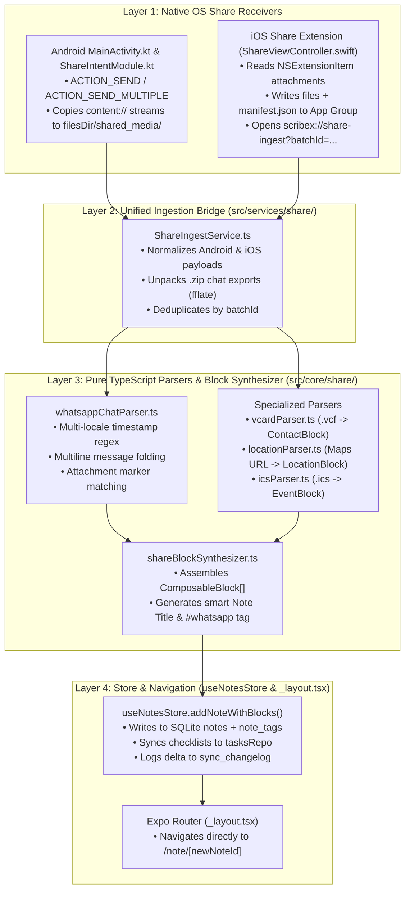

# ScribeX Inbound WhatsApp & Universal Share Sheet Integration Plan (Android & iOS)

> **Scope:** Native Android & iOS Inbound Share Sheet (`ACTION_SEND`, `ACTION_SEND_MULTIPLE`, iOS `NSExtensionItem`)  
> **Application ID / Bundle ID:** `com.nashtech.scribex` (`scheme: "scribex"`)  
> **Target Engine:** ScribeX Local-First SQLite Engine + 36-Block Composable AST Editor  
> **Design Constraint:** Strictly adhere to `<RULE[user_global]>` and `AGENTS.md` — full-bleed native canvas, non-generic editorial styling, zero outer boxed card wrappers, and sub-5ms optimistic SQLite persistence.

---

## 1. Complete Taxonomy of WhatsApp Shared Content & Wire Formats

Users share content out of WhatsApp in **two distinct ways**. Our architecture must handle both seamlessly:

1. **Mode A — In-Chat Message Selection $\rightarrow$ Share:**  
   The user long-presses 1 or more messages/media items inside a WhatsApp conversation, taps **Share**, and selects **ScribeX** from the OS Share Sheet.
2. **Mode B — "Export Chat" (With or Without Media) $\rightarrow$ Share:**  
   The user opens a chat menu $\rightarrow$ **More $\rightarrow$ Export Chat**, and selects **ScribeX** from the OS Share Sheet.

---

### 1.1. How WhatsApp Packages Every Message & Media Type

| # | WhatsApp Content Type | Android Intent Payload (`Intent`) | iOS Share Extension Payload (`NSItemProvider`) | Raw Structure & Quirks |
| :- | :--- | :--- | :--- | :--- |
| **1** | **Single Text Message** | `ACTION_SEND`<br>`type`: `text/plain`<br>`EXTRA_TEXT`: `"Message string"` | `public.plain-text` (`UTTypePlainText`) | Raw text string without timestamp header. May contain WhatsApp formatting (`*bold*`, `_italic_`, `~strike~`, ```` ```code``` ````). |
| **2** | **Multiple Selected Text Messages** | `ACTION_SEND`<br>`type`: `text/plain`<br>`EXTRA_TEXT`: `"Multi-line formatted transcript"` | `public.plain-text` (`UTTypePlainText`) | Combined into one string with per-message headers:<br>• Bracketed: `[14/11/26, 10:15:32 AM] Name: text`<br>• Android 24h: `[14/11/2026, 22:15] Name: text`<br>• Dash format: `14/11/2026, 10:15 am - Name: text` |
| **3** | **Single Photo / Sticker / GIF** | `ACTION_SEND`<br>`type`: `image/jpeg`, `image/png`, `image/webp`, `image/gif`<br>`EXTRA_STREAM`: `content://com.whatsapp.provider.media/item/...`<br>`EXTRA_TEXT`: Optional caption | `public.jpeg`, `public.png`, `org.webmproject.webp`, `com.compuserve.gif`, `public.heic` + optional `attributedContentText` | `content://` URI has temporary read permission (`FLAG_GRANT_READ_URI_PERMISSION`) that expires as soon as the receiving activity finishes—**must be copied into app storage immediately**. |
| **4** | **Voice Note (PTT) & Audio Files** | `ACTION_SEND`<br>`type`: `audio/ogg; codecs=opus`, `audio/opus`, `audio/mp4`, `audio/mpeg`, `audio/aac`<br>`EXTRA_STREAM`: `content://...` | `org.xiph.opus`, `public.ogg-audio`, `public.mpeg-4-audio`, `public.mp3`, `public.audio` | WhatsApp voice notes are saved as `PTT-YYYYMMDD-WAxxxx.opus` (Ogg Opus container). Audio forwards are typically `.mp3`, `.m4a`, or `.aac`. |
| **5** | **Video Clip** | `ACTION_SEND`<br>`type`: `video/mp4`, `video/3gpp`, `video/quicktime`<br>`EXTRA_STREAM`: `content://...`<br>`EXTRA_TEXT`: Optional caption | `public.mpeg-4`, `com.apple.quicktime-movie`, `public.movie` | Includes optional caption in `EXTRA_TEXT` (Android) or `attributedContentText` (iOS). |
| **6** | **Multiple Media + Text Selection** | `ACTION_SEND_MULTIPLE`<br>`type`: `image/*`, `video/*`, or `*/*`<br>`EXTRA_STREAM`: `ArrayList<Uri>`<br>`EXTRA_TEXT`: Optional combined captions/text | Single `NSExtensionItem` containing an array of `NSItemProvider` attachments | Can mix images, videos, audio notes, and documents in a single share batch. |
| **7** | **Documents (PDF, Office, CSV, Code, ZIP)** | `ACTION_SEND` or `ACTION_SEND_MULTIPLE`<br>`type`: `application/pdf`, `text/csv`, `application/vnd.*`, `application/zip`<br>`EXTRA_STREAM`: `content://...` | `com.adobe.pdf`, `public.comma-separated-values-text`, `org.openxmlformats.*`, `public.zip-archive`, `public.data` | Filenames are preserved in `ContentResolver` `OpenableColumns.DISPLAY_NAME` (Android) or `suggestedName` / file URL (iOS). |
| **8** | **Contact Card (Single or Multi-Contact)** | `ACTION_SEND`<br>`type`: `text/x-vcard` (`text/vcard`)<br>`EXTRA_STREAM`: `content://.../*.vcf` | `public.vcard` (`UTTypeVCard`) | Standard vCard 2.1 / 3.0 / 4.0 file containing `FN`, `TEL`, `EMAIL`, `ORG`, `TITLE`, `ADR`, and optional base64 `PHOTO`. May contain multiple `BEGIN:VCARD` blocks. |
| **9** | **Location Pin / Shared Place** | `ACTION_SEND`<br>`type`: `text/plain`<br>`EXTRA_TEXT`: Place name + Maps URL | `public.url` and/or `public.plain-text` | Shared as `https://maps.google.com/?q=<lat>,<lng>`, `https://www.google.com/maps/search/?api=1&query=<lat>,<lng>`, or `https://maps.apple.com/?ll=<lat>,<lng>&q=<Label>`. |
| **10** | **Web Link / YouTube URL** | `ACTION_SEND`<br>`type`: `text/plain`<br>`EXTRA_TEXT`: URL + user commentary | `public.url` + `public.plain-text` | Contains one or more `http://` or `https://` links, optionally surrounded by message text. |
| **11** | **WhatsApp Poll** | `ACTION_SEND`<br>`type`: `text/plain` | `public.plain-text` | Formatted as:<br>`POLL:`<br>`<Question>`<br>`OPTION: <Choice A> (X votes)`<br>`OPTION: <Choice B> (Y votes)` |
| **12** | **Full "Export Chat" Bundle** | `ACTION_SEND_MULTIPLE`<br>`EXTRA_STREAM`: `WhatsApp Chat with X.txt` + all media `Uri`s (or `.zip`) | `public.zip-archive`<br>Single file: `WhatsApp Chat - X.zip` | Contains `_chat.txt` (or `WhatsApp Chat with X.txt`) + media files (`IMG-*-WA*.jpg`, `PTT-*-WA*.opus`, `00000001-PHOTO-*.jpg`). |

---

### 1.2. Deep Dive: WhatsApp Chat Text & Export Format Nuances

To ensure our parser never fails across global devices, it must handle these exact real-world WhatsApp formatting rules:

1. **Invisible Unicode Control Characters:**
   * WhatsApp injects `\u200e` (Left-to-Right Mark) and `\u200f` (Right-to-Left Mark) before system messages and media attachment lines (e.g., `\u200e<attached: 00000005-PHOTO-2026-11-14-10-15-00.jpg>`).
   * iOS 17+ and Android 14+ locales often use `\u202f` (Narrow No-Break Space) or `\u00a0` (No-Break Space) before `AM`/`PM` (e.g., `10:15:32\u202fAM`).
2. **Locale Date & Time Variations:**
   * **Bracketed (iOS & Multi-message Copy/Share):**
     * `[14/11/26, 10:15:32 AM] Nash: Hello`
     * `[11/14/26, 22:15:32] Nash: Hello`
     * `[2026-11-14, 10:15] Nash: Hello`
     * `[10:15, 14/11/2026] Nash: Hello` (Android multi-message copy format: `[Time, Date]`)
   * **Dash-Separated (Android Export Chat):**
     * `14/11/2026, 10:15 am - Nash: Hello`
     * `11/14/26, 22:15 - Nash: Hello`
3. **Inline Media Attachment Markers inside Chat Logs:**
   * **Android Export Marker:** `IMG-20261114-WA0001.jpg (file attached)` (followed on the next line by the optional caption).
   * **iOS Export Marker:** `<attached: 00000001-PHOTO-2026-11-14-10-15-22.jpg>`
   * **Omitted Media Marker** (when exported "Without Media"): `<Media omitted>` or `image omitted` / `audio omitted` / `video omitted` / `document omitted`.
4. **Multi-Line Messages:**
   * Any line that does **not** start with a valid timestamp header belongs to the body of the immediately preceding message (e.g., bullet lists, code snippets, or multi-paragraph texts inside a single chat bubble).

---

## 2. ScribeX Editor Block Audit & Gap Analysis

We audited all **36 `BlockType`s** in [`frontend/src/types/note.ts`](file:///Users/nash/Documents/FrontEnd%20Development/ai_projects/scribeX/frontend/src/types/note.ts) and [`frontend/src/components/editor/blocks/`](file:///Users/nash/Documents/FrontEnd%20Development/ai_projects/scribeX/frontend/src/components/editor/blocks/) against the 12 WhatsApp content types above.

### 2.1. Content-to-Block Mapping Matrix

| WhatsApp Shared Content | Target ScribeX `BlockType` | Existing Component | Status & Readiness |
| :--- | :--- | :--- | :--- |
| **Multi-Message Chat Transcript** | `message_thread` | [`MessageThreadBlock.tsx`](file:///Users/nash/Documents/FrontEnd%20Development/ai_projects/scribeX/frontend/src/components/editor/blocks/MessageThreadBlock.tsx) | **Needs Minor Enhancement** (Add `'whatsapp'` channel + inline attachment/reply metadata) |
| **Single Text / Markdown Message** | `paragraph`, `heading`, `bulleted_list`, `numbered_list`, `quote`, `code` | [`BlockRenderer.tsx`](file:///Users/nash/Documents/FrontEnd%20Development/ai_projects/scribeX/frontend/src/components/editor/BlockRenderer.tsx) | **100% Ready** (via `parseMarkdownToBlocks` + WhatsApp `*bold*`/`~strike~` normalization) |
| **Photos, Stickers, WebP, GIFs** | `image` | [`ImageBlock.tsx`](file:///Users/nash/Documents/FrontEnd%20Development/ai_projects/scribeX/frontend/src/components/editor/blocks/ImageBlock.tsx) | **100% Ready** (Supports local `file://` URIs, captions, width %, alignment) |
| **Voice Notes (`.opus`) & Audio** | `audio` | [`AudioBlock.tsx`](file:///Users/nash/Documents/FrontEnd%20Development/ai_projects/scribeX/frontend/src/components/editor/blocks/AudioBlock.tsx) | **Needs `.opus` Verification on iOS** (Android Media3 plays `.opus` natively; add iOS fallback/support check) |
| **Videos (`.mp4`, `.mov`, `.3gp`)** | `video` | [`VideoBlock.tsx`](file:///Users/nash/Documents/FrontEnd%20Development/ai_projects/scribeX/frontend/src/components/editor/blocks/VideoBlock.tsx) | **100% Ready** (Supports local `file://` URIs, captions, playback controls) |
| **PDFs, Docs, Archives, APK, Generic** | `file` | [`FileBlock.tsx`](file:///Users/nash/Documents/FrontEnd%20Development/ai_projects/scribeX/frontend/src/components/editor/blocks/FileBlock.tsx) | **100% Ready** (Renders native PDF page-1 thumbnail + file size + 1-tap open/share) |
| **CSV Spreadsheets** | `sheet` | [`SheetBlock.tsx`](file:///Users/nash/Documents/FrontEnd%20Development/ai_projects/scribeX/frontend/src/components/editor/blocks/SheetBlock.tsx) | **100% Ready** (Auto-parses rows/columns into interactive multi-tab grid) |
| **Contacts (`.vcf` vCard)** | `contact` | [`ContactBlock.tsx`](file:///Users/nash/Documents/FrontEnd%20Development/ai_projects/scribeX/frontend/src/components/editor/blocks/ContactBlock.tsx) | **100% Ready** (Stores `name`, `phone`, `email`, `company`, `role`, `website`, `notes`) |
| **Shared Locations (Maps URL / Geo)** | `location` | [`LocationBlock.tsx`](file:///Users/nash/Documents/FrontEnd%20Development/ai_projects/scribeX/frontend/src/components/editor/blocks/LocationBlock.tsx) | **100% Ready** (Stores `placeName`, `address`, `latitude`, `longitude`) |
| **Web Links / Articles** | `bookmark` | [`BookmarkBlock.tsx`](file:///Users/nash/Documents/FrontEnd%20Development/ai_projects/scribeX/frontend/src/components/editor/blocks/BookmarkBlock.tsx) | **100% Ready** (Stores `url`, `title`, `description`, `domain`) |
| **YouTube / Vimeo Video Links** | `video` | [`VideoBlock.tsx`](file:///Users/nash/Documents/FrontEnd%20Development/ai_projects/scribeX/frontend/src/components/editor/blocks/VideoBlock.tsx) | **100% Ready** (Embedded player with mobile WebView origin support) |
| **WhatsApp Polls** | `checklist` | [`ChecklistBlock.tsx`](file:///Users/nash/Documents/FrontEnd%20Development/ai_projects/scribeX/frontend/src/components/editor/blocks/ChecklistBlock.tsx) | **100% Ready** (Poll options map to checklist items with vote counts) |
| **Calendar Invites (`.ics`)** | `event` | [`EventBlock.tsx`](file:///Users/nash/Documents/FrontEnd%20Development/ai_projects/scribeX/frontend/src/components/editor/blocks/EventBlock.tsx) | **100% Ready** (Maps `SUMMARY`, `DTSTART`, `DTEND`, `LOCATION` to event block) |

---

### 2.2. Specific Editor Enhancements Required

While ScribeX already has blocks for every single data category, **3 targeted upgrades** will make WhatsApp captures feel native and lossless:

1. **Upgrade `MessageThreadBlock.tsx` with `'whatsapp'` Channel & Inline Media Chips:**
   * Add `'whatsapp'` to `MessageChannel`:
     ```ts
     export type MessageChannel = 'whatsapp' | 'email' | 'slack' | 'imessage' | 'telegram' | 'teams';
     ```
   * Add WhatsApp styling to `CHANNEL_CONFIG`:
     ```ts
     whatsapp: { label: 'WhatsApp Chat', icon: MessageSquare, color: '#25D366', bg: 'rgba(37, 211, 102, 0.12)' }
     ```
   * Extend `ThreadMessage` interface with optional `attachmentName?: string` and `replyTo?: string` so that if a message in a thread references an attached photo/voice note, the chat bubble displays a sleek attachment badge while the full interactive media block (`ImageBlock`, `AudioBlock`, `VideoBlock`, `FileBlock`) is rendered right below the thread (or interleaved when a long export is segmented).

2. **Ensure `.opus` Voice Note Playback Across Android & iOS in `AudioBlock.tsx`:**
   * WhatsApp voice notes use `.opus` (`audio/ogg; codecs=opus`).
   * **Android:** `expo-audio` (backed by AndroidX Media3 / ExoPlayer) decodes `.opus` and `.ogg` natively out of the box.
   * **iOS:** Apple's `AVPlayer` supports `.m4a`, `.mp3`, `.wav`, and `.caf`, and iOS 17+ supports Opus in CAF/MP4/WebM, but sometimes rejects raw `.opus` Ogg containers in `AVPlayer`. In `AudioBlock.tsx`, if `Platform.OS === 'ios'` and the URI ends with `.opus` or `.ogg` and `expo-audio` reports a load error, we can transparently play it via a hidden 1x1 `react-native-webview` HTML5 `<audio>` element (since iOS WebKit supports Ogg Opus), ensuring 100% voice-note playback on both platforms.

3. **Add Lightweight `.zip` Unpacking for "Export Chat" Archives:**
   * When a user uses WhatsApp's **"Export Chat"**, iOS (and sometimes Android) shares a single `.zip` archive containing `_chat.txt` and all media files.
   * Using a tiny, zero-native-dependency pure JS zip reader (`fflate`, ~8 KB gzipped), our ingestion service will detect `.zip` archives containing a WhatsApp chat `.txt`, extract all media files to ScribeX's persistent `shared_media/` directory, and automatically link `<attached: filename>` markers to the extracted local file URIs.

---

## 3. Clean & Scalable Architecture

To keep the codebase modular, testable, and maintainable, we will implement a **4-Layer Decoupled Pipeline**:



---

### 3.1. Layer 1: Native OS Share Receivers (Android & iOS)

#### A. Android Native Implementation (`frontend/android/`)
Why write a small local Kotlin module instead of relying on abandoned third-party share-intent libraries?
* Most third-party React Native share libraries break on Expo SDK 57 / React Native 0.86 New Architecture (`fabricEnabled`), or fail to copy `content://` streams before Android revokes the temporary URI permission.
* A clean 120-line Kotlin module inside `frontend/android/app/src/main/java/com/nashtech/scribex/share/` has **zero external dependency risk** and works 100% with `./gradlew assembleRelease`.

1. **`AndroidManifest.xml` Updates:**
   Add intent filters inside `MainActivity` (keeping `android:launchMode="singleTask"`):
   ```xml
   <!-- Single item share (text, image, audio, video, pdf, vcard) -->
   <intent-filter>
     <action android:name="android.intent.action.SEND" />
     <category android:name="android.intent.category.DEFAULT" />
     <data android:mimeType="text/*" />
     <data android:mimeType="image/*" />
     <data android:mimeType="audio/*" />
     <data android:mimeType="video/*" />
     <data android:mimeType="application/*" />
   </intent-filter>

   <!-- Multi-item share (multiple photos, exported chat + media) -->
   <intent-filter>
     <action android:name="android.intent.action.SEND_MULTIPLE" />
     <category android:name="android.intent.category.DEFAULT" />
     <data android:mimeType="*/*" />
   </intent-filter>
   ```

2. **`ShareIntentHelper.kt` & `ShareIntentModule.kt`:**
   * Triggered in `MainActivity.onCreate()` and `MainActivity.onNewIntent(intent)`.
   * When `intent.action == Intent.ACTION_SEND` or `Intent.ACTION_SEND_MULTIPLE`:
     1. Extracts `Intent.EXTRA_TEXT` and `Intent.EXTRA_SUBJECT`.
     2. Extracts `Uri` (from `EXTRA_STREAM` or `clipData`) using `IntentCompat.getParcelableExtra` / `getParcelableArrayListExtra` (Android 13+ API 33 type-safe compatible).
     3. **Immediate Sandbox Copy (Critical):** For every `content://` URI, queries `ContentResolver` for `OpenableColumns.DISPLAY_NAME`, `OpenableColumns.SIZE`, and `getType(uri)`, then streams the bytes directly into `context.filesDir/shared_media/<timestamp>_<sanitized_name>`.
     4. Replaces `intent.action = Intent.ACTION_MAIN` after extraction so rotating the screen or backgrounding/foregrounding the app never re-triggers the share intent.
     5. Exposes `getPendingSharePayload()` (Promise) and emits `onSharePayloadReceived` device event to React Native.

#### B. iOS Native Implementation (`frontend/ios/` & Expo Config Plugin)
On iOS, apps appear in the system Share Sheet via an **App Extension (`NSExtensionPointIdentifier = com.apple.share-services`)**:

1. **Shared App Group Container (`group.com.nashtech.scribex`):**
   * Both the main app (`com.nashtech.scribex`) and the Share Extension (`com.nashtech.scribex.ShareExtension`) access `FileManager.default.containerURL(forSecurityApplicationGroupIdentifier: "group.com.nashtech.scribex")`.
2. **Zero-Friction Handoff Flow (`ShareViewController.swift`):**
   * Iterates over `extensionContext?.inputItems`.
   * Extracts plain text, URLs, vCards, and file attachments (`public.image`, `public.audio`, `public.movie`, `public.data`, `public.zip-archive`).
   * Copies all media files into `<AppGroup>/shared_media/<batchId>/`.
   * Writes `<AppGroup>/shared_media/<batchId>/manifest.json`:
     ```json
     {
       "batchId": "share-1794693600000",
       "createdAt": "2026-11-14T22:00:00.000Z",
       "text": "[14/11/26, 10:15:32 AM] Nash: Let's ship this",
       "files": [
         {
           "uri": "file:///.../shared_media/share-1794693600000/IMG_001.jpg",
           "fileName": "IMG_001.jpg",
           "mimeType": "image/jpeg",
           "fileSize": 184320
         }
       ]
     }
     ```
   * Immediately invokes `openURL(URL(string: "scribex://share-ingest?batchId=share-1794693600000")!)` and completes the extension request.
   * ScribeX opens directly into the newly synthesized note.

---

### 3.2. Layer 2 & 3: Pure TypeScript Parsers & Block Synthesizer

All parsing and block construction lives in pure, deterministic TypeScript modules under `frontend/src/core/share/` so it can be 100% unit-tested in Node.js without a device:

```
frontend/src/
├── core/
│   └── share/
│       ├── types.ts                  # NormalizedSharePayload, ParsedWhatsAppChat, SharedFileItem
│       ├── whatsappChatParser.ts     # Multi-locale chat parser, multiline folder, markdown normalizer
│       ├── vcardParser.ts            # .vcf -> ContactBlock metadata parser
│       ├── locationParser.ts         # Google/Apple Maps & geo: URI -> LocationBlock parser
│       ├── icsParser.ts              # .ics -> EventBlock metadata parser
│       └── shareBlockSynthesizer.ts  # Master orchestrator: Payload -> { title, tags, blocks }
└── services/
    └── share/
        ├── ShareIngestService.ts     # Reads native queue / App Group manifest, unzips .zip, calls synthesizer
        └── NativeShareBridge.ts      # NativeEventEmitter + NativeModules.ScribeXShareIntent wrapper
```

#### Key Algorithm: `whatsappChatParser.ts`
1. **Sanitize Line Prefixes:** Strip leading `\u200e`, `\u200f`, `\u202a`–`\u202e` directional marks; normalize `\u202f` and `\u00a0` to standard spaces.
2. **Universal Message Header Regex:**
   Matches all WhatsApp timestamp variants:
   * Bracketed `[Date, Time] Sender: Body` and `[Time, Date] Sender: Body`:
     ```ts
     const BRACKETED_HEADER_RE = /^\[(\d{1,4}[\/\.\-]\d{1,2}[\/\.\-]\d{1,4}|\d{1,2}:\d{2}(?::\d{2})?(?:\s*[APap][Mm])?),\s*(\d{1,2}:\d{2}(?::\d{2})?(?:\s*[APap][Mm])?|\d{1,4}[\/\.\-]\d{1,2}[\/\.\-]\d{1,4})\]\s+([^:]+?):\s*(.*)$/;
     ```
   * Dash-separated `Date, Time - Sender: Body`:
     ```ts
     const DASH_HEADER_RE = /^(\d{1,4}[\/\.\-]\d{1,2}[\/\.\-]\d{1,4}),?\s+(\d{1,2}:\d{2}(?::\d{2})?(?:\s*[APap][Mm])?)\s+-\s+([^:]+?):\s*(.*)$/;
     ```
3. **Detection Threshold:**
   * If $\ge 1$ lines match `BRACKETED_HEADER_RE` or `DASH_HEADER_RE`, the text is classified as a **structured WhatsApp conversation**.
   * System encryption banners (`Messages and calls are end-to-end encrypted...`) are automatically filtered out.
   * Consecutive messages are grouped into a `message_thread` block with `channel: 'whatsapp'`, populated `participants: string[]`, and `messages: ThreadMessage[]`.
4. **Attachment & Media Resolution:**
   * If a message body contains `<attached: filename.ext>` or `filename.ext (file attached)`, the synthesizer matches `filename.ext` against the shared `files` array:
     * Marks `attachmentName` on the `ThreadMessage`.
     * Appends the rich media block (`ImageBlock`, `AudioBlock`, `VideoBlock`, `FileBlock`, or `ContactBlock`) right after the thread (with the subsequent line used as the media `caption` if present).
5. **Single / Unstructured Message Handling:**
   * If the shared text has **no** WhatsApp timestamp headers (e.g., a single shared message or caption):
     * Checks if it's a **WhatsApp Poll** (`^POLL:\n`) $\rightarrow$ converts into a heading + `ChecklistBlock` items.
     * Checks if it's a **Location Share** (Google Maps / Apple Maps coordinate URL) $\rightarrow$ converts into a `LocationBlock`.
     * Checks if it's a **Standalone URL** $\rightarrow$ converts into a `VideoBlock` (if YouTube/Vimeo) or `BookmarkBlock`.
     * Otherwise, normalizes WhatsApp markdown (`*bold*` $\rightarrow$ `**bold**`, `~strike~` $\rightarrow$ `~~strike~~`) and runs `parseMarkdownToBlocks(text)`.
     * If media files were shared alongside a single text string, the text becomes the `caption` of the first media block (and/or a leading paragraph block).

#### Smart Title & Tag Generation (`shareBlockSynthesizer.ts`)
* **Title:**
  * If a WhatsApp chat thread with participants `[Alice, Bob]`: `"WhatsApp Chat · Alice & Bob"` (or `"WhatsApp · Alice"` if 1 sender).
  * If `subject` or export filename is present (e.g., `WhatsApp Chat with Project Team.txt`): `"WhatsApp Chat · Project Team"`.
  * If a Contact `.vcf` card: `"Contact · [Full Name]"`.
  * If a Location pin: `"Location · [Place Name]"`.
  * If a single text message: First sentence / first 48 characters of the text.
  * If media-only: `"WhatsApp Media Capture · 14 Nov 2026"`.
* **Tags:** Automatically attaches `['whatsapp']` (and `'voice-note'`, `'document'`, or `'contact'` when applicable).

---

### 3.3. Layer 4: Store & Router Integration

1. **Extend `useNotesStore.tsx` with `addNoteWithBlocks`:**
   ```ts
   addNoteWithBlocks: (options: {
     title: string;
     blocks: ComposableBlock[];
     colorToken?: NoteColorToken;
     folderPath?: string;
     tags?: string[];
   }) => Promise<NoteItem>;
   ```
   * Computes `contentMarkdown = serializeBlocksToMarkdown(options.blocks)`.
   * Performs optimistic state insertion into `notes`.
   * Calls `notesRepo.createNote({ id, title, contentMarkdown, blocks, colorToken, folderPath, tags })`.
   * Calls `tasksRepo.syncNoteChecklists(...)` so any checklist items (such as shared polls or action lists) immediately appear in the global Tasks View!

2. **Mount Share Listener in `frontend/app/_layout.tsx`:**
   * Alongside the existing `notificationService` listener in `_layout.tsx`, mount `ShareIngestService.initialize()`:
     * Checks `getPendingSharePayload()` on cold start.
     * Subscribes to `onSharePayloadReceived` and `Linking` URL `scribex://share-ingest` on warm resume.
     * Calls `addNoteWithBlocks(...)` and routes directly to `router.push(\`/note/\${createdNote.id}\`)`.

---

## 4. 4-Tier Verification & Testing Strategy

Because you have an **Android phone** (for APK testing) and an **iOS Simulator** (which does not have WhatsApp installed), we will verify every layer deterministically:

### Tier 1: Automated Headless Test Suite (`scripts/test_inbound_share_pipeline.mjs`)
Runs in $<1\text{s}$ via Node.js and tests 100% of the parsing, block synthesis, and SQLite persistence logic:
1. Single text message with WhatsApp `*bold*`, `_italic_`, `~strikethrough~`, and code blocks.
2. Multi-message bracketed iOS WhatsApp transcript (`[14/11/26, 10:15:32\u202fAM] Alice: ...`) with multiline messages.
3. Multi-message dash-separated Android WhatsApp transcript (`14/11/2026, 22:15 - Bob: ...`).
4. Android `[Time, Date]` copied message format (`[10:15, 14/11/2026] Alice: ...`).
5. Full `.zip` Export Chat bundle unpacking (`_chat.txt` + attached `.jpg`, `.opus`, `.mp4`, `.pdf`) verifying `<attached: ...>` and `(file attached)` resolution.
6. Voice note `.opus` + Image `.jpg` + Video `.mp4` + PDF `.pdf` + CSV `.csv` block synthesis.
7. Contact `.vcf` (single and multi-vCard) $\rightarrow$ `ContactBlock` extraction.
8. Google Maps & Apple Maps location URLs $\rightarrow$ `LocationBlock` lat/lng extraction.
9. WhatsApp `POLL:` text $\rightarrow$ `ChecklistBlock` conversion & `tasksRepo` synchronization.
10. Batch deduplication guard (ensuring the same `batchId` is never ingested twice).

### Tier 2: Android CLI Intent Injection (`adb shell am start`)
Before even opening WhatsApp on your phone, we can test the native Android receiver directly via `adb`:
```bash
# 1. Test Multi-Message WhatsApp Thread Share
adb shell am start -a android.intent.action.SEND \
  -t "text/plain" \
  --es android.intent.extra.TEXT "[14/11/26, 10:15:00 AM] Alice: Here is the sprint update
[14/11/26, 10:16:12 AM] Bob: Awesome, let's capture this in ScribeX!" \
  -n com.nashtech.scribex/.MainActivity

# 2. Test Location Share
adb shell am start -a android.intent.action.SEND \
  -t "text/plain" \
  --es android.intent.extra.TEXT "Coffee Shop Meet: https://maps.google.com/?q=37.7749,-122.4194" \
  -n com.nashtech.scribex/.MainActivity
```

### Tier 3: iOS Simulator Testing (Without WhatsApp)
On the iOS Simulator:
1. **Safari / Notes / Files / Photos Share Sheet:** Select text, links, photos, audio files, or a sample WhatsApp `.zip` export inside the Simulator's **Files** app $\rightarrow$ tap **Share** $\rightarrow$ select **ScribeX**.
2. **Deep-Link Handoff Simulation (`xcrun simctl`):**
   Drop a test manifest into the Simulator's App Group directory and run:
   ```bash
   xcrun simctl openurl booted "scribex://share-ingest?batchId=test-sim-001"
   ```

### Tier 4: In-App Developer Simulation Action (in `WorkspaceSettingsModal.tsx`)
We will add a **"Simulate WhatsApp Share"** quick-test row inside the Workspace & Storage Settings modal (`__DEV__` or diagnostics section) with 3 one-tap presets:
* *Preset 1: Multi-Speaker Chat + Media*
* *Preset 2: Voice Note + Photo + PDF*
* *Preset 3: Contact Card + Location Pin + Poll*

This lets you visually verify the entire end-to-end note creation and editor rendering on both the iOS Simulator and Android in 1 tap.

---

## 5. Phased Implementation Roadmap

| Stage | Description | Files to Create / Modify | Verification |
| :--- | :--- | :--- | :--- |
| **Stage 1** | **Editor Block Enhancements** (`'whatsapp'` channel in `MessageThreadBlock`, `.opus` audio fallback, `addNoteWithBlocks` in store) | `MessageThreadBlock.tsx`, `AudioBlock.tsx`, `astSerializer.ts`, `useNotesStore.tsx` | `cd frontend && npx tsc --noEmit`<br>`npm --prefix frontend run audit:all` |
| **Stage 2** | **Pure TS Parsers & Block Synthesizer** (WhatsApp chat regex, `.vcf`, Maps location, `.ics`, Poll, `.zip` extractor) | `frontend/src/core/share/types.ts`, `whatsappChatParser.ts`, `vcardParser.ts`, `locationParser.ts`, `icsParser.ts`, `shareBlockSynthesizer.ts` | `node scripts/test_inbound_share_pipeline.mjs` |
| **Stage 3** | **Android Native Share Receiver** (`AndroidManifest.xml` intent filters, `ShareIntentModule.kt`, `MainActivity.kt` hook) | `AndroidManifest.xml`, `MainActivity.kt`, `MainApplication.kt`, `share/ShareIntentModule.kt`, `share/ShareIntentPackage.kt` | `./gradlew assembleRelease` |
| **Stage 4** | **iOS Share Extension & App Group Bridge** + Unified `ShareIngestService.ts` + `_layout.tsx` auto-navigation + Settings Simulator | `ShareIngestService.ts`, `NativeShareBridge.ts`, `frontend/app/_layout.tsx`, `WorkspaceSettingsModal.tsx`, iOS extension files | `cd frontend && npx tsc --noEmit`<br>`npm --prefix frontend run test:uiux`<br>`node scripts/test_inbound_share_pipeline.mjs` |
